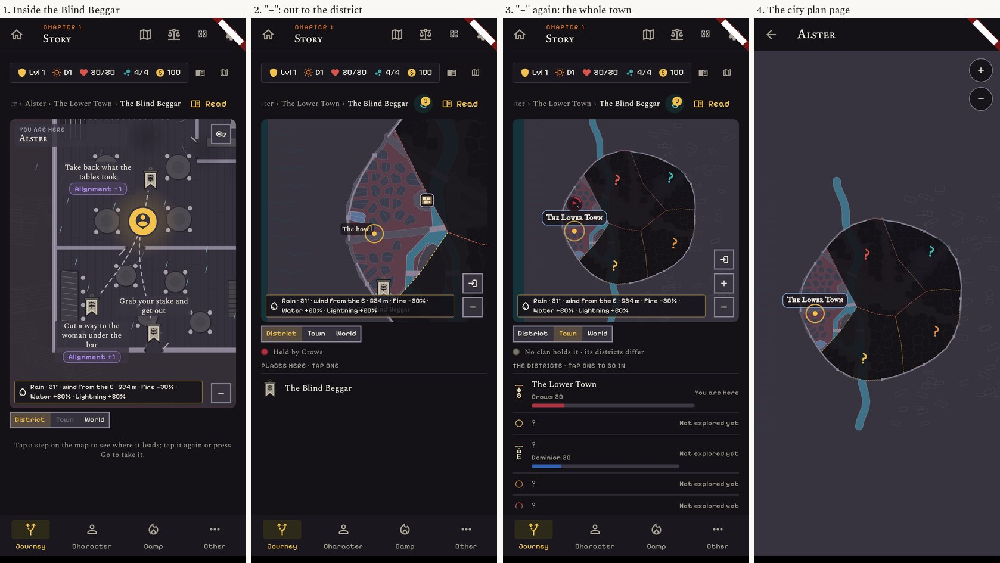
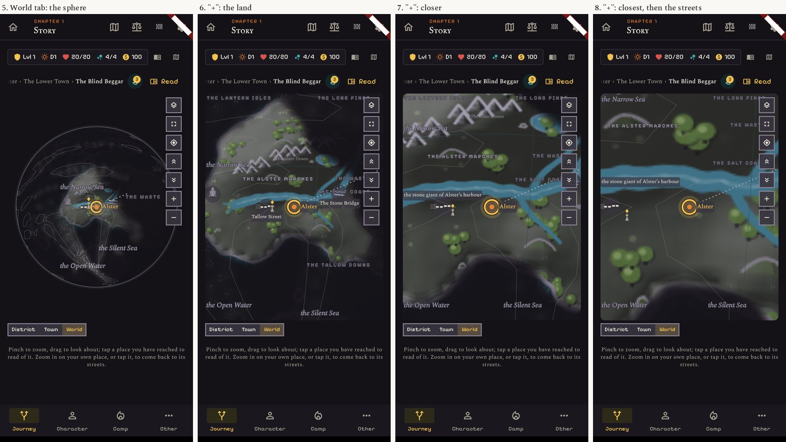
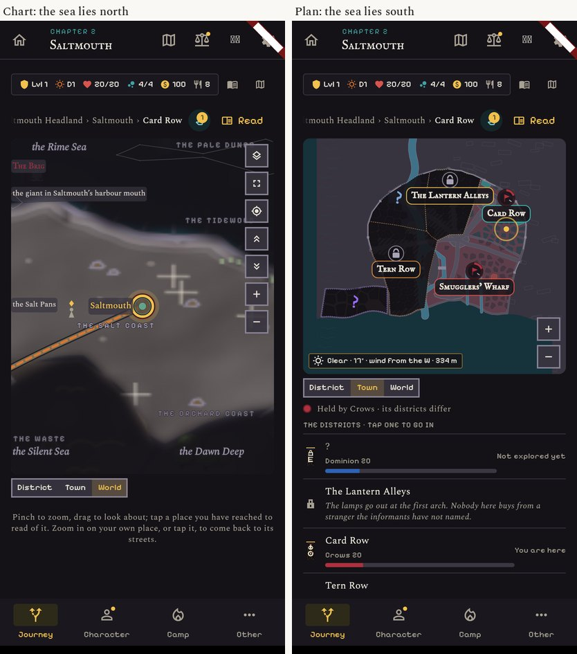
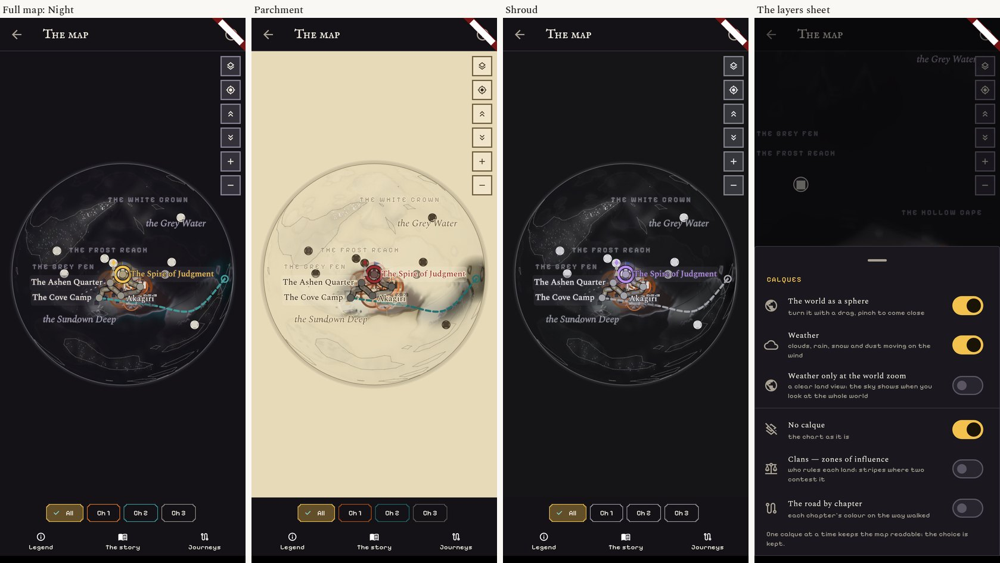
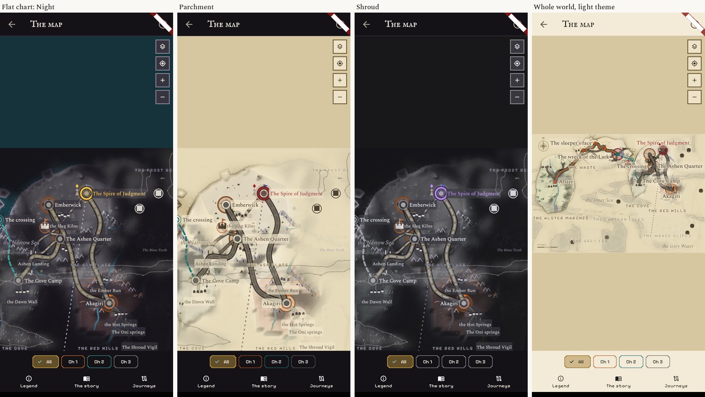
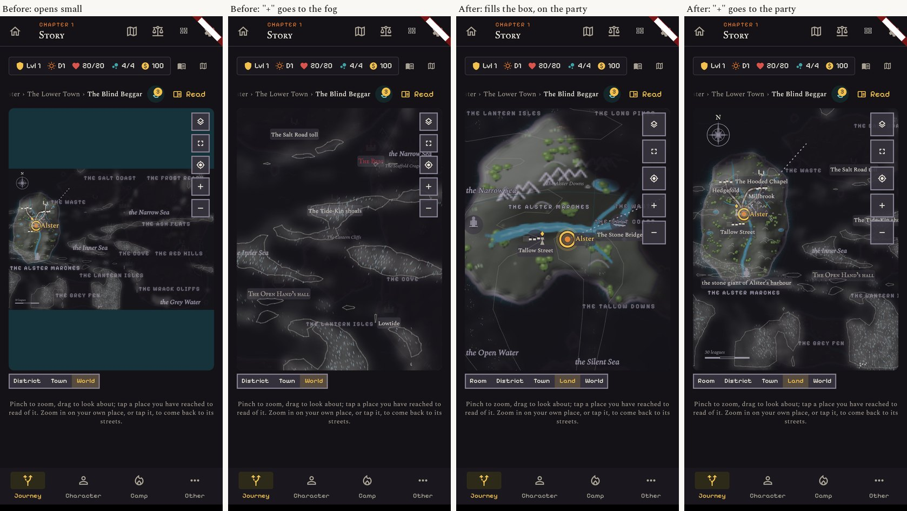
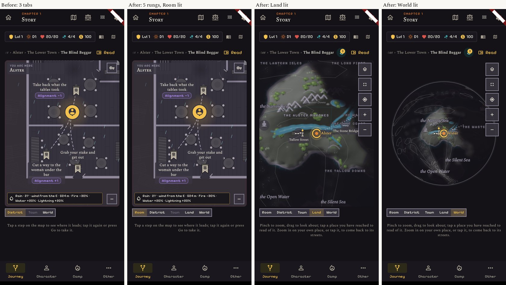
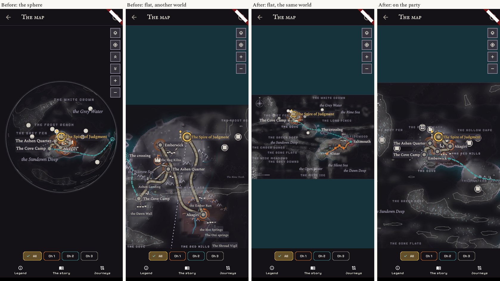
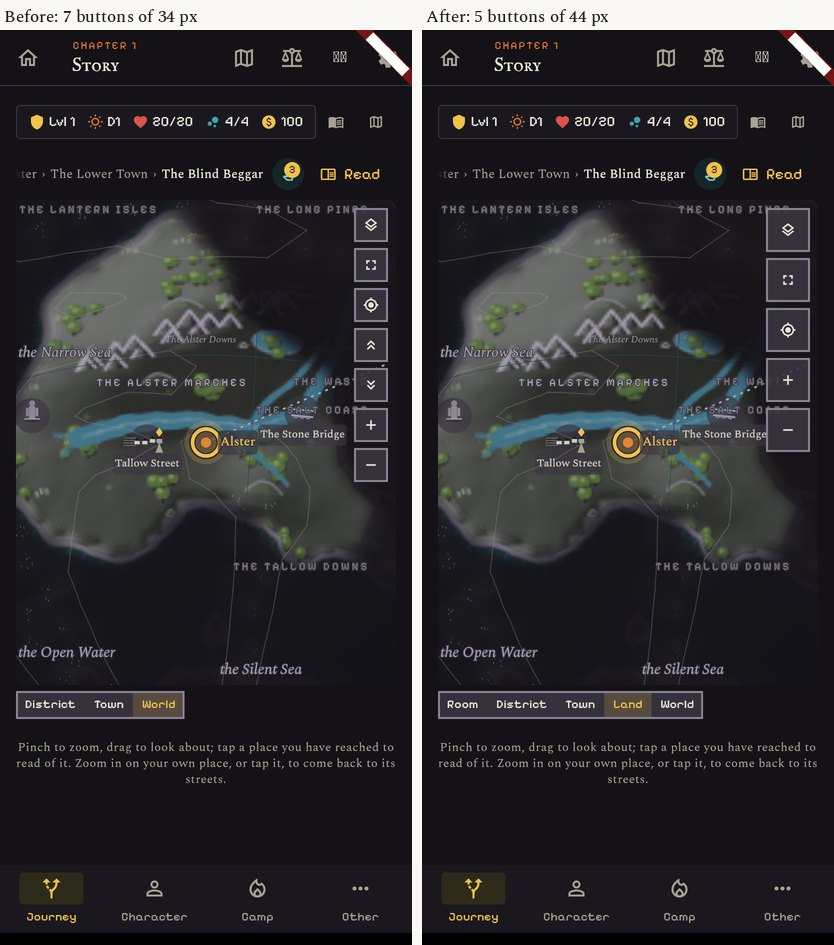
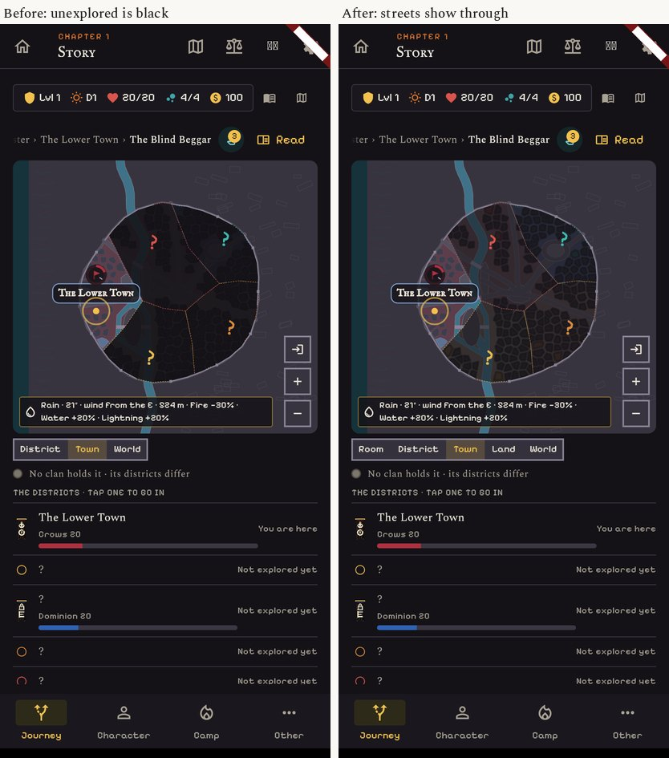

# The atlas: every map the player sees, from a room to the globe

Maps session, first task. Docs only: nothing in the app changed. The French pass is in `french.md`.

**How the pictures were made.** Real screens of the app at v1.913, 412 x 915, rendered by a throw-away
Flutter test (`shot_test.dart.txt`, copy it to `test/zz_atlas_shot_test.dart` to run it; one
`ATLAS_ONLY=<name>` a run, because only the first test of a run loads the city plans). Each sheet shows
four screens at half size. Dark theme with the Night look unless the caption says otherwise.
The "after" pictures come from two small temporary patches (`prototype.patch.txt`), reverted afterwards.

**Not done, so not judged here:** the epilogue map (it needs a finished game), the camp's cliff town,
a walk on a real phone, and frame times on a phone (see "Speed").

## 1. The chain of maps, as the player meets it

| Level | Where it is | Up | Down |
|---|---|---|---|
| **Room** (inside a building) | Journey tab, the map box, when the scene is in a building | the "−" button or a pinch out: the streets round the building | (lowest level) |
| **District** | Journey tab, "District" | "−" or pinch out, or the "Town" tab | "Go inside" when the scene is in a building |
| **Town** (whole city) | Journey tab, "Town" | "−", pinch out, or the "World" tab | "+" or a tap on a district |
| **City plan page** | the small map icon at the top right of the Journey | none: only the back arrow | "+", or a tap on a district |
| **Land** (the chart, close) | "−" from the town, or "+" from the world | "−" | "+" three times, then the streets |
| **World** (sphere or flat chart) | Journey tab, "World" | (highest level) | "+" |
| **Full map page** | the square button on the world map, or the map icon of the top bar | none: only the back arrow | a tap on a place opens a sheet |

What moves: the streets grow in from small in 0.36 s, the chart glides between zooms in 0.32 s, a door
between a room and the streets clears the map. Everything else is a cut.

Sheets: `01` (Alster: room, district, town, city plan page), `02` (the sphere, closing in),
`03` (the flat chart), `04` and `05` (Saltmouth, night and parchment), `07` (Ashen Quarter, White Wells,
Black Reliquary), `08` (the room plans, the casino included), `09` to `11` (the full map page: three looks,
the globe turned east, west and to the pole, the flat chart), `12` (360 px wide).

## 2. What works and what is weak

| Level | Works | Weak (picture) |
|---|---|---|
| **Room** | Walls, doors, tables read at once. The ways hang as banners on the plan. 12 kinds of room, all distinct. | The label says "You are here: Alster", not the building (`01`). Rain streaks are drawn inside the tavern (`01`). The "Town" tab is greyed inside a building: the player must step out first. Hearths have a soft glow, which the art direction rules out (`08`). **The casino cannot be entered:** no building of the story is a casino today, so its plan was rendered alone (`08`). |
| **District** | The party's district is clear, houses and bridges read. | Districts not yet found are solid black and can fill most of the frame (`07`, Ashen Quarter). The breadcrumb above is cut on the left ("ter › The Lower Town"). |
| **Town** | District names are framed and readable, also at 360 px (`12`). Locked and unknown districts are marked. | At the start four fifths of a city is a black shape with "?" (`01`, `07`). The list under the map repeats "? Not explored yet". |
| **City plan page** | Bigger than the Town tab's box. | It is the same map as the Town tab with other buttons (round, top right, against square, bottom right). "+" closes in on the middle of the city, not on the party: after two taps the screen is black fog (`04`, last screen). No way up to the world from here. |
| **Land** | Roads, the party's ring and the nearest places read well. | Region names run under the button column and are cut ("THE WAS", "THE SALT COAS", `02`). The long feature labels sit on top of region names ("the stone giant of Alster's harbour"). |
| **Closest zoom, then the streets** | The step exists: three "+" and the streets open. | The closest zoom shows a blur and large crosses, nothing new (`02`, last screen; `04`). The jump from that blur to a street plan is a cut between two unrelated drawings. |
| **Sphere** | Turning by hand works, the party is always brought back in view, the three looks are distinct enough on the ball. | The ball uses half of the panel's height (`09`). Places are white dots without names; the names that are shown overlap ("The Spire of Judgment" on Emberwick, `09`). At the pole, two place marks hang outside the ball (`10`). Seven buttons of 34 px in a column. |
| **Flat chart** | Roads and places are at their best here when close (`11`). | It opens as a strip a third of the box high, with empty sea above and below (`03`, `11`). "+" from there closes in on the middle of the chart, which is fog (`03`). On the whole world, names pile up (`11`, last screen). |
| **Sphere against flat** | | **They are two different worlds.** The sphere draws the story world; the flat chart draws the older "ring" world. Alster is in the middle of a continent on one and on a western island on the other (`09` against `11`). |
| **Chart against city plan** | | **The sea is on the wrong side.** Every coastal plan has its sea at the bottom. On the chart Saltmouth's coast is to the north, Greyhithe's to the north-west, Candlehold's to the west (`06`). |
| **Looks** | Night, Parchment and Shroud exist for the chart, the city and the rooms. | The player cannot choose: the picker is on a page only Edit Mode opens. Under the light theme the Journey's map stays Night. Shroud differs from Night by the party's colour only (`09`). The chart is soft and blurred, the city and rooms are flat line drawings: three hands, none of them the pixel look of the art direction. |
| **Words** | | The layers sheet is titled "Calques" in English (`09`). For Narrative. |
| **Taps** | Places on the chart answer within 22 px. | Map buttons are 34 px, the level tabs 28 px high, under the usual 44 to 48 px. |

### Speed (measured, with its limits)

`perf.txt`: the map's canvas was marked dirty and one frame pumped, 40 times, three runs. This is the time to
build a frame's drawing on this container's processor. It is not a phone and nothing was drawn by a graphics
chip, so it compares the maps with each other and does not say how smooth a phone is.

- Every map builds its frame in 3 to 6 ms (median); the worst single frame was 27 ms (the land zoom, first frames).
  No map stands out as slow. The weather costs about 1 ms.
- The room, district, town and city plan screens **never rest**: they ask for a new frame all the time.
  On the city plan page the cause is known: the party's breathing ring redraws the whole plan each frame
  (`city_chart_view.dart`, the painter is rebuilt with the ring's pulse). The world map is still when untouched.
- A measure on a phone is still needed before calling any of this smooth or slow.

## 3. Proposals, ranked by what the player gains against the work

### A. The flat chart opens on the party and fills its box (small)
Today it opens as a thin strip and "+" goes into the fog. After: it fills the box's height, centred on the
party, and "+" closes in on the party. The prototype's second step still shows a strip of sea on the left;
the real change clamps it.
Files: `lib/widgets/journey_world_map.dart`. Needs nobody else.

### B. One ladder from the room to the globe (medium) — the continuity proposal
Today there are three tabs, a "−" button, a "+ / −" pair on the chart, a city plan page and a full map page:
five controls for one idea, and two levels (Room, Land) that have no name on screen.
After: **one strip of five rungs, Room · District · Town · Land · World**, always in the same place.
The lit rung is where the player looks. A tap on a rung goes there. "−" or a pinch out always climbs one rung,
"+" or a pinch in always goes down one rung towards the party. A rung that does not exist here is dim
(no Room in the street, no Town in a hamlet). World is the sphere, Land is the flat chart close on the party,
so the sphere switch in the layers sheet is no longer needed. The city plan page and the full map page become
the "enlarge" button of the Town and World rungs, with the same buttons as the small map.
The picture shows the strip only; the rungs Room and Land are not wired in the prototype.
Files: the strip and its moves are in `lib/screens/journey_screen.dart` (a shared screen: **UX** for the
strip's look, and no other open PR on the file), `journey_world_map.dart`, `city_chart_view.dart`,
two new strings. No new field from Core.

### C. One world on the sphere and on the flat chart (medium)
The flat chart would draw the story world, the sphere unrolled, so a place is in the same spot whichever
way it is looked at. The prototype is one line; it shows the lands and the places right, but the villages,
side roads and sea names of the story world still have to be placed for the flat view, and the name pile-up
on the whole world must be thinned.
Files: `journey_world_map.dart`, `chart_story.dart`, `chart_map_painter.dart`, the map tests.
The three older worlds would then only serve Edit Mode. To check with **Core**: nothing reads a place's
position on the ring world for a rule.

### D. Buttons a thumb can hit, and fewer of them (small)
Map buttons from 34 to 44 px; the two pole buttons leave the column (the sphere turns by hand). The level
strip should grow from 28 to 40 px high with it. The city plan page takes the same square buttons.
Files: `journey_world_map.dart`, `city_chart_view.dart`; the strip's height is in `journey_screen.dart`
(shared, with **UX**).

### E. A city the player can read before it is explored (small to medium)
The fog lets the streets and blocks show through (still no names, no pins, still "?"), so a city looks like
a city and not a black shape. "+" on the city plan closes in on the party's district. The breathing ring gets
its own layer so the plan is drawn once, not sixty times a second. The room's label names the building, and
the rain stays outside.
Files: `lib/widgets/city_chart/`, `room_plan_painter.dart`; the label and the rain are in `journey_screen.dart`.
How much the fog hides is a game choice: the user's call, and **Core** should say if hiding the streets matters.

### F. The sea on the side where the chart puts it (medium, needs Core)
Each coastal city's plan is turned so its sea faces the same way as its coast on the chart (Saltmouth north,
Greyhithe north-west, Candlehold west). No after picture: turning a plan by hand in the painter would also
turn its names and pins.
Needs **Core**: the plans are generated (`city_plans.json`); the cleanest way is a "sea side" per city in the
generator, or the plans regenerated turned. Maps then checks names and pins on each plan. Before: sheet `06`.

### Later, larger: one hand for all the maps
The chart is soft and blurred, the city and the rooms are thin line drawings, and the art direction asks for
hard edges, one ink and no glow. Bringing the three to one look (hard-edged relief, the same ink line, the
same marks at every level) is a large piece and wants pictures of two or three directions first. The look
picker (Night, Parchment, Shroud) should come into the game's layers sheet at the same time (**UX** owns
that sheet), and Shroud needs to differ by more than one colour, or go.

## 4. Files in this folder

- `01` to `12`: the levels as they are. `20` to `24`: before and after for proposals A to E.
- `shot_test.dart.txt`: the picture test. `prototype.patch.txt`: the two temporary patches for the after pictures.
- `perf.txt`: the drawing times, three runs.
- `french.md` (`30`, `31`): the French pass. `core-questions.md`: what proposals C and F need Core to confirm.
