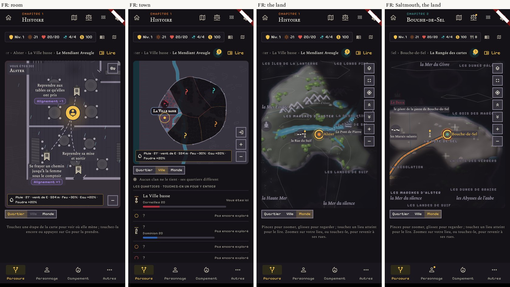
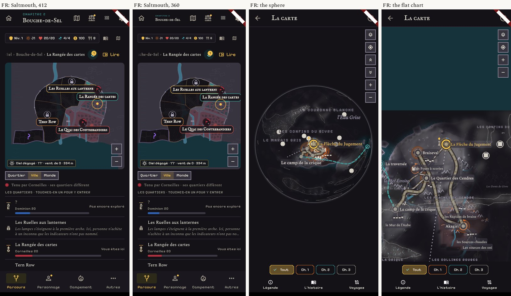

# The maps in French: what is cut or not translated

Same screens as the atlas, language set to French, 412 px and one at 360 px (`30`, `31`).
Only the map screens were read: the room, district, town, city plan page, land, sphere, flat chart, layers sheet.

## Not translated (for Narrative)

| Where | Shown in French | Note |
|---|---|---|
| Saltmouth, district label and list | "Tern Row" | `geography.json`, `saltmouth_tern_row`: `name_fr` is the English name. The other districts are translated. |
| The Journey's button and its hint | "Go", "appuyez sur Go" | key `journey_go` is "Go" in both languages. |
| The weather line on the map | "vent de E", "vent de O" | reads as a code; "vent d'est", "vent d'ouest" would read as French. |
| The layers sheet, **in English** | "Calques" | key `journey_calques` is the French word in both languages. Fine in French. |

## Cut or covered (for Maps, when a proposal is built)

| Where | What |
|---|---|
| Land and flat chart, right edge | Region names run under the button column: "LES LONGS PIN…", "LA DÉSOLATI…", "LA CÔTE DE S…", "LE BOIS DES MARÉE…", "LES DUNES PÂL…", "LES CONFINS DU…". Worse than in English: the French names are longer. |
| Sphere | Place dots sit on the names: "LA COURONNE BLANCHE" loses its first word, "LES CONFINS DU GIVRE" its first letter, "La Flèche du Jugement" is crossed by two dots. |
| Town, Saltmouth | "Les Ruelles aux lanternes" is the longest label: at 412 px its end is under a pin, at 360 px its last letter is under the next label. |
| Land, Saltmouth | The feature label "le géant de la passe de Bouche-de-Sel" covers "LE BRICK" beside it. |
| Breadcrumb above the map | Cut on the left as in English: "…lation › La Mer de dunes › Les Puits blancs", "…che-de-Sel › La Rangée des cartes" at 360 px. |
| Town list, 360 px | The Lantern Alleys' line ends in "…" after two lines. By design, but the cut falls mid-word ("pas no…"). |

## Fine in French

The level tabs (Quartier, Ville, Monde), the room's banners (three lines fit), the layers sheet, the full map's
foot (Légende, L'histoire, Voyages), the chapter chips, "Vous êtes ici", "Pas encore exploré".

## Not read

The legend sheet, the journeys sheet, a place's sheet on the full map, the epilogue map, the camp's cliff town.
