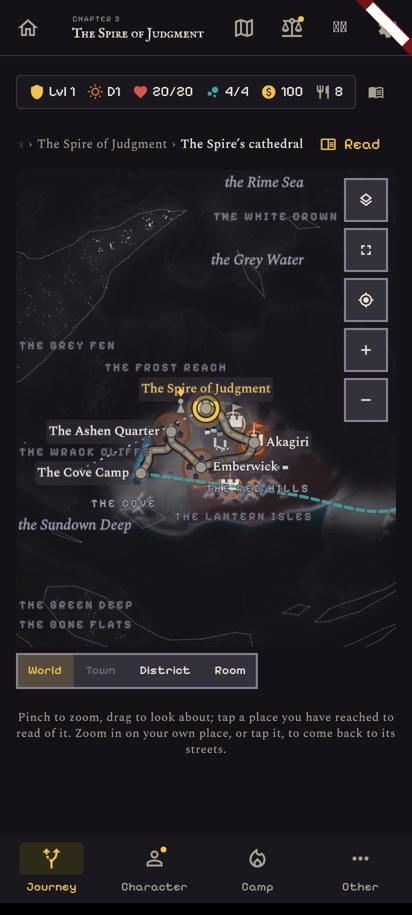

# Wave 1 of the review, built (v1.1000.0)

The only thing the player sees: on the World, at a place with no town plan (the Spire of Judgment),
"Town" is dim, as it already was on the District and the Room.

## Counts, before and after

Same throw-away test as the review, 30 frames each, Saltmouth unless said. Times are a test build on a
server, to compare one with the other, not a phone's.

| What | Before | After |
|---|---|---|
| Drag of the ball, each frame | 89 widgets rebuilt, 529 pieces repainted, 13.4 ms | 0 rebuilt, 4 repainted, 6 to 8 ms |
| Drag of the ball, mid game | 102 rebuilt, 535 repainted, 21.3 ms | 13 rebuilt, 55 repainted, 13.9 ms |
| The glide after "−" | 78 rebuilt, 661 repainted, 16.4 ms | 0 rebuilt, 104 repainted, 6.9 ms |
| Town, nothing touched | 1 rebuilt, 118 repainted, 3.0 ms | 0 rebuilt, 1 repainted, 1.2 ms |
| District, nothing touched | 1 rebuilt, 99 repainted, 2.5 ms | 0 rebuilt, 1 repainted, 1.1 ms |

What is left mid game (13 widgets, 55 pieces) is the chapter's banner animating, not the map.

## What was done

- **The ball.** It and its weather sit behind a paint boundary, and their painters follow the turns and
  zooms themselves, so a drag, a pinch or a glide rebuilds nothing. The buttons have their own layer: a
  press's ripple no longer repaints the screen.
- **The party's ring.** The review said "a paint boundary round the ring"; the ring already had one. The
  cause was elsewhere: each beat rebuilt a widget under the view's layout builder, which laid the view out
  again and repainted everything on its layer (the buttons, the strip, the weather line). The ring's painter
  now follows the breath itself.
- **The ball's ground pictures.** When the last ball leaves the screen they are let go, **all but one**: the
  one the World opens with, in the look last drawn (about 3 MB kept, 8 MB or more let go per look and layer).
  So coming back shows the same ball at once. A picture that was let go is made again when it is next looked
  at, and until it is ready the kept one stands in (before, a missing picture showed the plain coarse ball
  for a few frames; that flash is gone too, also on the first zoom of a session). Making one takes 45 to 80 ms
  on the server. Not tried on a phone.
- **The 190 KB stub plan: left.** It is a whole hand-made plan that Edit Mode's preview page and four tests
  of other sessions read by its districts, pins and buildings (`town_service_pins_view`, `town_tints`,
  `motion`, `city_hour`). A smaller fixture would mean rewriting what those tests look for, which could
  weaken them, for 190 KB.

## Tests

- `map_ladder_test`: no Town rung on the World where the place has no town plan (fails without the fix).
- `chart_sphere_test`: the last sphere gone, its pictures are let go but one; coming back draws, a picture
  let go is made again.
- `city_chart_layers_test`: updated; it now checks the ring moves with no widget rebuilt.
