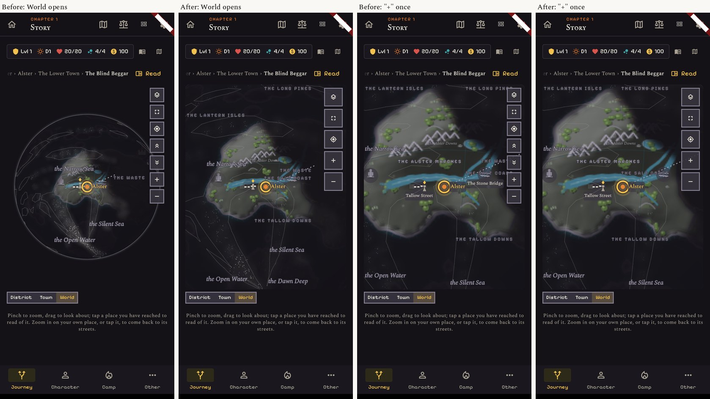
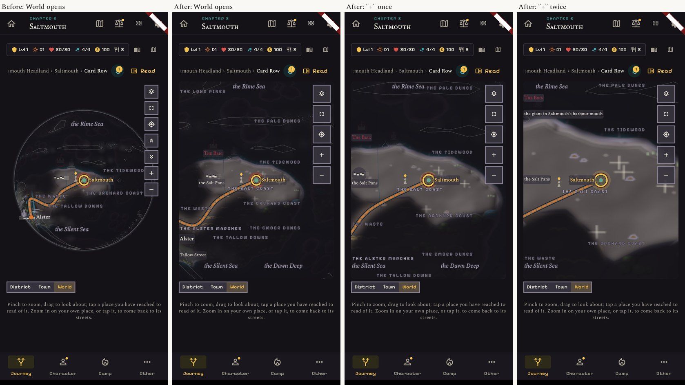
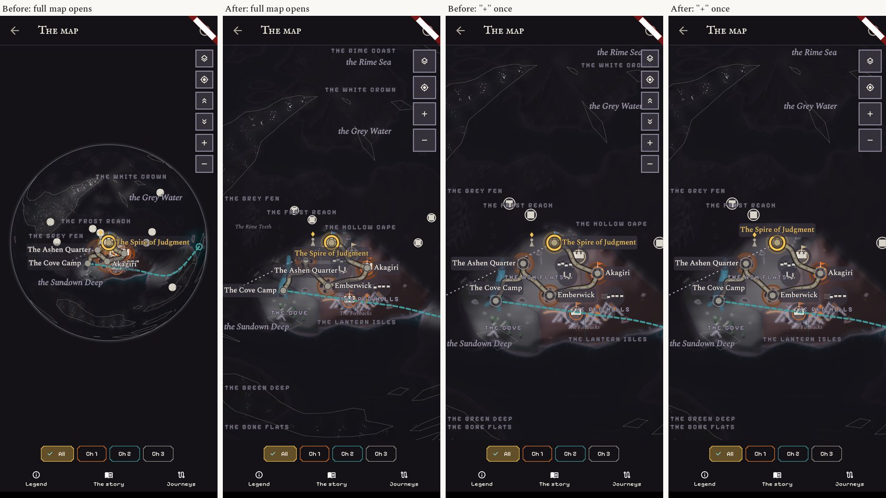
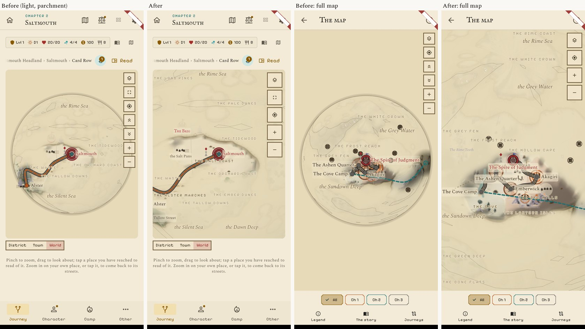
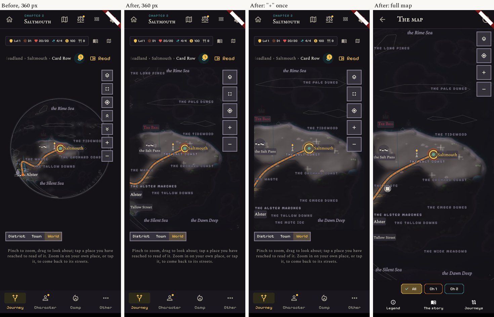
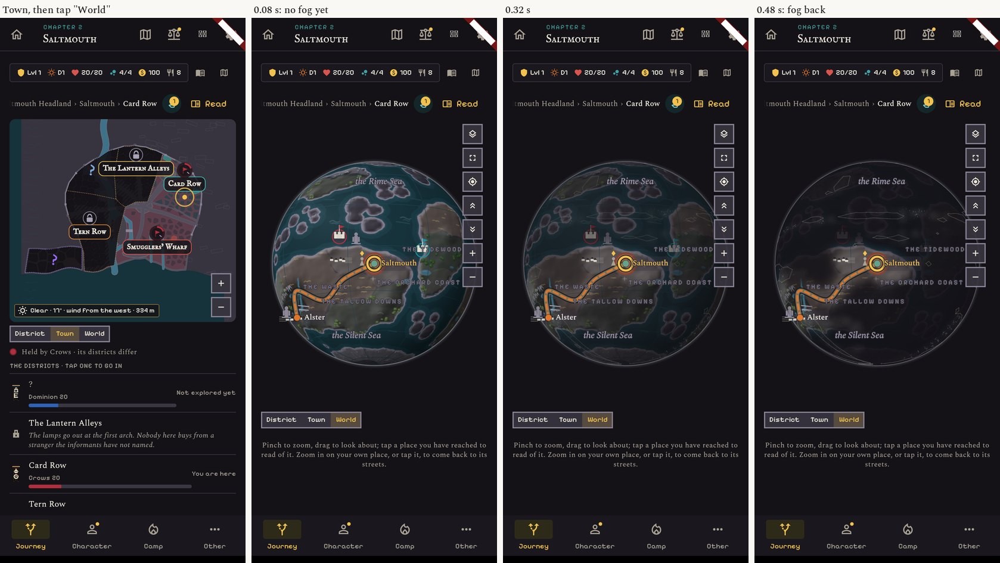
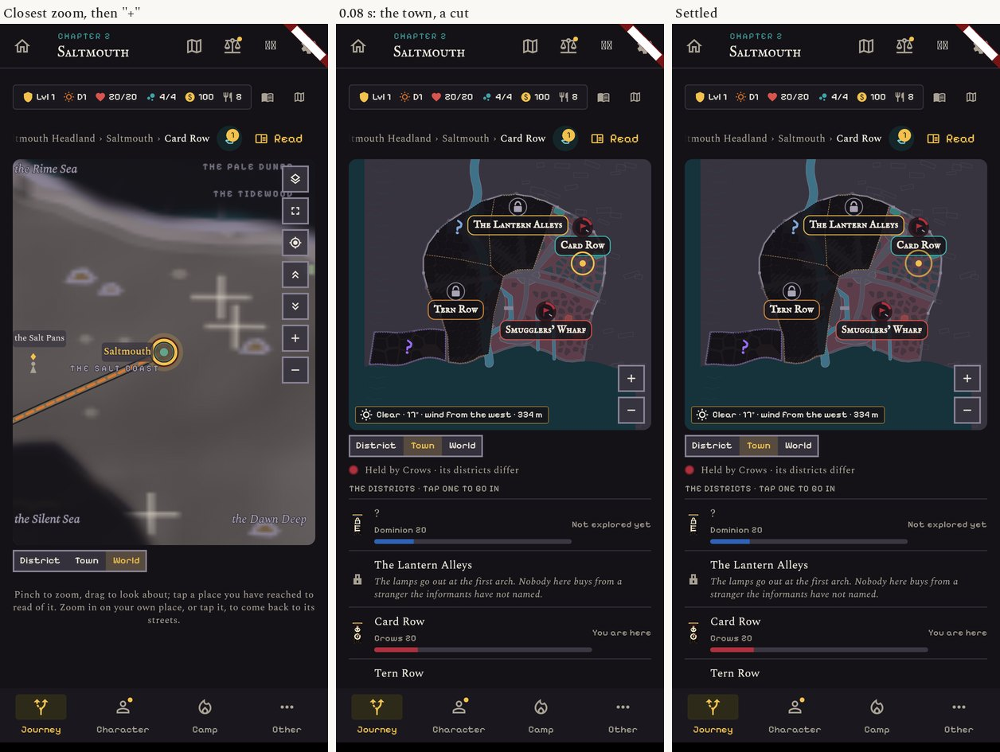
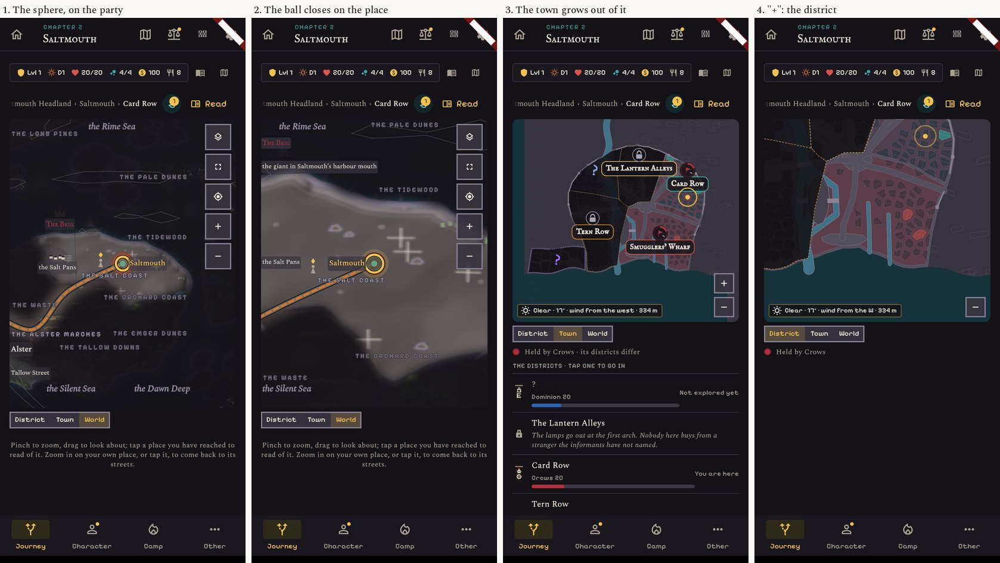
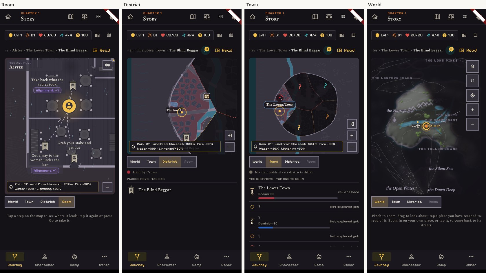
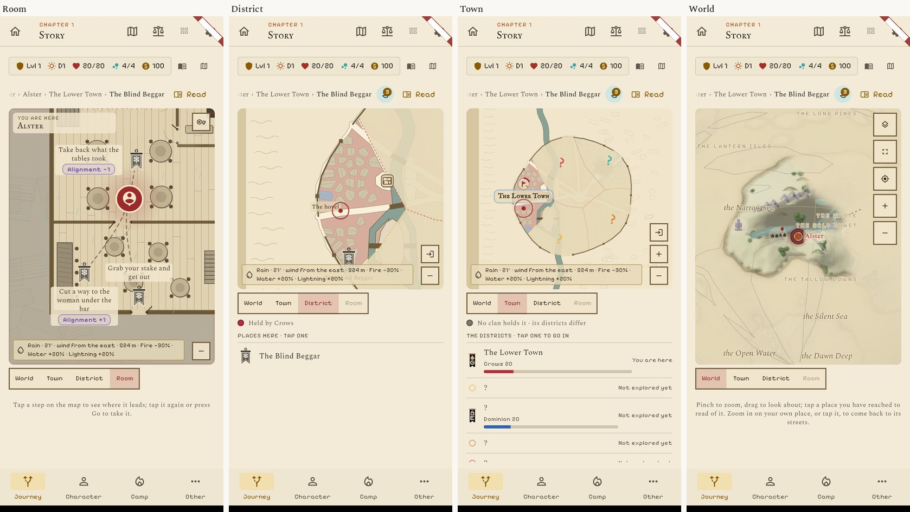

# The sphere, then the location maps

The user's answer on the atlas: "For maps I just want the sphere and then the locations maps."
So the player's path keeps two kinds of map: **the sphere** for the world, and **the map of a location**
(the town with its districts, and the inside of a building). The flat world chart and the "Land" zoom
leave the player's path.

Docs and pictures only: nothing in the app changed. The pictures are real screens of the app (v1.916),
412 x 915 dark with the Night look, light with Parchment, and 360 wide. The "after" pictures come from a
temporary patch (`prototype.patch.txt`, rendered by `shot_test.dart.txt`), reverted afterwards.
Earlier findings: `../atlas/README.md`.

## 1. What the flat chart does today, and what the sphere takes over

| Where the flat chart shows | Today | With the sphere only |
|---|---|---|
| Journey, "World" tab, sphere switched off | the flat chart of the ring world | gone: the tab always shows the sphere |
| Journey, the "Land" zoom (after "−" from a town) | sphere or flat chart, close on the party | **the sphere, filling its box, turned to the party** (section 2) |
| Full map page (top bar, the square button, the camp's "On the map", the tutorial's map lesson) | sphere or flat, whichever is switched on | the sphere only; the page, its place sheet, chapter chips, legend and journeys stay |
| A move along a road (the camera follows the party over the map) | works on both; on the sphere the ball turns with the party | unchanged |
| The road crossing page (the strip of land the party walks) | not the flat chart: its own strips, already drawn from the sphere's world | unchanged |
| The layers sheet | the switch "The world as a sphere", the weather switches, the layers (clans, chapter roads) | **the sphere switch goes**; the rest stays |
| The legend sheet, the journeys sheet and replay | no flat-only part | unchanged |
| The epilogue map ("who holds each town at the end") | the flat chart of the ring world, always | **must move to the sphere's world**: either the sphere with the Clans layer on, or the same flat drawing of the story world. To decide with a picture when it is built. |
| The district view's "ways out" (which edge a road leaves by) | the direction is read on the ring world | read on the sphere's world, so a way out points where the sphere shows the next place |
| The weather where the party stands | read on the ring world (or whichever world Edit Mode picked) | pinned to the sphere's world. One line in `climate_provider.dart`, agreed by Core: no balance number depends on it |
| Edit Mode's world map page (no fog, the three older worlds A, B, C, the look picker) | flat | stays as it is, for Edit Mode only |

**What the sphere already draws, checked in the code and on the pictures:** roads walked and the road ahead,
the party's ring, places and their names, villages and works from the second zoom, region names, sea names,
rivers, the fog, the clan zones and the other layers, the chapter roads, the weather.
**What only the flat chart draws:** the compass rose and the scale bar, rivers that widen towards the sea,
the shaded relief picture (the sphere has its own light). None is needed on a ball.

**What can simply go from the player's path:** the sphere switch, the flat chart's pan-and-zoom viewer in
the Journey map, the two pole buttons (the ball turns by hand), the "Land" level as a separate state
(it becomes a zoom of the sphere), the saved "flat or sphere" setting.

## 2. The sphere up close

Today the World tab opens on a ball that uses half of its box, with unnamed dots and names on top of each
other; region names run under the buttons. After, with four small changes:

1. **It fills its box**: the ball is as wide as the box's diagonal, so no black corners. "−" still shows the whole ball.
2. **It opens turned to the party**, and **"+" always closes in on the party**, wherever the ball was turned.
3. **Names keep clear of the button column**: region and place names stop 56 px from the right edge.
4. **Five buttons of 44 px** instead of seven of 34.

Because the ball is bigger, the painter's own rule ("a name with no clear spot is left off") now finds room:
on the full map the Ashen Quarter, the Cove Camp, Emberwick and Akagiri are named where there were dots.

Still weak in the prototype, to fix in the build: a few places only heard of stay as unnamed squares;
"THE RED HILLS" sits on a village mark (`03`, last screen); the soft blur of the ground is unchanged.

## 3. From the sphere to a location: one move

**Today** (`06`, `07`, frames 0.08 s apart): both ways are a cut. Down, the town is there on the first frame.
Up, the sphere is there on the first frame **and for about a third of a second it has no fog**: the whole
world shows before the fog comes back. That leak should be fixed whatever is chosen.

**Proposed: the dive.**
- **Down:** a tap on the place where the party stands, or "+" at the closest zoom, or a pinch in past it.
  The ball closes in on the place for 0.3 s; the town's plan grows out of the place's mark and the ball fades
  under it. The player lands on the **Town** (the whole place), then "+" or a tap goes to the district.
- **Up:** "−", a pinch out, or the World rung on the town. The plan shrinks back into its mark and the ball
  is there, **turned to that place**, at the zoom that fills the box.
- **Another place the party has reached:** a tap turns the ball to it and shows its card, as today. Opening
  that place's plan to look at it (no ways, no "Go") is possible later; it needs Core to say which districts
  count as found when the party is not there.
- What animates: the ball's size, the plan's size and fade, the fog (never off). 0.3 to 0.4 s in all, and
  none of it with "reduce motion".

The storyboard below is made of real screens; the in-between motion is not prototyped.

## 4. The ladder with the new rungs

**World · Town · District · Room**, one strip, always in the same place, 40 px high. The lit rung is where the
player looks; a rung that does not exist here is dim (no Town in a hamlet without a plan, no Room in the street).
"−" or a pinch out climbs one rung, "+" or a pinch in goes down one rung towards the party, on every map.
The city plan page and the full map page become the "enlarge" button of the Town and World rungs, with the
same buttons as the small map. In the pictures the Room rung is drawn but not wired.

Kept from the atlas:
- **D, buttons a thumb can hit, fewer of them**: in the pictures above (44 px, five on the sphere).
- **E, a city readable under the fog**: `../atlas/24-proposal-E-city-fog.jpg`. Matters more now: the Town is
  where every dive lands.
- **F, the sea on the side where the sphere puts it**: `../atlas/06-saltmouth-chart-vs-plan.jpg`. Matters more
  now that the sphere is the only world. Core's answer: a quarter turn after generation is fine, gate ids stay,
  no rule reads a plan's geometry or a city's distance to the coast.
- **A and C** (the flat chart's opening, one world on both) are moot: there is one world map.

## 5. What it touches, how big, in what order

**Files**
- Maps: `lib/widgets/journey_world_map.dart` (the flat viewer leaves, the opening, "+", the buttons, the dive),
  `chart_map_painter.dart` (names clear of the buttons, the fog on the way up), `lib/screens/full_map_screen.dart`,
  `epilogue_map_screen.dart`, `lib/widgets/city_chart/` (fog, "+" on the party's district, the ring on its own
  layer), `room_plan_painter.dart`, the map look provider (the sphere switch).
- Shared, with **UX**: `lib/screens/journey_screen.dart` (the strip, its moves, the Land state, the room's label
  and the rain indoors), `lib/widgets/calques_sheet.dart` (one switch less).
- **Core**, agreed: one line in `lib/providers/climate_provider.dart` (the weather reads the sphere's world).
  Later, for F: a "sea side" per city in `tool/city_plans/` and a regenerated `city_plans.json`.
- Strings: "Room" for the new rung (EN and FR), and the sphere switch's two strings go.

**Tests.** Five files drive the flat chart and must be rewritten for the sphere, not dropped:
`journey_levels_test.dart`, `map_poi_zoom_test.dart`, `map_readability_test.dart`, and QA's
`qa_smoke_world_test.dart` and `qa_smoke_tints_test.dart` (QA's files: through the Manager).
`world_map_edit_test.dart` and `world_map_test.dart` stay with Edit Mode's page. New tests: the opening
frame (the party in view, no name under the buttons), the dive both ways, the fog never off.

**Build order, each release usable on its own**

| Release | What the player gets | Size | Needs |
|---|---|---|---|
| 1. **The sphere that replaces the Land view** | the World opens filling its box on the party; "+" goes to the party; names clear of the buttons; 44 px buttons; the fog leak fixed; the sphere switch and the flat chart leave the Journey and the full map; the weather pinned | medium | Core's one line; QA's two smoke tests |
| 2. **The ladder and the dive** | the strip World · Town · District · Room; "−" and "+" mean the same everywhere; the dive down and up; the epilogue map on the sphere's world | medium to large | UX for the strip in `journey_screen.dart` |
| 3. **The locations** | the city readable under the fog, "+" on the party's district, the plan drawn once; the room's label and no rain indoors; the sea on the right side | medium | the user's call on the fog; Core's generator change for the sea |

Picture first at each release: its screens are shown before the PR, as here.

## Not done

French, the epilogue map itself, a move along a road on the patched sphere, anything on a real phone.
The dive's motion is described, not prototyped.
