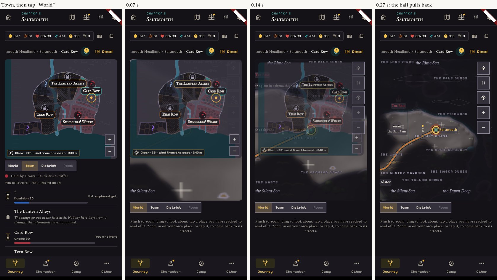
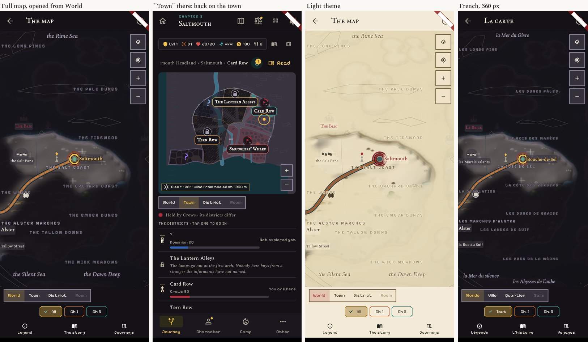

# Two follow-ups after release 3

Real screens of the app (v1.940 plus this change), 412 x 915 dark and light, and 360 wide in French.

## 1. The town steps back when the player goes up to the world

Before: a tap on "World" (or "−", or a pinch out) from a town cut straight to the ball.
Now the ball is there at once, close on the place and pulling back, and for 0.2 s a picture of the
town's plan (the plan alone, not the list under it) shrinks a little and fades over it.
It shrinks about its own middle, not down to the size of the place's mark.
Nothing moves with "reduce motion", nor in a place that has no town plan.

## 2. The full map page carries the level strip

Opened from the Journey, the full map shows the same strip World · Town · District · Room, with World
lit. A tap on another rung closes the page and puts the Journey on that level. Opened from elsewhere
(the camp, the tutorial), the page has no strip, as before.

Fixed on the way: after going up to the world from a district, "Town" could land on the district.

## Files

`lib/screens/journey_screen.dart` and `lib/screens/full_map_screen.dart` (the second is Maps'; the first
is a shared screen), `test/map_ladder_test.dart`. No new string.

## Not done

Not tried on a real phone. The French 360 picture is of the full map page only.
