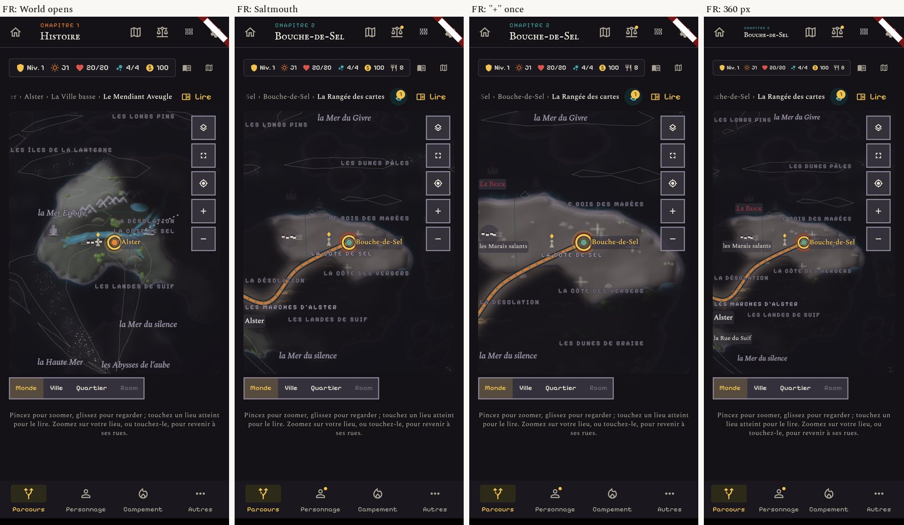
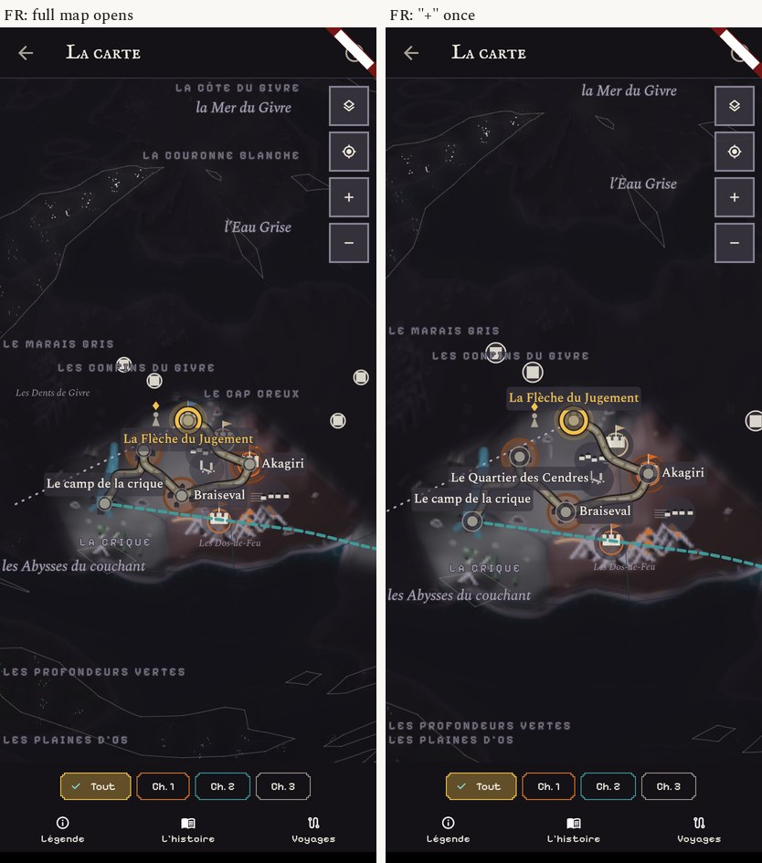

# The patched sphere in French, and the one line for Core

## French on the sphere prototype

Same prototype patch as the README, language set to French, 412 px and one at 360 px.




**Names clear of the buttons: yes.** Every region name that was cut in French on today's sphere is whole:
"LES LONGS PINS", "LES DUNES PÂLES", "LE BOIS DES MARÉES", "LA CÔTE DES VERGERS", "LES DUNES DE BRAISE",
"LA CÔTE DU GIVRE", "LA COURONNE BLANCHE". At 360 px too.

**Still to fix when it is built (Maps):**
- Round Alster, "LA DÉSOLATION" and "LA CÔTE DE SEL" sit one on the other, crossed by the dotted road ahead.
- "LES MARCHES D'ALSTER" is crossed by the mountain marks.
- On the full map, "LES CONFINS DU GIVRE" has a place mark on it, and "LA CRIQUE" touches a road.
- These are the painter's region names: they are placed after the place names but do not avoid marks and roads.
  The fix is to give region names the same "no clear spot, try the next one" rule the place names have.

**For Narrative:** the new rung "Room" needs a French word (the prototype shows "Room"). "Salle" or
"Intérieur"; "Pièce" reads as a coin in this game.

## The one line in `lib/providers/climate_provider.dart` (Core's file)

Today, line 46, inside `skyHereProvider`:

```dart
  final chart = chartOf(ref.watch(mapShapeProvider));
```

Asked:

```dart
  final chart = chartOf(MapShape.story);
```

With it, line 8 (`import 'map_look_provider.dart';`) is no longer used in this file and goes; `MapShape`
comes from `../data/map_charts.dart`, already imported on line 6. Nothing else in the file changes:
`ChartClimate.of(chart)` and `chart.of(standing)` stay as they are.

What it changes for the player: the weather where the party stands is computed from the sphere's world, the
one the map shows, whatever shape Edit Mode's page has picked. Core has said that no balance number and
neither simulator reads the weather. No test under `test/` sets `mapShapeProvider`, so none should change;
`climate_test.dart` and `weather_effects_test.dart` are run with the change when it is built.

It ships with release 1, listed in that PR under "Touches another session's area".
