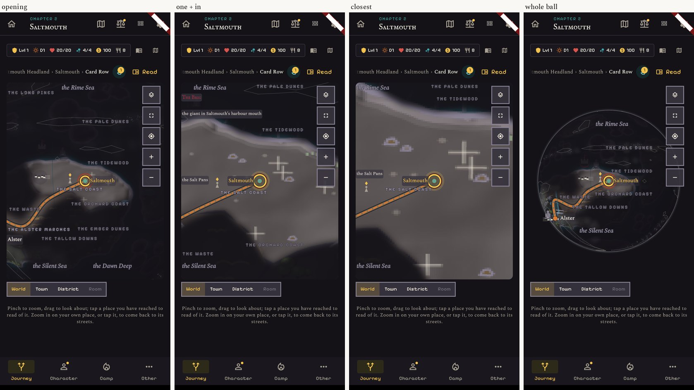
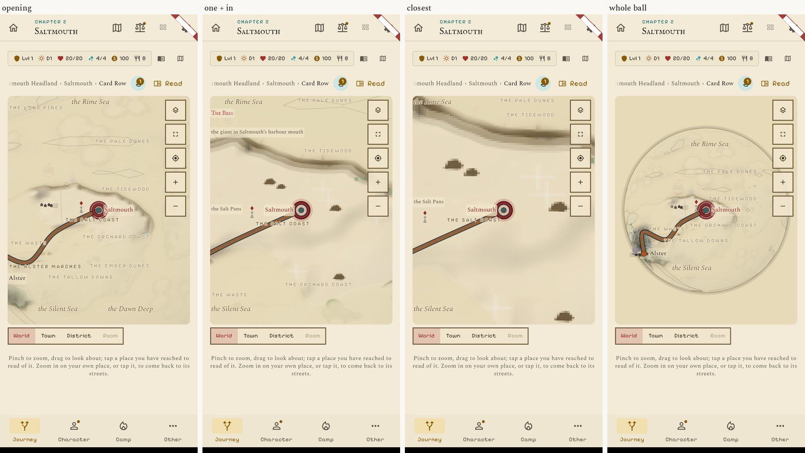
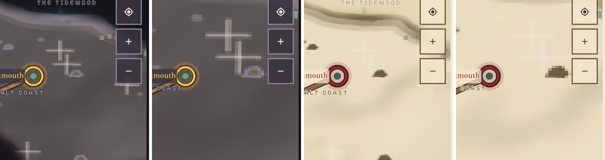
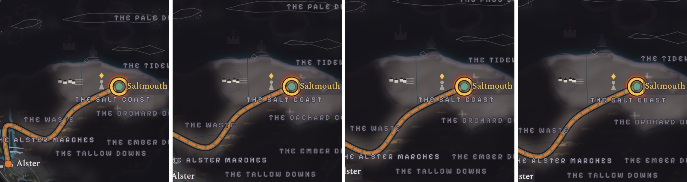

# The sphere's ground close up: hard pixels (the user's choice A, 12 November)

Close up, the sphere's ground is the same picture as before, shown without smoothing: stepped edges
in place of a blur. Far off (the whole ball), where the picture is shrunk, it stays smooth: shown hard
there it would shimmer as the ball turns.

Real screens of this build, Saltmouth, at the opening view, one "+" in, the closest view and the whole ball:
`01` Night 412, `02` Night 360, `03` Parchment 412, `04` Parchment 360.

`07`: the ground at full size, one "+" in and closest, Night and Parchment.

## The seam between the smooth far view and the hard near view

The change falls where the ground's picture already becomes finer (between the whole ball and the
opening view). `05` shows frames of the zoom in from the whole ball, 80 ms apart, and `06` four frames
40 ms apart at full size, across the change: no jump is seen in the ground.

## What to know

- At the opening view the picture is barely stretched, so the steps hardly show; they show one "+" in
  and plainly at the closest view.
- The picture itself has soft shading in it (the coast's fade, the relief), so close up it reads as soft
  shapes cut into small squares, not as drawn pixel art.
- One line changed in `lib/widgets/chart_map_painter.dart`. No cost in memory or speed.

## Not checked

A real phone (its screen is finer than these pictures, so the squares will be smaller in the hand),
the Shroud look, French (no words change), a pinch held right on the change.
