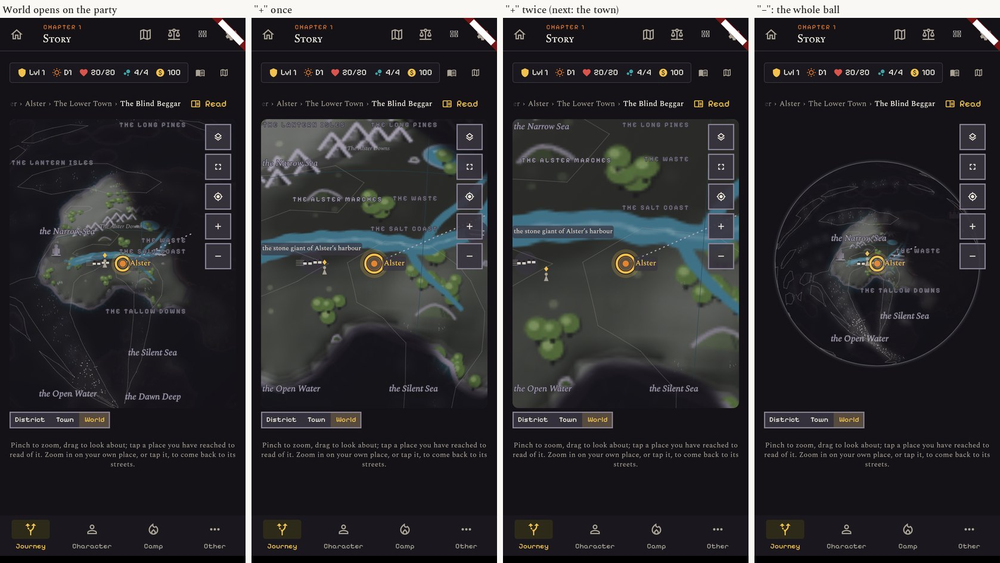
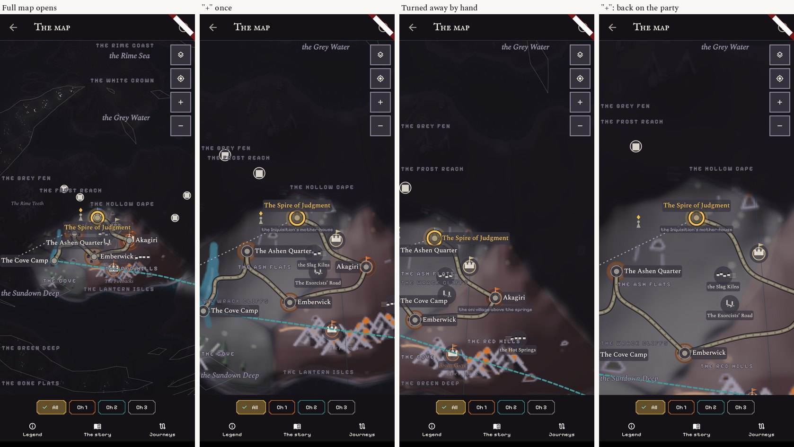
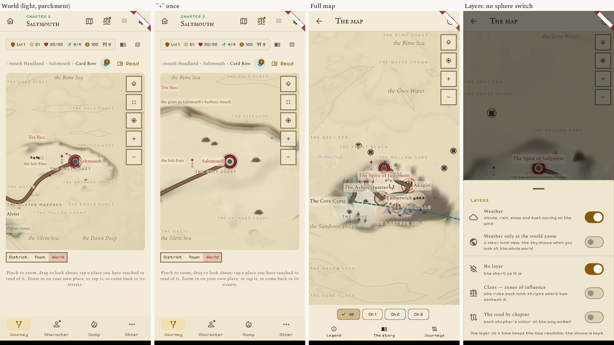
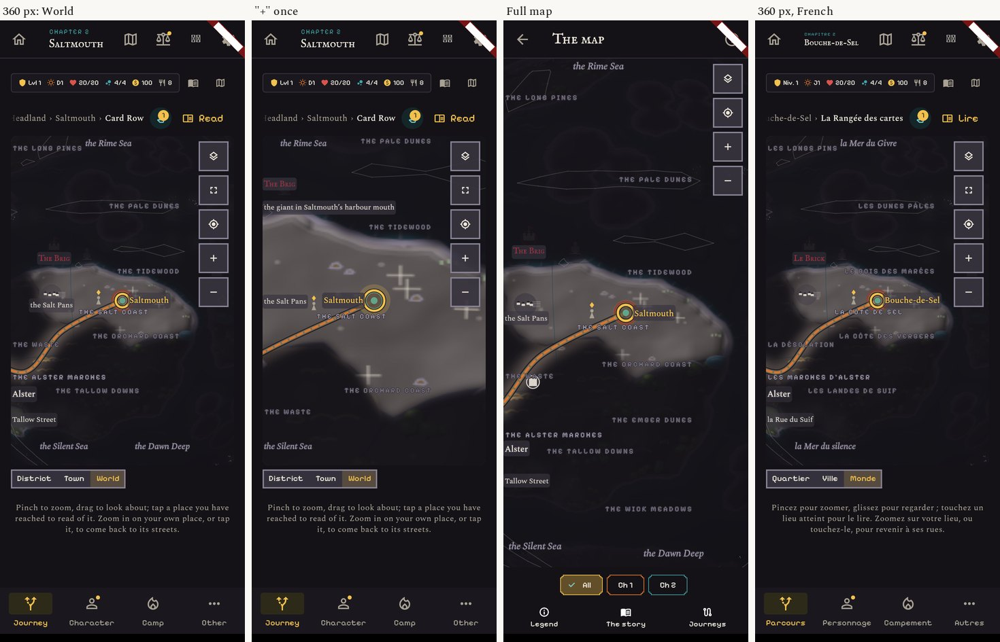
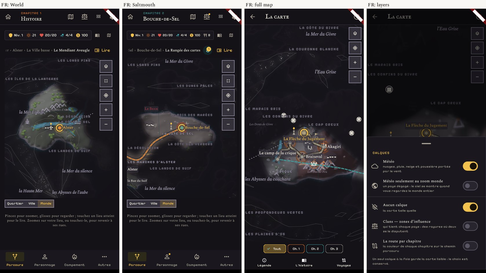
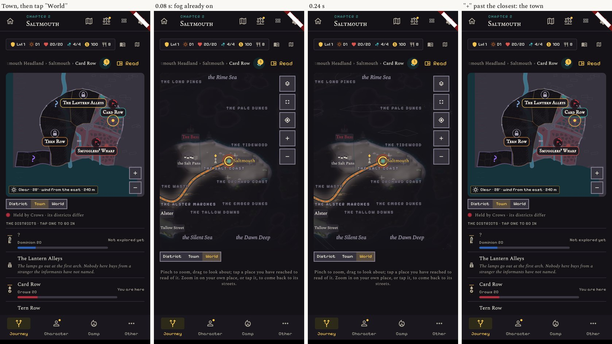
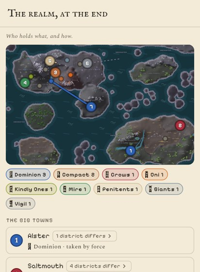

# Release 1: the sphere is the world

Real screens of the build, 412 x 915 (dark with the Night look, light with Parchment), 360 wide, and French.

| What | Picture |
|---|---|
| The World opens with the ball filling its box, turned to the party. "+" goes one step closer, then one more, then into the town. "−" shows the whole ball. | `01-journey-world-dark.jpg` |
| The full map page opens the same way. After the ball is turned away by hand, "+" comes back to the party. | `02-full-map-dark.jpg` |
| Light theme. The layers sheet has no sphere switch any more. | `03-light.jpg` |
| 360 px wide, English and French. | `04-360.jpg` |
| French: every region name is whole, none under the buttons. | `05-french.jpg` |
| Going up from the town, the fog is on from the first frame. | `06-town-to-world.jpg` |
| The epilogue map draws the sphere's world: a town sits where the world map shows it. | `07-epilogue.jpg` |

## What changed

- The flat world chart, the sphere switch, the two pole buttons and the separate "Land" view are gone from the
  player's path. The older worlds A, B and C stay on Edit Mode's world page.
- Five map buttons of 44 px (they were seven of 34).
- Names stop 56 px short of the right edge, where the buttons are.
- Quick presses of "+" or "−" add up: two fast presses go two steps.
- The weather where the party stands is read on the sphere's world (Core's agreed line).
- The district view's "ways out" point where the sphere shows the next place.

## Known, not in this release

- The epilogue map is a flat cut of the sphere's world, as before, not a ball that turns. It can become one
  if wanted; say so on seeing the picture.
- Region names still sit on place marks and roads here and there ("THE FROST REACH", "LES CONFINS DU GIVRE").
  They need the place names' rule (no clear spot, try the next one).
- From the opening zoom, "+" goes straight to a close view where little shows in empty country (`03`, second
  screen). A step in between may be wanted; easy to add.
- The move between the sphere and a town is still a cut: that is release 2.
- Not tried on a real phone.
