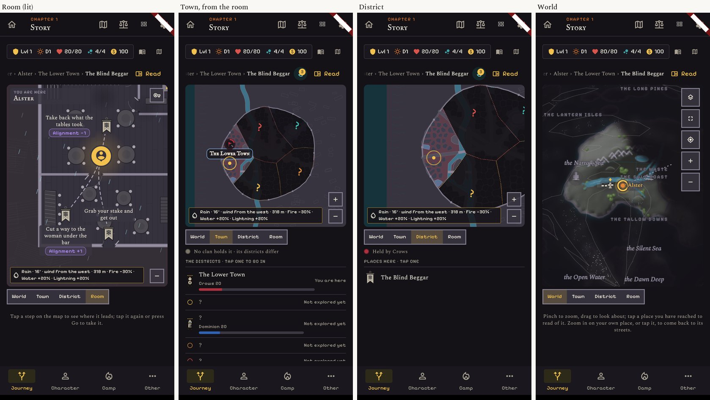
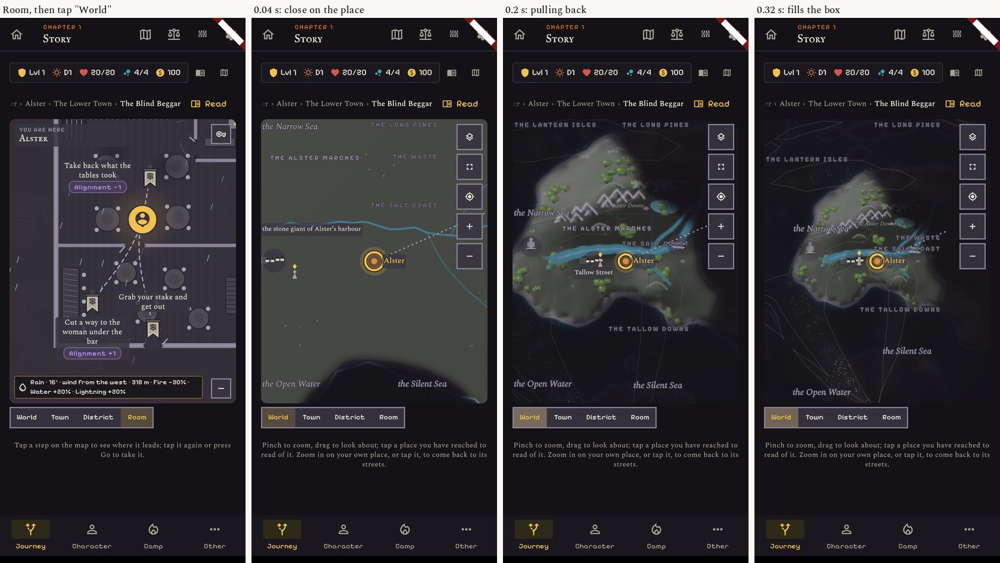
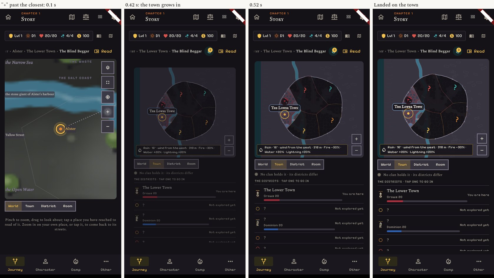
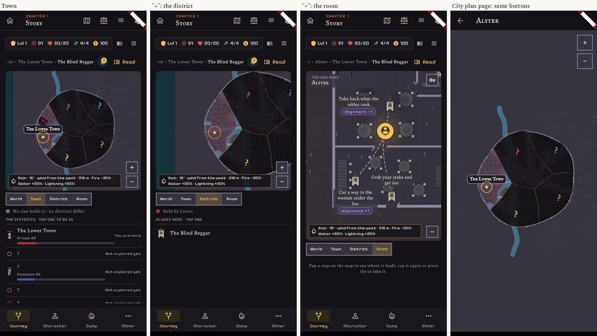
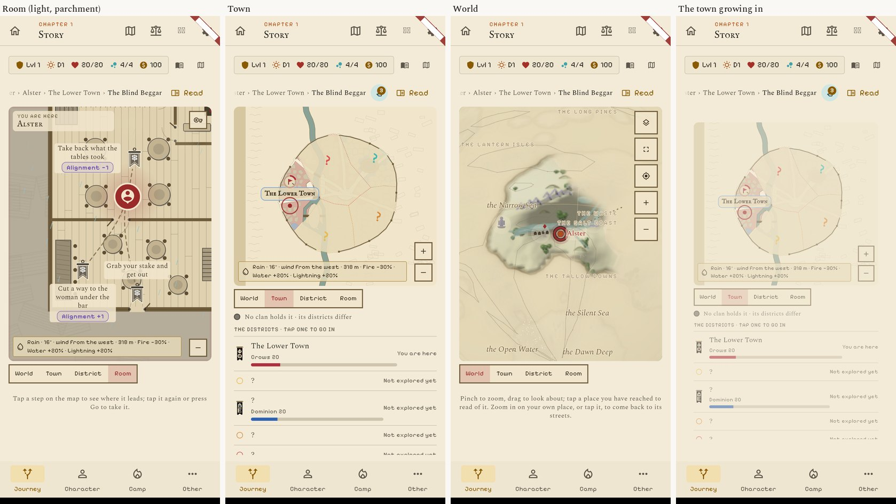
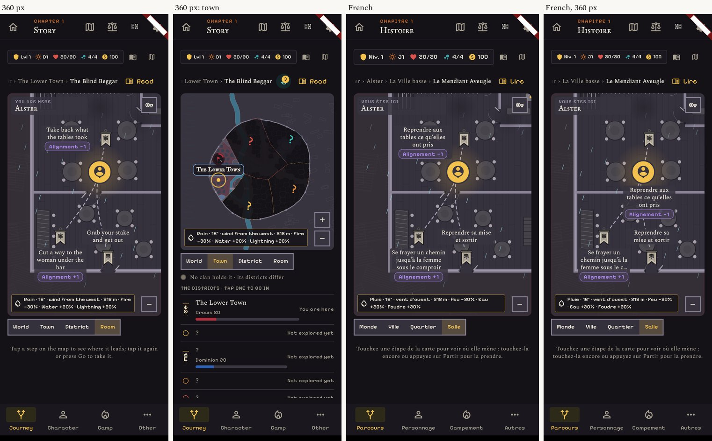
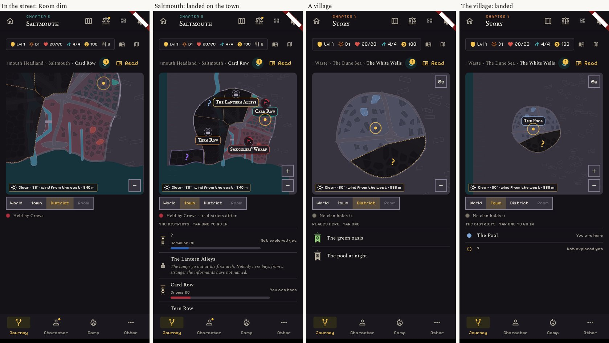

# Release 2: the ladder and the dive

Real screens of the build, 412 x 915 (dark with the Night look, light with Parchment), 360 wide, and French.

| What | Picture |
|---|---|
| One strip, **World · Town · District · Room**. The lit rung is where the player looks. From the room, "Town" steps out and shows the whole town (it was greyed before). | `01-ladder-dark.jpg` |
| Up to the world: the ball opens close on the place and pulls back until it fills the box. | `02-up-pull-back.jpg` |
| Down from the world: "+" past the closest zoom (or a tap on the party's place) makes the ball close in further, then the town grows out of the place. It lands on the whole town, with no words about a door. | `03-down-dive.jpg` |
| "+" goes down a rung everywhere: town, district, room. The city plan page has the same square buttons as the small map. | `04-plus-down-the-rungs.jpg` |
| Light theme. | `05-light.jpg` |
| 360 px wide, and French ("Monde · Ville · Quartier · Salle"). | `06-360-and-french.jpg` |
| In the street the Room rung is dim; a village lands the same way. | `07-no-room-no-town.jpg` |

## What changed

- The strip has four rungs in the order World, Town, District, Room, and any rung is one tap from any other.
- "−" goes up one rung and "+" goes down one rung on every map. The button into a building is now a "+",
  in the same place as the town's "+"; on the whole town only the district's "+" shows.
- World to town and back is a move, not a cut (0.3 s each way; at once with "reduce motion").
- Coming down from the world no longer plays the door's veil and "You step back out into the streets".
- The city plan page's two buttons are the map's own square 44 px buttons.
- The separate "Land" level is no longer used by the Journey: "−" from a town goes to the world.

## Choices made, to confirm

- **The strip is 36 px high, not 40.** At 40 the map loses 12 px, and on a 360 x 640 screen one way's mark
  could no longer be tapped (`journey_step_taps_test`). 36 passes. On a narrow screen the strip shrinks as a
  whole and stays on one line.
- **The strip keeps today's look** (the map's colours, 12 px text) until UX says otherwise.
- **The dive lands on the Town**, as proposed. "+" then goes to the district and the room.

## Known, not in this release

- Going up, the town does not shrink into its mark first: the ball simply opens close and pulls back.
- During the dive the ground grows but the names at the map's edge stay where they are.
- The full map page has no strip: it is the World rung enlarged, reached as before.
- Not tried on a real phone.
