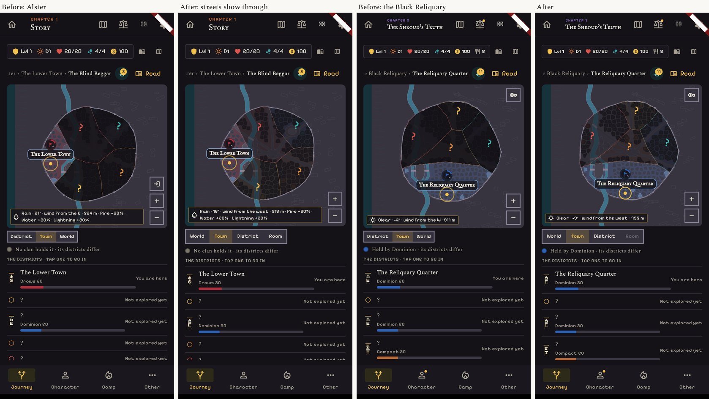
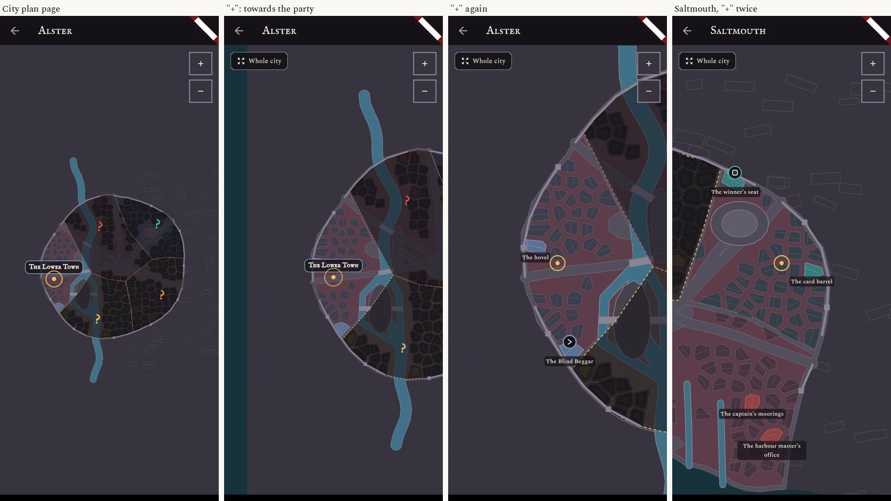
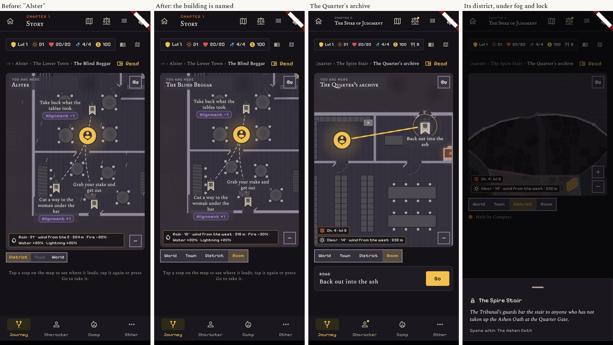
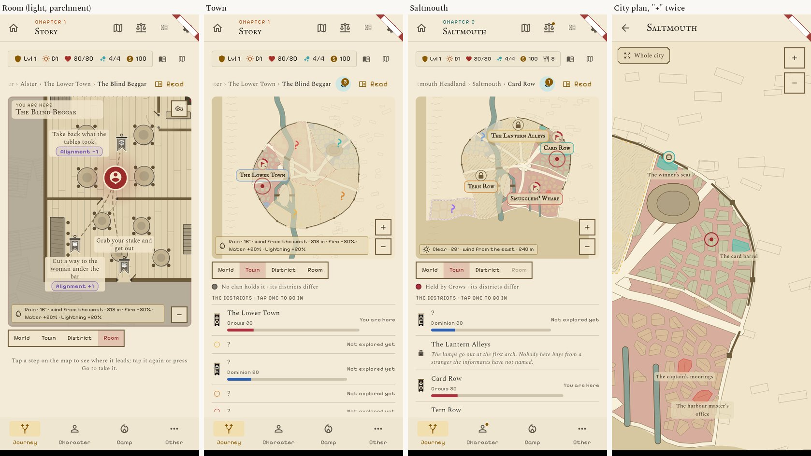
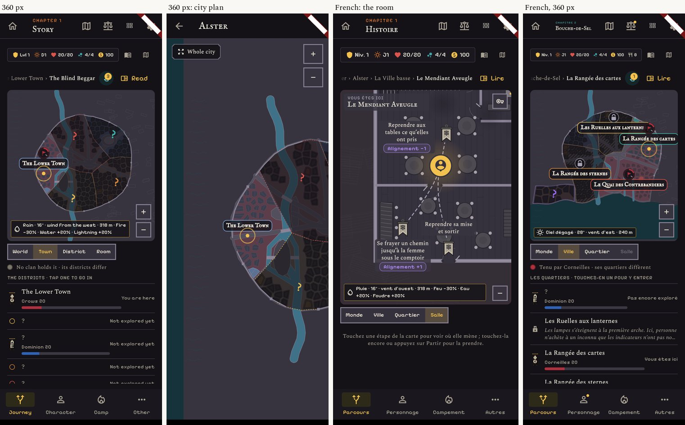
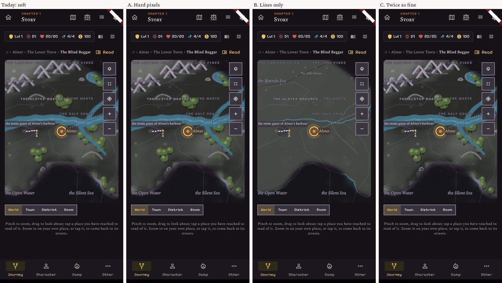
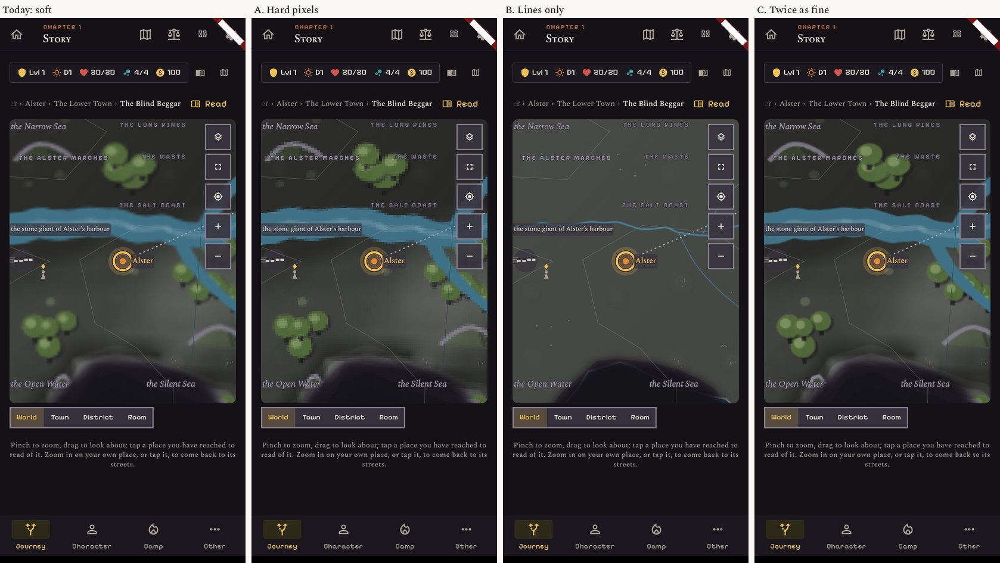

# Release 3: the locations

Real screens of the build, 412 x 915 (dark with the Night look, light with Parchment), 360 wide, and French.
The "before" screens are the atlas's.

| What | Picture |
|---|---|
| The fog over a district not yet found lets its streets and blocks show through. Still no name, no pin, still "?". | `01-fog-before-after.jpg` |
| On the city plan page, "+" closes in on the party, not on the middle of the city. | `02-city-plan-plus.jpg` |
| Inside a building the label names the building, not its town. | `03-room.jpg` |
| Light theme. | `04-light.jpg` |
| 360 px wide, and French. | `05-360-and-french.jpg` |

## What changed

- **Fog.** A district not yet found is covered at 55 % instead of 88 %: the streets and blocks read, the
  names and pins stay hidden, the "?" and the dashed outline stay.
- **"+" on the city plan** brings the party's place towards the middle of the view (as far as the plan's
  edge allows). With no party on the plan it zooms on the middle, as before.
- **The plan is drawn once.** The party's breathing ring is on its own layer, so the 60 or more buildings
  are no longer redrawn every frame for it.
- **The room's label** names the building ("The Blind Beggar", "The Quarter's archive").
- **No rain, snow or ash is drawn under a roof.**

## The soft ground close to the party's town: three options (pictures only, nothing built)

Close up, the sphere's ground (woods, hills, rivers) is a picture of the whole world stretched three to six
times, so it looks out of focus beside the crisp names. It is not fog. `06` is one "+" from the opening view,
`07` is the closest view.

- **A. Hard pixels.** The same picture, shown without smoothing: blocky, sharp-edged, in the spirit of the
  art direction (hard stepped edges, no blur). No cost in memory or speed. Small change.
- **B. Lines only.** The coast, rivers and roads as clean lines, no woods and no relief. Crisp but bare.
  Small change.
- **C. Twice as fine.** The picture drawn at twice the detail: softer than A but clearly sharper than today.
  It costs four times the memory for that picture (about 26 MB instead of 6.5 at the closest view), and it is
  made again at each zoom step. Medium change, and it must be tried on a real phone.

## A correction to the atlas

The atlas said rain streaks were drawn inside the tavern. The short strokes still seen in a room are not
rain: they are the land's own texture (the biome's backdrop) showing round the room. The weather itself is
now off indoors, which the test checks. Whether the land's texture belongs under a room is a separate,
small question.

## Not in this release

- **The sea on the side where the sphere puts it.** It needs Core's change to the plan generator (a "sea
  side" per city and regenerated plans). When it lands, each turned plan is checked on real screens.
- A district that is both not found and shut by a side quest is still dark (fog plus the shutter's hatch):
  Saltmouth's Lantern Alleys and Tern Row.
- On the Parchment look the thinner fog is pale: an unexplored district is told mostly by its "?" and its
  dashed outline (`04`).
- The soft ground on the sphere: the three options above wait for a choice; none is built.
- Not tried on a real phone.
