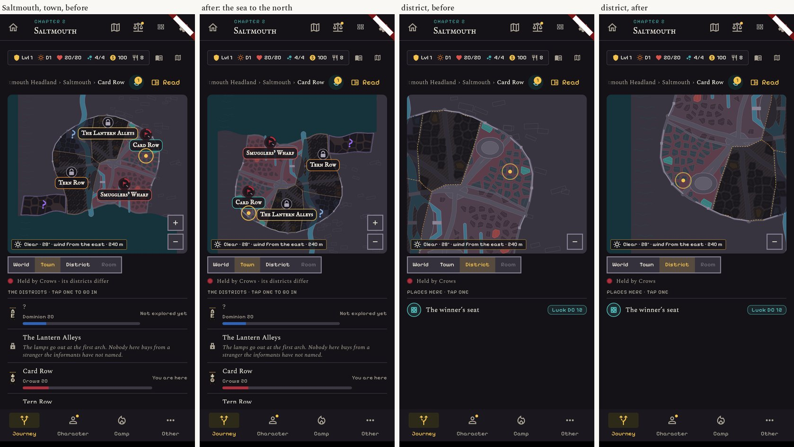
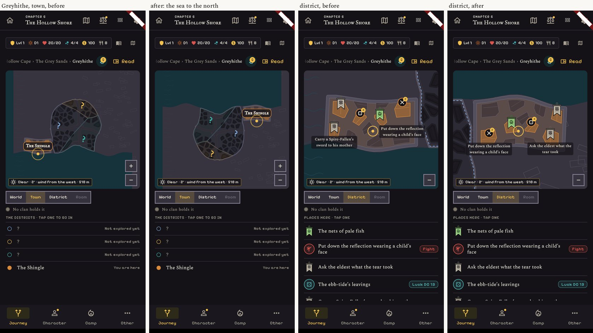
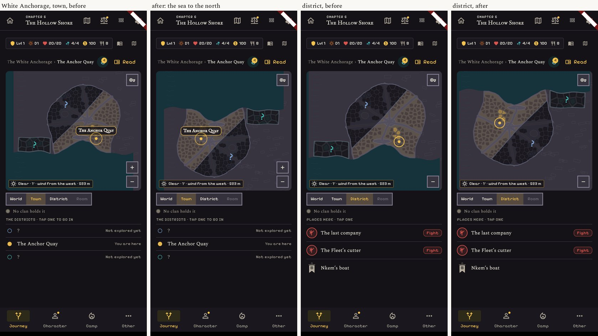

# The sea on the sphere's side: Saltmouth, Greyhithe, the White Anchorage

Before and after pictures of Core's change (`claude/core-seaside`, PR #1022, head e6e94cb6). The app's
code is the same on both sides: only `assets/gamedata/city_plans.json` differs, so "after" is this branch
with Core's file put in for the run. Real screens, dark theme, the Town and the District of the Journey,
412 and 360 wide.

| City | 412 | 360 |
|---|---|---|
| Saltmouth | `01-saltmouth-412.jpg` | `02-saltmouth-360.jpg` |
| Greyhithe | `03-greyhithe-412.jpg` | `04-greyhithe-360.jpg` |
| The White Anchorage | `05-anchorage-412.jpg` | `06-anchorage-360.jpg` |

`07`: the three places on the sphere, for where their coast lies.

## What is seen

- In the three cities the sea is now at the top of the plan; the whole city is turned a half turn with it.
- District names, the locks, the "?" marks, the party's ring and the pins of the district stay upright and
  inside the frame at both widths. Nothing is cut and no name sits on another.
- Greyhithe: "The Shingle" now sits at the right edge of the plan; its name fits at 360, with little room to spare.
- Saltmouth: "Card Row" and "The Lantern Alleys" are now side by side with the party's ring between them; both read.
- The other 13 plans are the same data as before, compared city by city (Candlehold included), so nothing
  else on a city plan moved. The sphere, the roads and the rooms do not read this file.

## Not checked

The city plan page and its "+" on these three, the ways out drawn at the plan's edges, the light theme,
French, a real phone.
