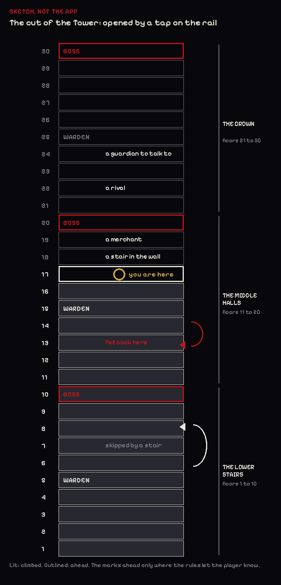

# What a map could add to the Tower: a short list, pictures first, nothing built

The Tower today has one map: the rail down the left of the floor screen, 30 notches, the wardens (5, 15, 25)
wider, the bosses (10, 20, 30) ringed in red, the hero's head on the floor it stands on, an arrow when an
event skipped floors or threw the run back. It says where the run is. It does not say what happened on the
way, what the three bands are, or what lies ahead.

The two pictures are **sketches**, drawn by hand in the Tower's ink (black, white, red), not screens of the
app. `sketch-2` is drawn over a real screen.

## 1. The cut of the Tower (medium)

A tap on the rail opens the Tower in section, the whole height on one page: the three bands by name (The
Lower Stairs, The Middle Halls, The Crown), each floor a storey, the wardens and bosses marked, the storeys
climbed filled in, the run's own story drawn on it (a stair that skipped a floor, a fall back), and the hero
where the run stands. It is the Tower's "full map", as the Journey has one for the world.

Needs from Core: nothing new for what was climbed (the run already keeps its floors and its jumps).

## 2. What is known ahead, on the rail (small, but a rule question first)

Small marks beside the notches ahead: a stair where a shortcut waits, a coin for a merchant, a head for a
rival or a guardian. The player plans the climb, as on a map.

This is a game choice before it is a drawing: today a floor's event is met on arrival. Showing it ahead
changes how the Tower plays, so it is the user's and Core's call (all of it, the next floor only, or only
after an oath or a purchase reveals it).

## 3. The climb's trace on the end screen (small)

When the run ends, the same cut, small, with the run drawn on it: how high, where the stairs were taken,
where it fell, where it ended. One picture that tells the run, and that reads at a glance beside the best run.

## 4. The landing as a small plan (medium, wants Art)

On a choice between two ways ("Take the stair" or "Take the door"), a small plan of the landing in the
style of the room plans: the door ahead, the stair in the wall, the guard on it. The choice is read on a
drawing as well as on two buttons. It only earns its place if the landings differ; with one plan for all
thirty it is decoration.

## 5. The Tower on the sphere (small, a taste question)

A mark for the Ashen Tower on the world's ball, on the menu or the start page of the Tower: where it stands
in the world of the story. It ties the mode to the world; it adds nothing to the climb itself.

## My order

1 first (it gives the Tower a real map and needs no new rule), then 3 (nearly free once 1 exists), then 2
if the user wants the Tower to be planned ahead. 4 and 5 only if wanted.

## Whose

The rail and the Tower's screens are UX's (the Tower in ink) and Core's (the run's rules): a map there
would be built with them, the drawing by Maps. Pictures of the real screens before any build.
