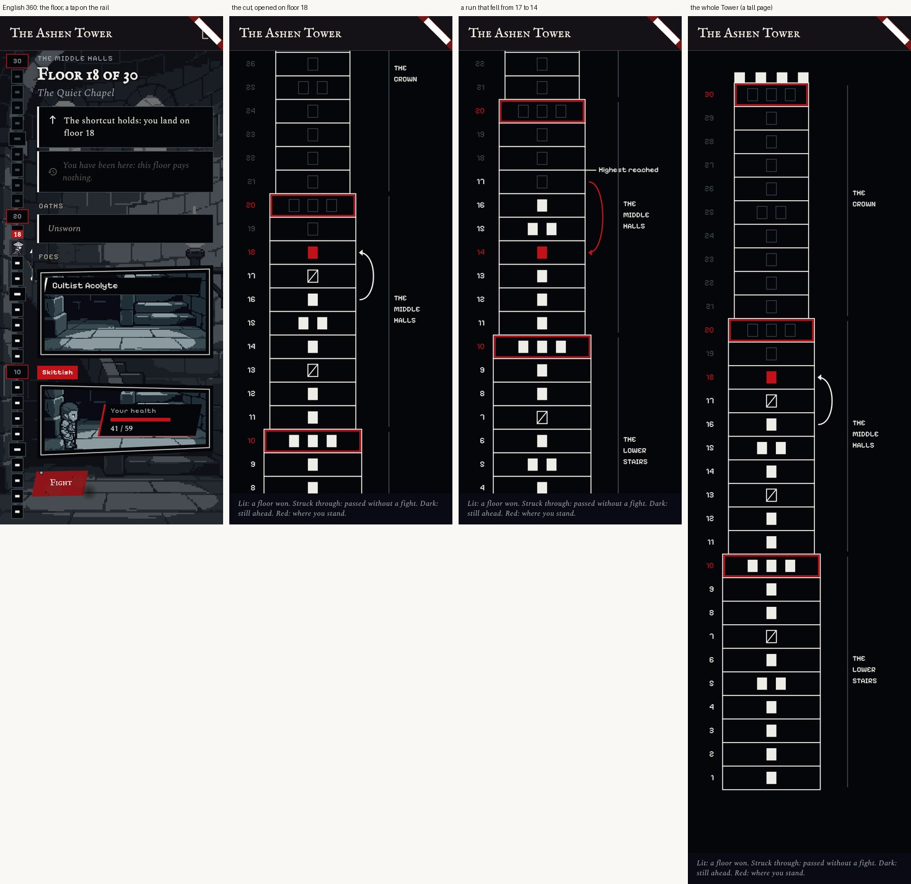
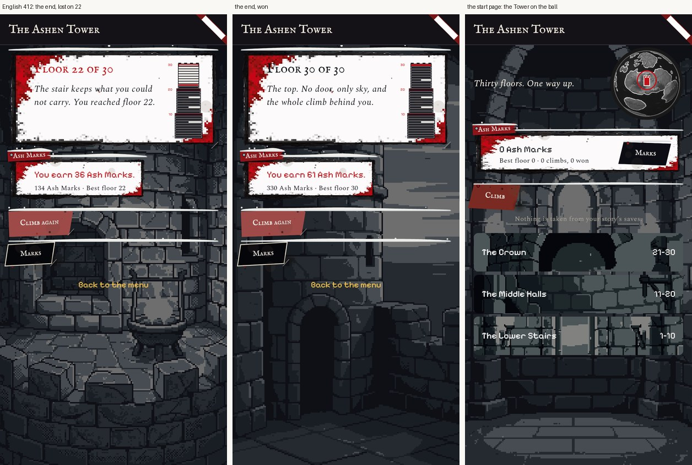
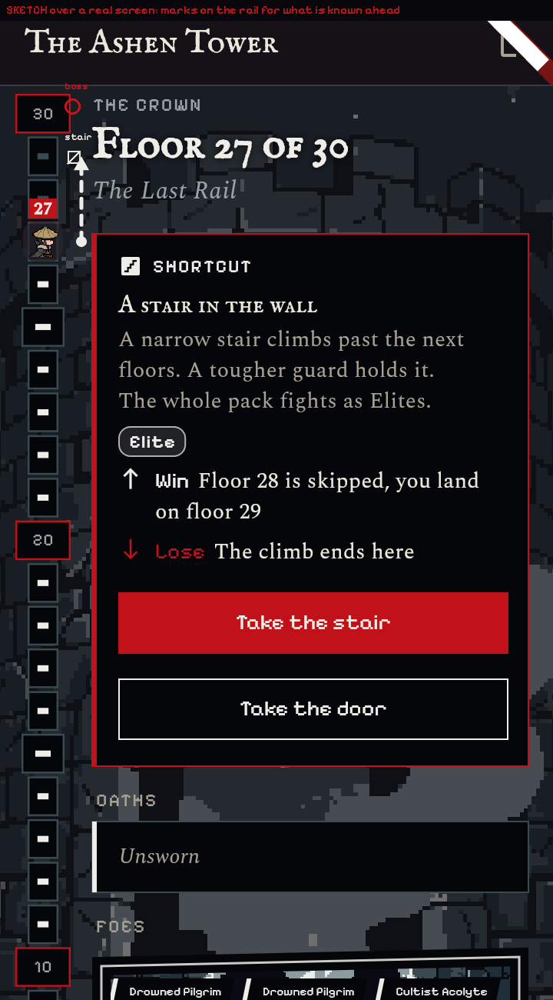

# The Tower's maps

## Real screens of the three ideas the user picked (25 November), nothing merged

Built as a held prototype on the branch `claude/maps-3` (head 3caf12a3, on main v2.8.1); no version, no
PR. These are screens of that build, in the Tower's ink, English and French, 360 and 412 px wide:

| | English 360 | English 412 | French 360 | French 412 |
|---|---|---|---|---|
| The cut | `01-cut-en-360.jpg` | `01-cut-en-412.jpg` | `01-cut-fr-360.jpg` | `01-cut-fr-412.jpg` |
| The end's trace, the Tower on the ball | `02-end-and-globe-en-360.jpg` | `02-end-and-globe-en-412.jpg` | `02-end-and-globe-fr-360.jpg` | `02-end-and-globe-fr-412.jpg` |

### 1. The Tower in cross-section, opened by a tap on the rail
A page of its own: the whole Tower, narrowing band by band, battlements on top, the three bands named
beside it. Each floor is a storey with a window: lit where the floor was won, struck through where it was
passed without a fight, dark ahead; two windows for a warden, three and a red frame for a boss. The run's
floor is red (window and number). The last jump is drawn beside the wall: white up (a stair), red down (a
fall), and a flag marks the highest floor reached when the run stands under it. The page opens with the
run's floor in view; the legend stays at its foot.

### 3. The climb's trace on the end screen
The same drawing, small, on the first paper panel: storeys won filled, passed half filled, the floor where
the run ended in red, the bosses numbered.

### 5. The Tower on the world's ball
On the Tower's start page, beside the tagline: the story's world as a small grey ball, a red keep where the
Tower stands.

## A correction to what I said before

I wrote that "the run already keeps its floors and its jumps". It keeps less: its floor, its highest floor,
the floors whose chest it opened, and **only the last event**. So the cut shows, truthfully, which floors
were won and which were passed, where the run is, how high it got, and the last jump. It cannot show every
stair taken and every fall of a run. For that, Core would have to keep a short log in the run (a list of
jumps, a few numbers each). Not needed for these pictures.

## What it needs from others

- **UX** (the Tower in ink is UX's): a look at the drawing's hand (line weight, the windows, the keep on the
  ball); the pixel digits, where a 5 reads close to an S, as on the rail; whether the trace sits well on the
  paper panel, which has blood on its right edge. Three screens of UX's and Core's are touched in a few
  lines each: `tower_floor_screen.dart` (the rail takes a tap, 15 lines), `tower_end_screen.dart` (the
  trace beside the words, 20 lines), `tower_start_screen.dart` (the ball beside the tagline, 15 lines). The
  drawing itself is in Maps' own files (`lib/widgets/tower_cut.dart`, `tower_on_globe.dart`,
  `lib/screens/tower_cut_screen.dart`).
- **Core**: a tap on the rail was free until now (the rail only skipped the hero's walk on a tap somewhere
  on the screen). And, if the whole climb is wanted on the cut: the log of jumps above.
- **Narrative**: **where the Tower stands in the world is written nowhere.** The picture puts it at the
  Ashen Quarter because of the name; that is my guess, not a fact of the story. Also five new strings, in
  English and French, to reword as wished (the legend's four phrases, "Highest reached").

## Checked

Format and analyze clean. A new test file (`test/map_tower_cut_test.dart`: what the cut reads off a run,
the page opening on the run's floor, the trace on the end screen), and all the Tower's own test files pass
with the prototype in (212 tests). Not tried on a real phone.

---

# The first list (24 November), with two hand sketches

The Tower today has one map: the rail down the left of the floor screen, 30 notches, the wardens (5, 15, 25)
wider, the bosses (10, 20, 30) ringed in red, the hero's head on the floor it stands on, an arrow when an
event skipped floors or threw the run back. It says where the run is. It does not say what happened on the
way, what the three bands are, or what lies ahead.

The two pictures are **sketches**, drawn by hand in the Tower's ink (black, white, red), not screens of the
app. `sketch-2` is drawn over a real screen.

## 1. The cut of the Tower (medium)

A tap on the rail opens the Tower in section, the whole height on one page: the three bands by name (The
Lower Stairs, The Middle Halls, The Crown), each floor a storey, the wardens and bosses marked, the storeys
climbed filled in, the run's own story drawn on it (a stair that skipped a floor, a fall back), and the hero
where the run stands. It is the Tower's "full map", as the Journey has one for the world.

Needs from Core: nothing new for what was climbed (the run already keeps its floors and its jumps).

## 2. What is known ahead, on the rail (small, but a rule question first)

Small marks beside the notches ahead: a stair where a shortcut waits, a coin for a merchant, a head for a
rival or a guardian. The player plans the climb, as on a map.

This is a game choice before it is a drawing: today a floor's event is met on arrival. Showing it ahead
changes how the Tower plays, so it is the user's and Core's call (all of it, the next floor only, or only
after an oath or a purchase reveals it).

## 3. The climb's trace on the end screen (small)

When the run ends, the same cut, small, with the run drawn on it: how high, where the stairs were taken,
where it fell, where it ended. One picture that tells the run, and that reads at a glance beside the best run.

## 4. The landing as a small plan (medium, wants Art)

On a choice between two ways ("Take the stair" or "Take the door"), a small plan of the landing in the
style of the room plans: the door ahead, the stair in the wall, the guard on it. The choice is read on a
drawing as well as on two buttons. It only earns its place if the landings differ; with one plan for all
thirty it is decoration.

## 5. The Tower on the sphere (small, a taste question)

A mark for the Ashen Tower on the world's ball, on the menu or the start page of the Tower: where it stands
in the world of the story. It ties the mode to the world; it adds nothing to the climb itself.

## My order

1 first (it gives the Tower a real map and needs no new rule), then 3 (nearly free once 1 exists), then 2
if the user wants the Tower to be planned ahead. 4 and 5 only if wanted.

## Whose

The rail and the Tower's screens are UX's (the Tower in ink) and Core's (the run's rules): a map there
would be built with them, the drawing by Maps. Pictures of the real screens before any build.
