# Wave 3: readable maps, pictures before any build

Real screens of the app (v1.1009) at **360 and 320 px** wide, before and after, for five ideas from the
review. The "after" screens come from a temporary patch (`prototype.patch.txt`), reverted: nothing in
the app changed. Each sheet reads left to right: before 360, after 360, before 320, after 320.
Pictures were made by `shot_sphere_test.dart.txt` and `shot_plan_test.dart.txt`.

## 1. Names of lands not yet reached: a stronger ink

Today they are drawn at 60 % strength in a mid grey (Night) or mid brown (Parchment). After: a stronger
ink per look and 85 % strength; reached lands stay at full strength. The names of ranges take the same
ink (today they are the Night grey on every look).

| Look | Ground behind | Today | After |
|---|---|---|---|
| Night | fog / land / sea | 3.5 / 2.8 / 3.0 | 7.3 / 5.1 / 5.6 |
| Parchment | fog / land / sea | 2.3 / 2.4 / 2.1 | 4.8 / 5.2 / 4.2 |
| Shroud | fog / land / sea | 3.3 / 2.5 / 3.3 | 7.1 / 4.8 / 7.0 |

(Contrast, computed from the colours at 80 % strength; 4.5 is the mark for readable text. At 85 % every
cell is above 4.5.) The inks tried: `#C9C3D6` Night, `#4A3B22` Parchment, `#C4C4CE` Shroud. Colours are
UX's to settle.

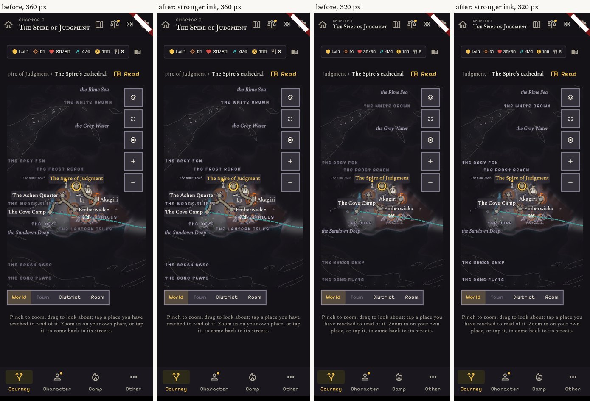
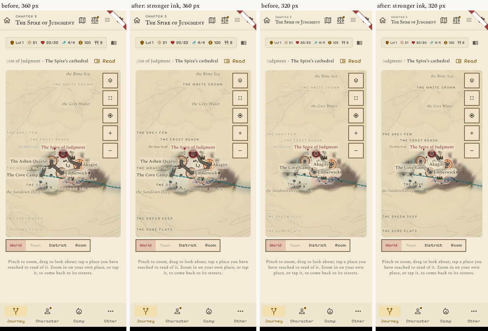
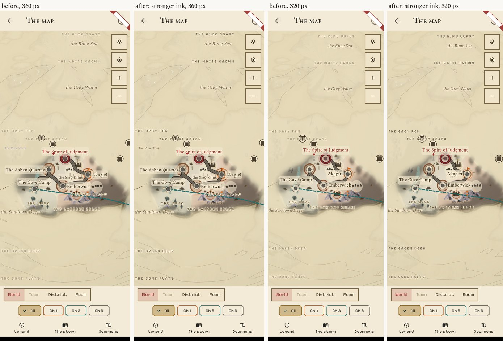

What to judge: on Night the gain is small to the eye; on Parchment it is the difference between
guessing and reading. Reached and unreached are now closer to each other.

## 2. The small print on the ball, bigger

Lands from 10 to 12 px at the least, ranges and woods to 12, notes under a mark to 12, works to 13.

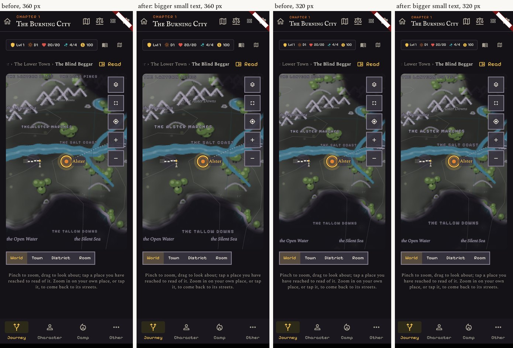
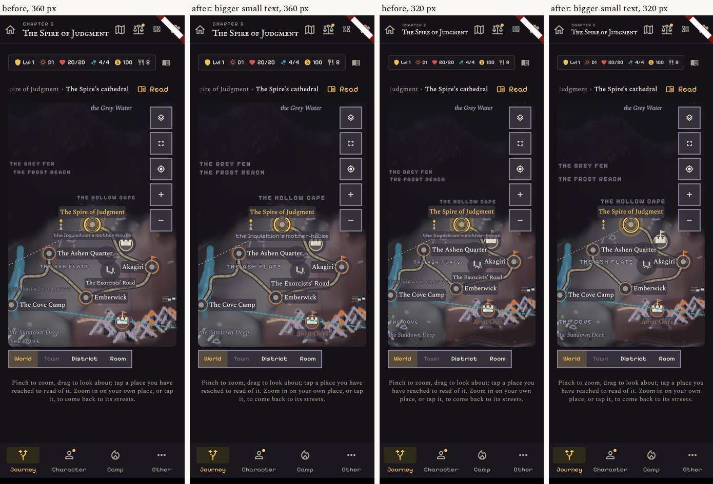

What it costs: bigger names need more room, so where it is crowded one more name is left off
("THE LONG PINES" at Alster, 360). At 320 the lands' names start to feel heavy beside the places'.

## 3. Lands' names that keep clear of marks, roads and rivers

Today a land's name only avoids other names. After: it first looks for a spot clear of the walked road,
the rivers and the small marks, further out than today (up to four lines up or down, or a third of its
width to a side); if there is none it falls back to today's rule, so no name is lost.

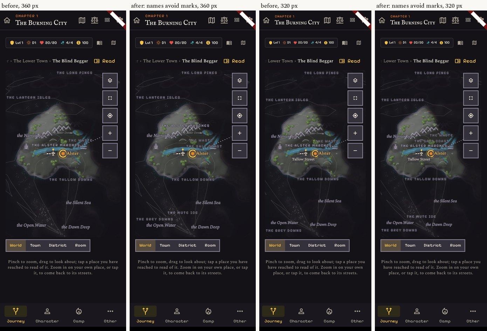
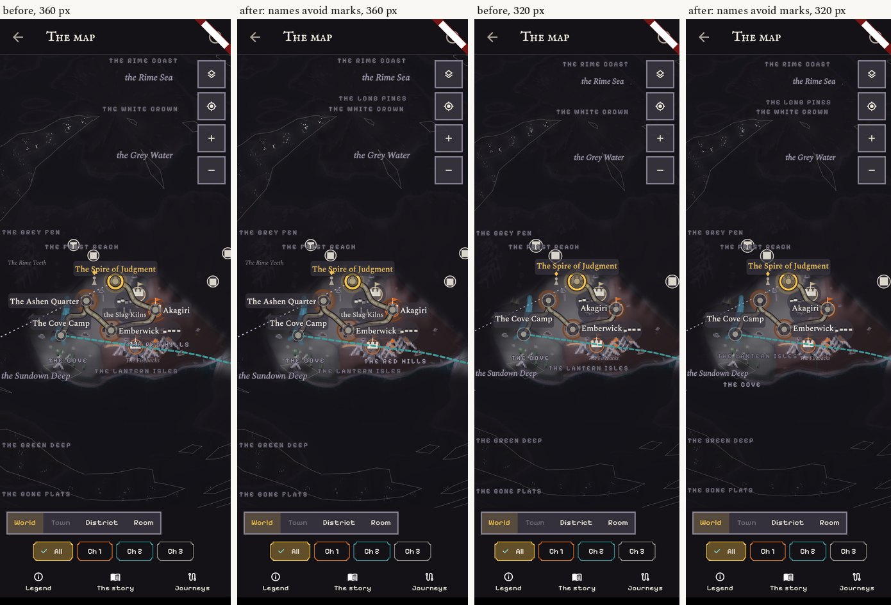
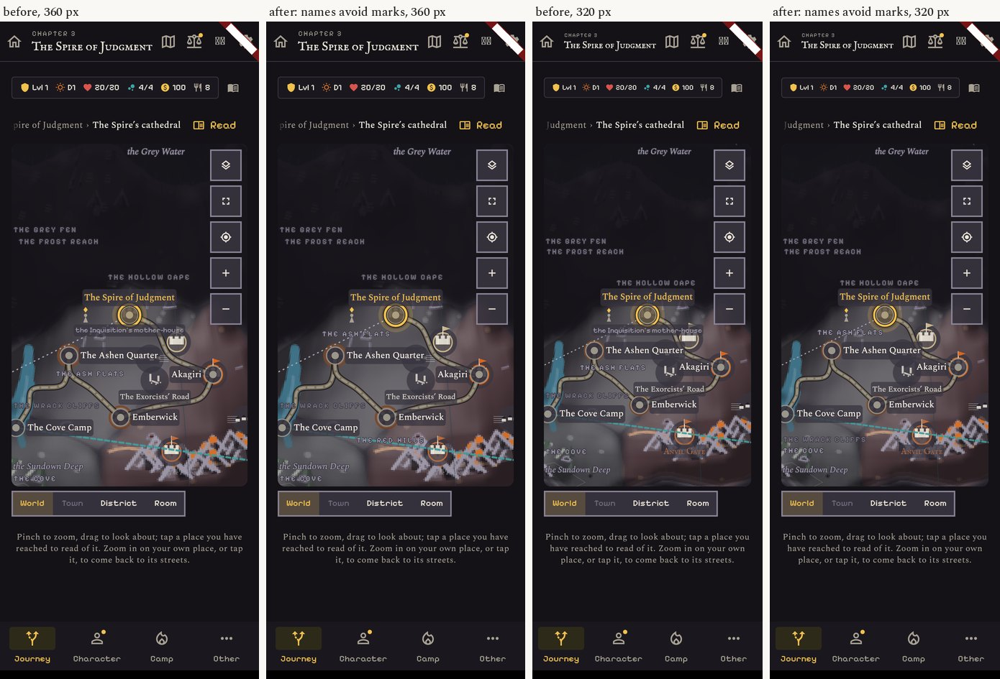

What to judge, plainly: it helps where there is room ("THE RED HILLS" leaves Emberwick's mark and road,
`07`), and names that had no room before now appear ("THE LONG PINES", "THE MUTE ICE"). It does not
help where the land is small and full: at Alster "THE ALSTER MARCHES" leaves the river but lands on the
peaks, and "THE SALT COAST" stays on the river (`06`). Peaks and woods are not avoided in this try. At
320 one name moved next to a range's name (`07`, last screen). A build would need a pass over every land.

## 4. The epilogue map

After: the page's own light look (Parchment under the light theme), no names on the chart (they were
about 4 px high), and numbered marks that sat on each other pushed apart, each tied to its town by a
thin line.

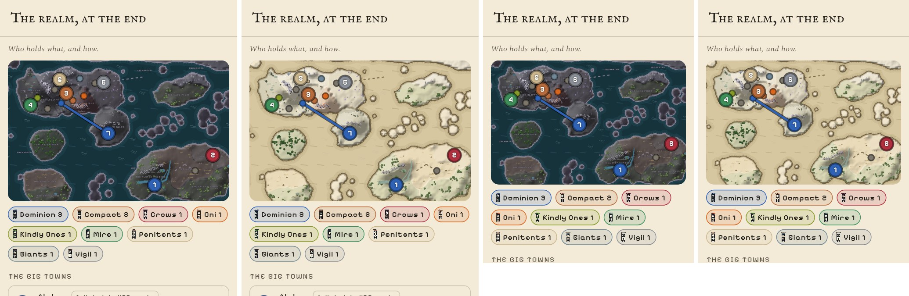

Not done in the picture: a tap on a number scrolling to its line; the small unnumbered dots still have
no name.

## 5. The city plan page as a true zoom of the Town view (option a)

After: the "+" and "−" at the foot on the right, where the Journey's map has them; the level strip under
the plan with Town lit; "Whole city" 44 px high. First screen of each sheet: the Town rung, to compare.

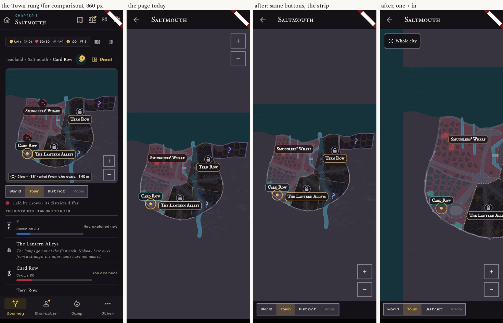
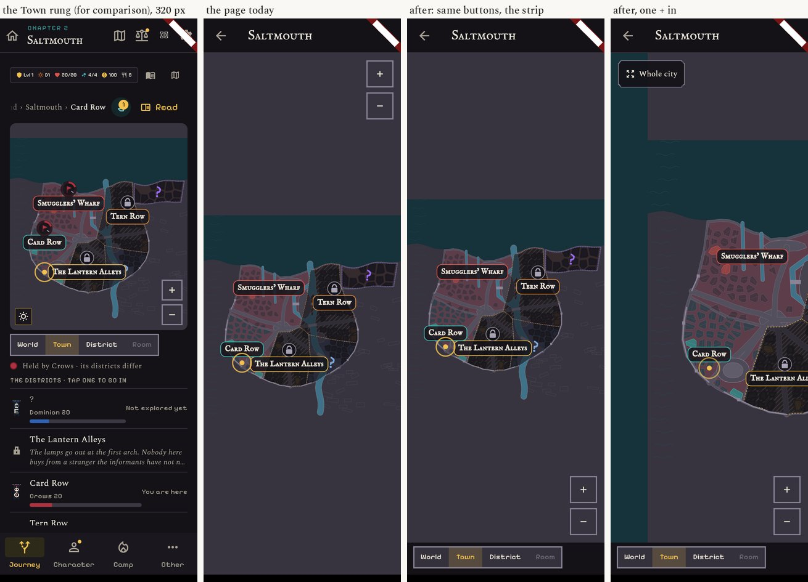
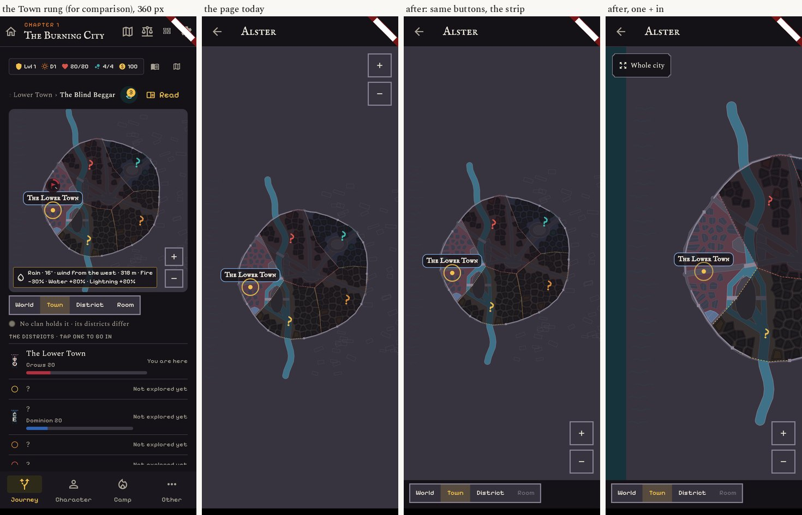
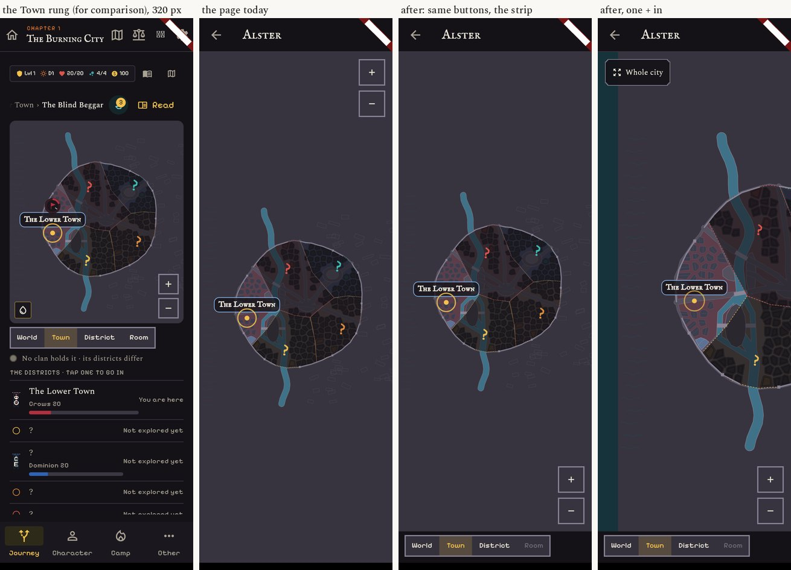

Plainly: in the picture the strip is drawn but not wired (a tap closes the page). The plan still fits
the page's width, so on a tall phone there is empty ground above and below it: a round town cannot fill a
tall page without cutting its sides. The page has no list of districts; the Town rung keeps it.
Wiring the strip means handing the picked rung back to the Journey screen, which Core is splitting now:
to build after that.

## Sizes if built

1 S (with UX for the colours). 2 S. 3 M. 4 M. 5 M (after the Journey screen's split).
