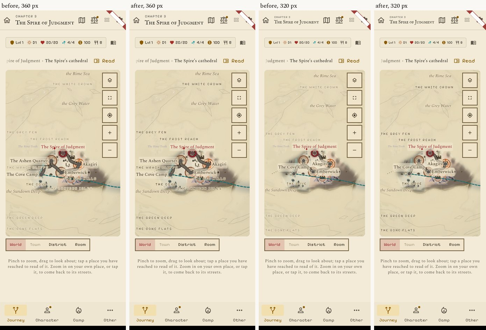
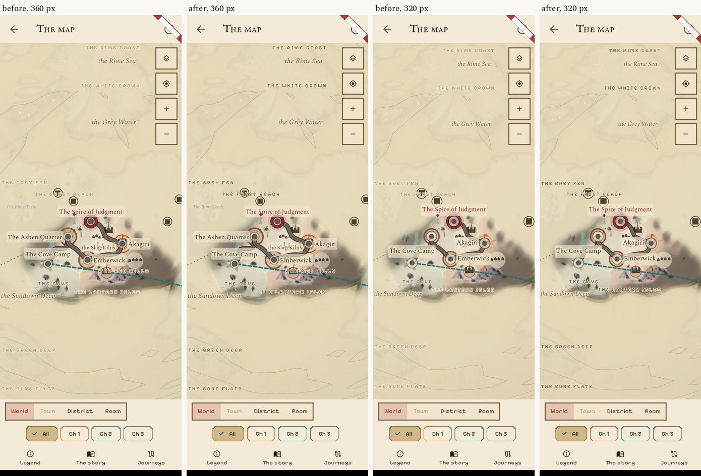
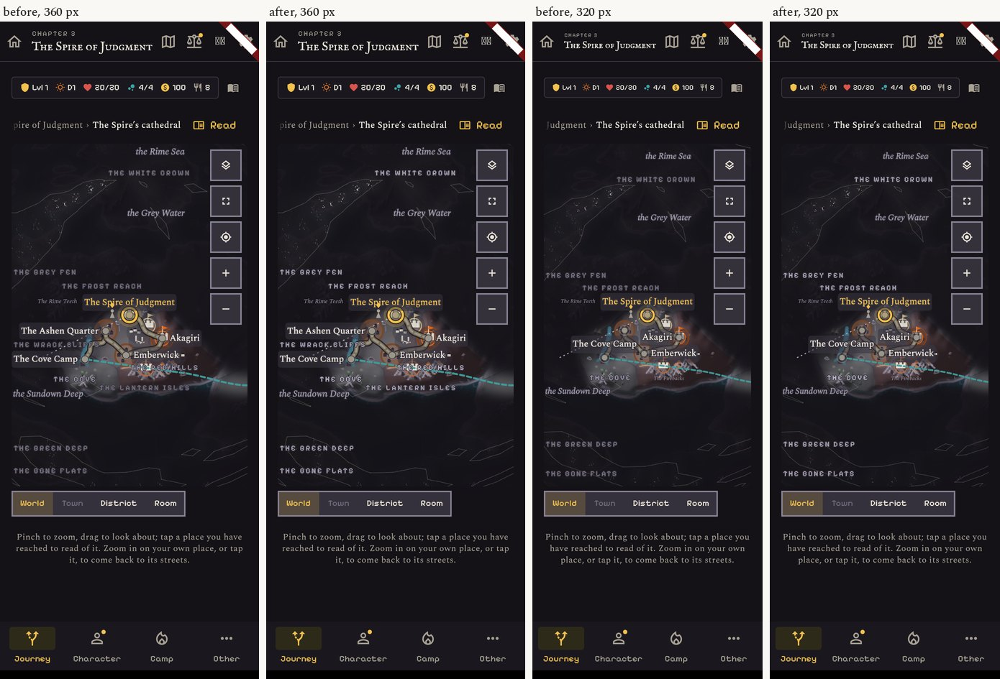
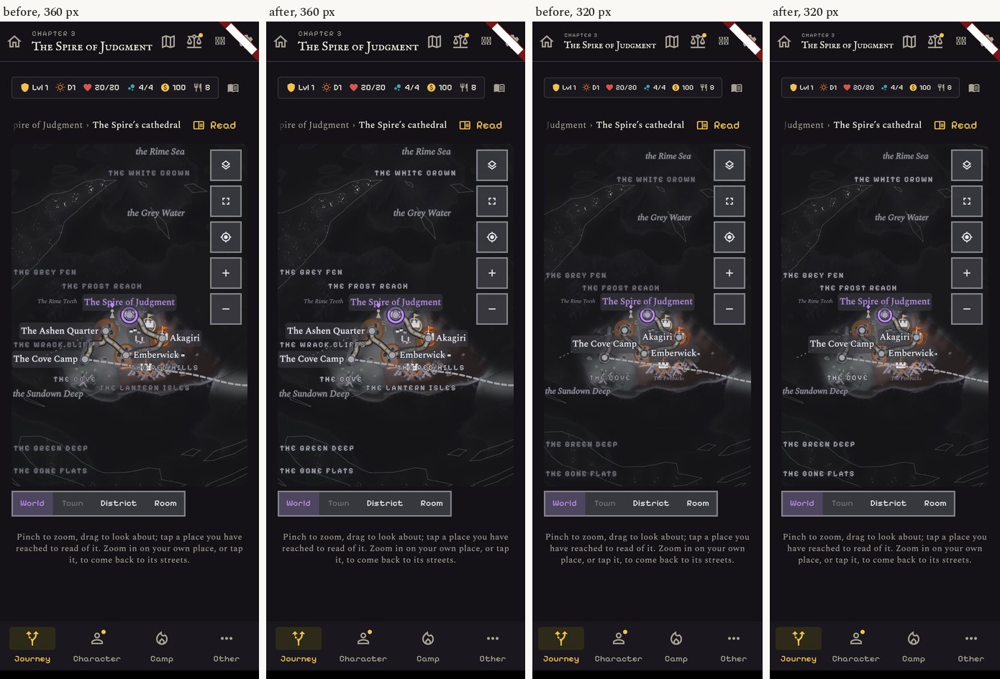

# Built: names of lands not yet reached, in a stronger ink (v2.3.1)

The user's pick from Wave 3. Real screens of this build, mid game, before and after, at 360 and 320 px:
`01`/`02` Night, `03`/`04` Parchment, `05`/`06` Shroud (the World and the full map page).

A land's name is now drawn in the look's own land-name ink, at 85 % strength while the land is not
reached and at full strength once it is. Before: the grey or brown of the chart's small print, at 60 %.

| Look | Ink | Contrast at 85 % on fog / land / sea | Before |
|---|---|---|---|
| Night | `#C9C3D6` | 8.1 / 5.6 / 6.1 | 3.5 / 2.8 / 3.0 |
| Parchment | `#4A3B22` | 5.4 / 5.9 / 4.7 | 2.3 / 2.4 / 2.1 |
| Shroud | `#C4C4CE` | 7.9 / 5.2 / 7.7 | 3.3 / 2.5 / 3.3 |

The three inks are new colours in `lib/data/map_charts.dart` (`ChartPalette.landName`): **for UX to look
at**, colours are UX's. `test/map_land_names_test.dart` holds every look to 4.5 or more.

Unchanged: the names of places, ranges, seas and works; where each name sits; its size.
A reached land's name is also a little stronger than before, since it takes the same ink at full strength.
