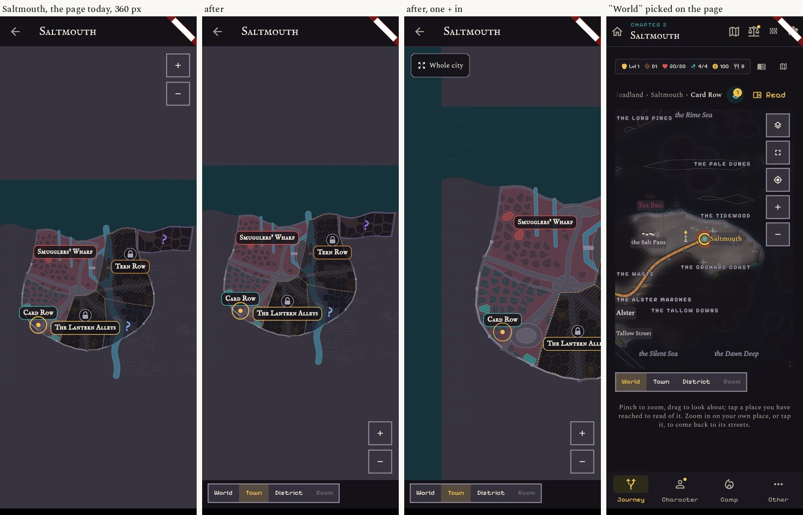
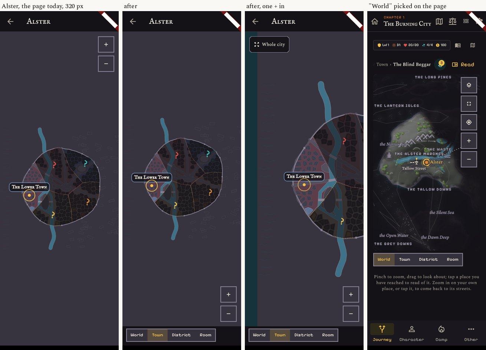

# Held prototype: the city plan page as the Town view enlarged

Built and tested, then taken back out: the app is unchanged. `held.patch.txt` holds the whole change with
its test; `git apply docs/maps/wave3/held/city-plan-page/held.patch.txt` puts it back (made on v2.3.1).

Pictures, real screens of the build, 360 and 320 px: `01`/`02` Saltmouth, `03`/`04` Alster. Each sheet: the
page today, the page after, the page after one "+", and the Journey after "World" was picked on the page.

## What it does

- "+" and "−" sit at the foot on the right, where the Journey's map has them (today: top right).
- The level strip is under the plan, Town lit. A tap on World, District or Room closes the page and the
  Journey goes to that level. **Wired and tested**, not only drawn.
- "Whole city" is 44 px high (was 34).
- A way picked on the plan still closes the page with that way, as today.

## What it does not do

- The plan still fits the page's width, so a round town leaves empty ground above and below on a tall
  phone. Filling the height would cut the town's sides.
- No list of districts on the page; the Town rung keeps it.
- Edit Mode's preview of the page keeps its buttons at the top.

## Files

- `lib/screens/city_chart_screen.dart`, `lib/widgets/city_chart/city_chart_view.dart` (Maps').
- `lib/screens/journey_screen.dart`, a shared screen: about fifteen lines where the page is opened, to take
  a rung back as well as a way. Nothing under `lib/screens/journey/`.
- `test/city_chart_page_test.dart` (new): the strip with Town lit, the buttons at the foot at 44 px, World
  and District picked on the page.

## Checked

Format and analyze clean; the 118 test files that show a city plan or the Journey pass (501 tests).
Not tried on a real phone. No new string.
