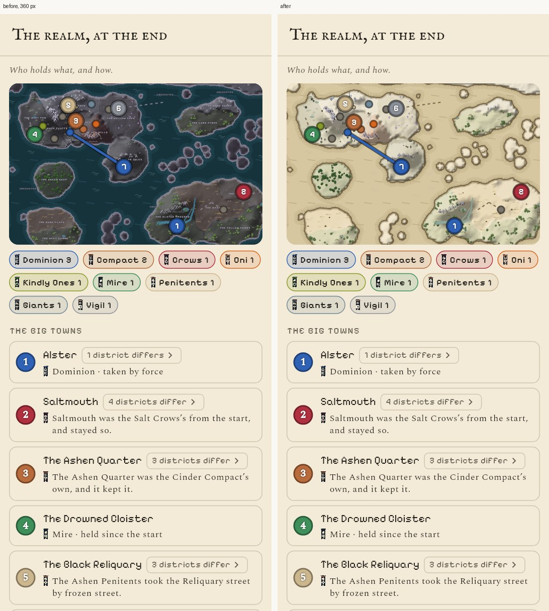

# Held prototype: an epilogue map that reads on a phone

Built and tested, then taken back out: the app is unchanged. `held.patch.txt` holds the whole change with
its tests; `git apply docs/maps/wave3/held/epilogue-map/held.patch.txt` puts it back (made on v2.3.1).

Pictures, real screens of the build: `01` at 360 px, `02` at 320 px, before and after.

## What it does

- On a light page the chart wears Parchment, so it is no longer a dark slab in the page; on a dark page it
  keeps the look the player chose.
- No names on the chart. They were about 4 px high; the towns are named in the list under it.
- The big towns' numbers no longer sit on each other: two that would overlap are pushed apart, each tied to
  its town by a thin line.
- A tap on a number brings that town's line into view (the page is built whole so a line still off screen
  can be reached). Still with "reduce motion": it jumps.

## What it does not do

- The small dots of the other towns still have no name.
- The map cannot be zoomed.
- The numbers on the chart are in the pixel digits, where a 5 reads close to an S and a 2 close to an 8.
  The list's numbers are in the serif digits. Putting the serif digits on the chart is a font choice: UX's.

## Files

- `lib/screens/epilogue_map_screen.dart` (Maps').
- `lib/widgets/chart_map_painter.dart`: one new option, `names`, on by default.
- `test/map_epilogue_test.dart` (new): overlapping numbers are pushed apart and a lone one stays put; the
  chart is Parchment with no names on a light page; at 360 x 640 a tap on the seventh number brings its
  line from below the fold into view.

## Checked

Format and analyze clean; the epilogue's own test and the map tests pass (93 tests).
Not tried on a real phone. No new string.
