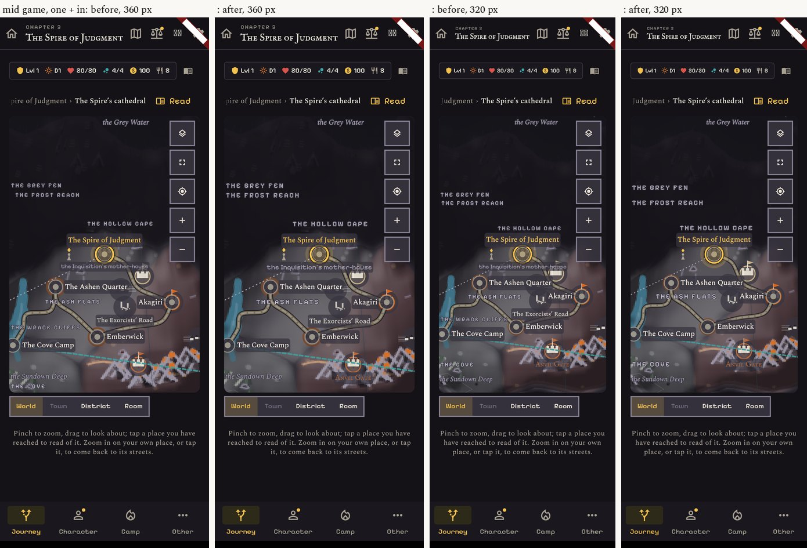
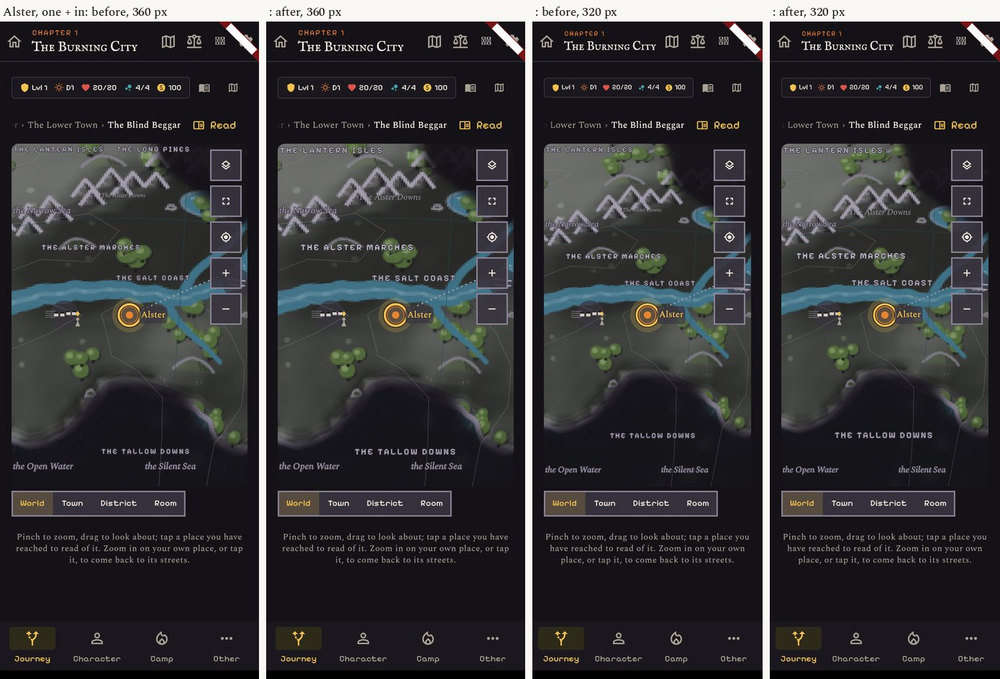

# Held prototype: the small print on the ball, bigger

Built and tested, then taken back out: the app is unchanged. `held.patch.txt` holds the whole change with
its test; `git apply docs/maps/wave3/held/globe-text/held.patch.txt` puts it back (made on v2.3.1).

Pictures, real screens of the build, before and after at 360 and 320 px: `01` Alster one "+" in,
`02` Alster's opening view, `03` mid game one "+" in, `04` mid game on the full map.

## What it does

No name on the ball is drawn under 12 px any more:

| Name | Least size before | After |
|---|---|---|
| Lands | 10 px | 12 px |
| Ranges and woods | none (they shrank with the zoom, to about 7 px) | 12 px |
| Villages and works | 11 px | 12 px |
| A clan's seat | 12 px | 13 px |
| The note under a mark | 10 px | 12 px |
| Places | 12.5 px | 12.5 px (unchanged) |

## What it costs

Bigger names need more room, and a name with no clear spot is left off. In the pictures: mid game at
360 px, "THE WRACK CLIFFS" and "THE COVE" are gone one "+" in (`03`); at Alster "THE LONG PINES" is
gone at 360. At 320 the lands' names start to weigh as much as the places'.
It would sit well with the held "names avoid marks" idea, which finds more room for the lands' names.

## Files

- `lib/widgets/chart_map_painter.dart`: three constants and the four places that use them.
- `test/map_small_print_test.dart` (new): no least size under 12 px; a seat at least as big as the small
  print, a place at least as big as a land.

## Checked

Format and analyze clean; the map tests pass (95 tests, with `map_readability` and `map_poi_zoom`).
Not tried on a real phone. No new string.
