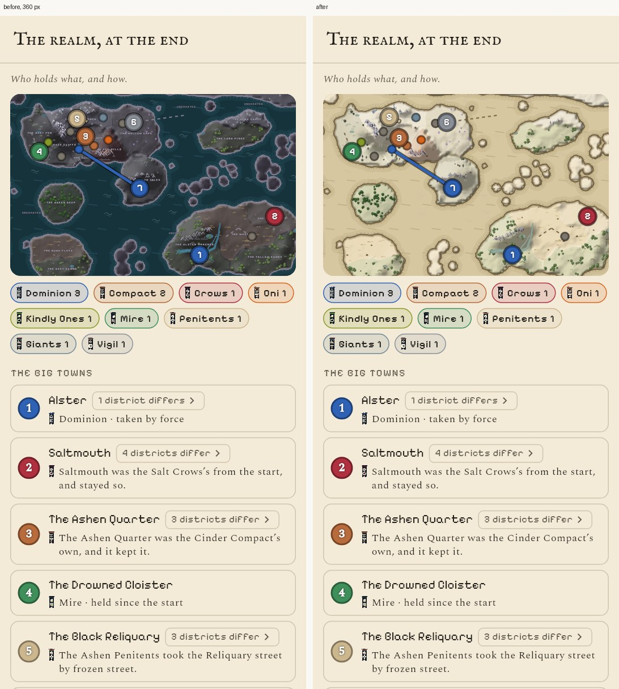
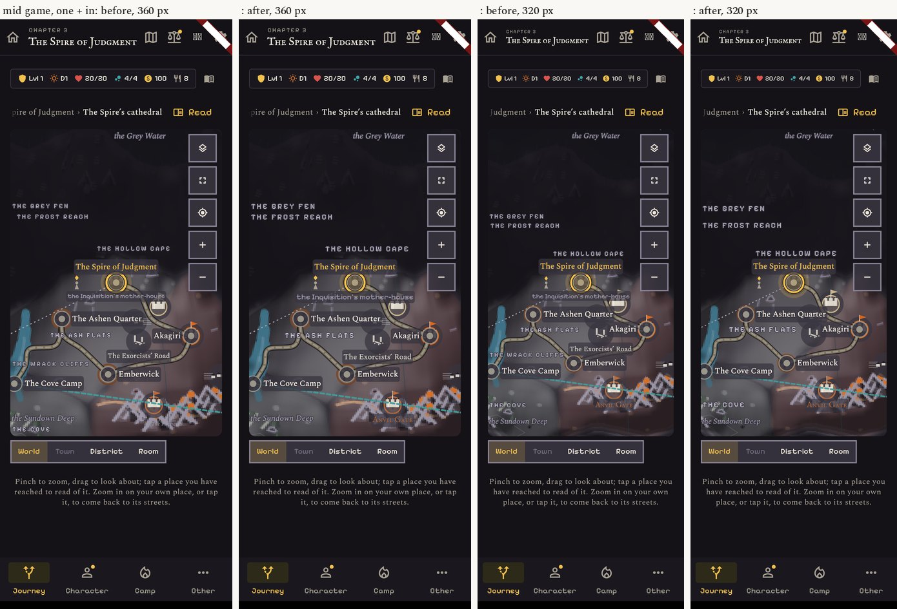

# Shipped in v2.8.1: the epilogue map, the globe's small print, the ring at 20 a second

The user's pick of 24 November. The two prototypes were applied from their held patches unchanged; their
pictures and notes are where they were:

- **The epilogue map**: `held/epilogue-map/` (`01-epilogue-360.jpg`, `02-epilogue-320.jpg`, before and after).
  The page's light look, no names on the chart, numbers pushed apart, a tap on a number brings its line up.
- **The small print on the ball**: `held/globe-text/` (`01` to `04`, before and after at 360 and 320).
  No name under 12 px; where it is crowded a name is left off.

## The party's ring, 20 times a second

On a town, a district or the city plan page left alone, the ring was the only thing moving, and it asked
for a frame at every refresh of the screen. It now breathes from a clock of its own, 20 beats a second:
the same two-second breath in 40 steps.

Measured in `test/city_chart_layers_test.dart`: over one second of 60 refreshes the ring moves 20 times
and a frame is asked for on 20 of them (60 before). It stands still with "reduce motion" and while the
plan is under another page, as before.

To the eye: the breath is slow (4 px of radius over a second), so 20 steps a second read as smooth in a
test build's frames; not tried on a real phone.

## Not shipped

The city plan page as a zoom of the Town view stays held on `claude/maps-2` (`held/city-plan-page/`).
