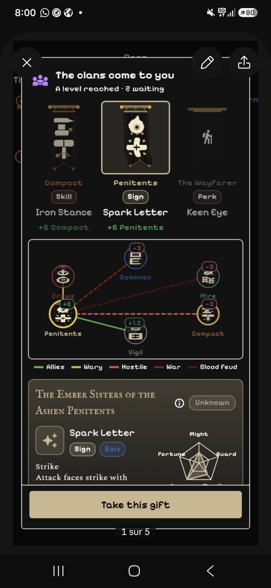

# Banner choice: the design the user picked

The user picked this condensed design for the "clans come to you" popup (wave 8, item 2). UX builds it as v1.381.0.

From top to bottom:
1. **The banner row.** Each banner shows its clan, a chip for the kind of gift (Skill, Sign, Perk), the gift's name and the standing it brings (+6 Compact). The selected banner is framed.
2. **The relations ring.** The chosen clan sits on the ring with its relation lines to the others, each with its standing badge. A legend sits under it: Allies, Wary, Hostile, War, Blood Feud.
3. **One block.** It has the clan's full name, an (i) button and the standing chip on its header line. Under it, on the left, the gift (icon, name, kind and rarity chips, what it does) and on the right, the radar.
4. **"Take this gift"**, pinned at the bottom.

Also asked by the user:
- A long press on a banner (in the row, on the ring, and on the Throne screen) opens the clan's details: its orientation (alignment, faith, what it stands for, tags) and a short recap of its backstory. The (i) button opens the same.
