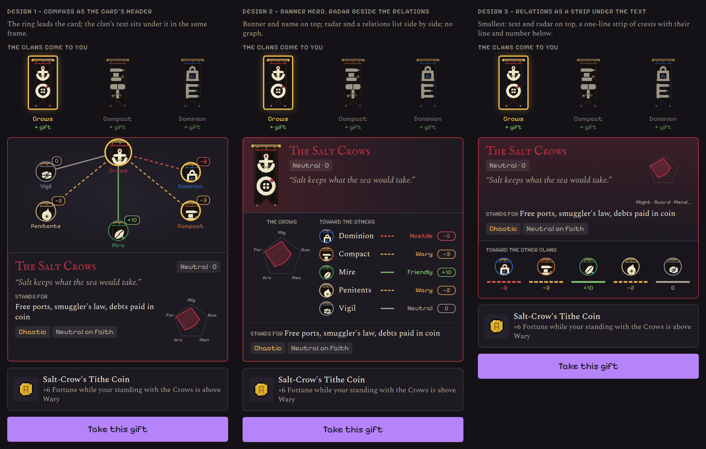

# Banner choice, one block (design, not built)

Today ("The clans come to you") the relations graph and the clan card are two
blocks: a ring of crests with Wary / Hostile lines and +10 / −8 chips, then,
below it, the clan's name, standing, quote, "stands for", alignment and radar.
The ask: **one block**. Kept in all three designs: the gift row on top (the
offered banners, one selected), the gift detail and **Take this gift** at the
bottom, the small radar and the relations.

Mockups use sample text (the Salt Crows selected, the Crows' relations:
Dominion hostile −8, Compact wary −3, Mire friendly +10…). Overview:
`images/banner-choice-overview.png`.

## Design 1: the compass as the card's header
`images/banner-choice-1-compass.png`

The ring is the top of the card; the selected clan's crest sits on top and
bigger, its lines run to the others (solid friends, dashed foes, coloured by
step, as in the Clans tab), the number rides each crest. Under it, inside the
same frame: name, standing tag, quote; "stands for" and alignment on the left,
the small radar on the right.

- Pro: the relations stay the picture they are today; nothing new to learn.
- Con: tallest of the three (about the screen's height with the gift row).
- Build: reuse `ClanCompass` (Wave 7 D) inside the card with `focusId`; the card
  frame takes the selected clan's colour.

## Design 2: banner hero, radar beside a relations list
`images/banner-choice-2-hero.png`

No graph. The card opens with the clan's banner large and its name on a wash
of its colour. Under it two columns: the radar, and a list "toward the others"
(crest, line style, the step's word, the number). "Stands for" and alignment
close the card.

- Pro: the most readable at 320 px; the words (Hostile, Wary) are spelled out
  and can be sorted (foes first).
- Con: loses the "map" feel of the ring.
- Build: new list widget over `politics.relationStep`; `ClanRadarChart` as is.

## Design 3: relations as a strip under the text
`images/banner-choice-3-strip.png`

The smallest. Name, standing, quote, "stands for", alignment and a small radar
on top; one line under them: five crests, each with its line (solid or
dashed, coloured) and its number. Tap a crest to name the clan and the step.

- Pro: fits the gift row, the card and the button without scrolling on most
  phones.
- Con: the least rich; lines between the *other* clans are not shown.
- Build: strip over the same data; `ClanRadarChart` at 88 px.

## Recommendation
Design 1 if the ring is what players like (the user kept it in the last
round); Design 3 if the popup must fit one screen. Design 2 is the safest for
small screens and French (longer words). A tab or an expander is not proposed:
the ask is to *see* the relations while choosing.

## Notes for build
- Shared: the selected clan's colour frames the block; the gift row keeps its
  gold ring on the selected banner and dims the others.
- New strings (EN + FR) only for Design 2's heading ("Toward the others") and
  Design 3's tap hint.
- Files: `lib/widgets/offer_dialog.dart` (UX), `clan_compass.dart`,
  `clan_radar_chart.dart`. No Core data needed.
