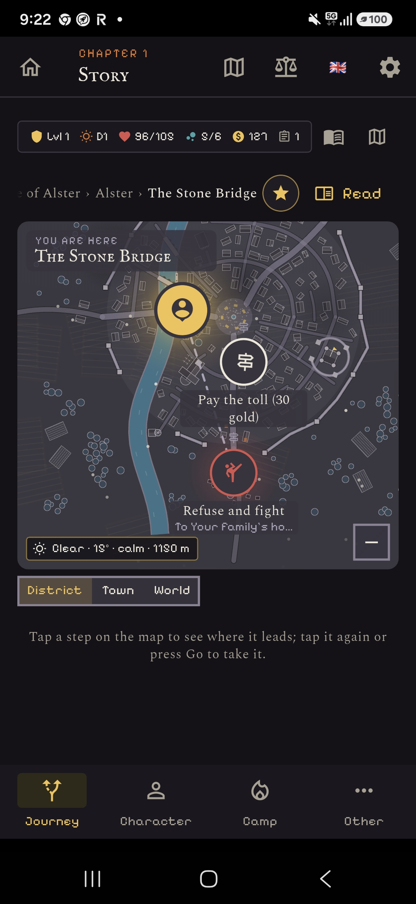
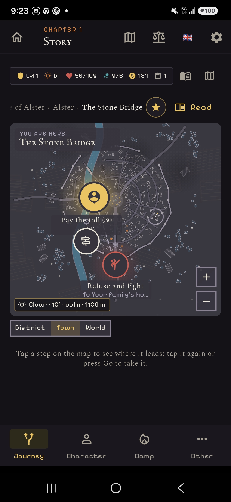
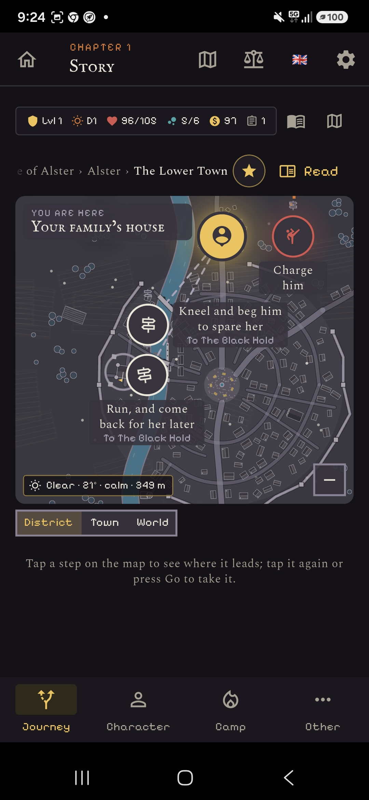

# Choices that keep you in place: brief for mockups

## The problem
On the journey map, every choice is drawn as a pin, even when it doesn't move the player. At the Stone Bridge, "Pay the toll" and "Refuse and fight" are pins around "You are here". At the family house, "Charge him", "Kneel and beg him" and "Run" are too. Labels overlap the marker and each other (Town zoom).

  

Core measured all 1,061 choices: 62% stay in place, 32% walk within the same location, 6% travel elsewhere. 61% of the multi-choice scenes have only in-place choices. Core is adding `lib/data/choice_shape.dart` (move: stay / walk / travel; action: fight, pay, talk, sneak, attempt, evade, go, decide).

## The four designs the user wants to see
1. **Choice list under the map.** The map shows only choices that move you, as pins at their destination. Under the map, every choice is a card: an action icon, the text, a cost or "→ destination" tag. Tapping a card highlights its path on the map, or pulses the marker if it stays.
2. **Scene panel.** At a step whose choices keep you in place, the map dims and a panel slides up with a small vignette (who you face) and the choices as buttons. The map comes back after.
3. **Ring around the marker.** In-place choices are 2–4 small action icons in a ring on "You are here", their labels in one list under the map. Choices that move you stay as pins.
4. **Stage mode.** The map zooms to District, your sprite and the other character's face each other, and the choices come out of your sprite as speech bubbles. Choices that move you are arrows at the map's edge.

Use the two screens above (the Stone Bridge, the family house) in each mockup, in English, at phone size.
