# Choices that keep you in place: four designs, then two additions

Mockups only, nothing built. The brief is `docs/proposals/inplace-choices-brief.md` on the manager's branch (`ccr-76229db7-131ulj`), with the user's three screenshots. The problem in one line: on the Journey map every choice is a pin, and 62% of choices don't move the player, so the labels pile on the marker and on each other.

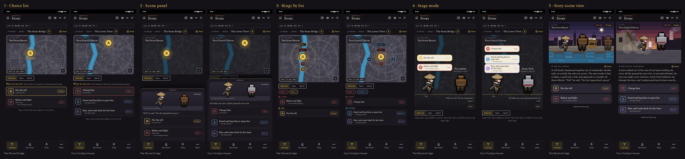

## What the mockups show

Two scenes, English, phone size (411 × 890), in the app's own look (Stitched Ink fonts, the walker sprite, the foes' icons). The map is drawn to look like the District zoom; it is not the real map painter.

**The rule they follow (Core's #315, `choice_shape.dart`).** A choice is `here` when it is acted out where you stand (a fight, a payment, a check, a decision), even when its aftermath moves you. That is 848 of the 1,061 choices (80%). Only the plain `go` choices (213) are real pins. So in every design the `here` choices sit **at the marker** (list, panel, ring or bubbles), with a small "→ destination" line when the aftermath moves you, and **pins (or edge arrows) are kept for plain `go` choices only**.

| | The Stone Bridge (node 260) | Your family's house (node 400) |
|---|---|---|
| **Pay the toll** | pay, tag `30 gold` (the price comes from the next scene's `reqGold`; you have 127) | |
| **Refuse and fight** | fight the slum thug, → Your Family's House afterwards | |
| **Charge him** | | fight Aurel Vane |
| **Kneel and beg him to spare her** | | decision, `Good +2`, → The Black Hold afterwards |
| **Run, and come back for her later** | | decision, `Evil −2`, → The Black Hold afterwards |

Neither scene has a plain `go` choice, so **neither map has a pin**: only "You are here". That is the point, but it also means these two screens do not show what a `go` choice looks like. In each design it is the same thing it is today: a pin at its destination with its path, and in design 4 an arrow at the map's edge. (Say if you want a third screen with a `go` choice.)

**Tags.** Each choice carries one tag at the right: a cost (`30 gold`), a kind (`Fight`) or an alignment shift (`Good +2`), and the "→ destination" goes on its own line under the text when there is one. They come from what the choice already has (the next scene's `reqGold`, `triggerEnemyId`, `alignmentMod`, the next scene's location). Action icons follow Core's action list: fight, pay, talk, sneak, attempt, evade, go, decide.

**Stand-ins.** There is no art for Aurel Vane, so the mockups borrow the Inquisition Warden's icon. Foes have 128 px front-facing icons only, not side-view sprites; design 4 needs those (see below).

## 1. Choice list under the map

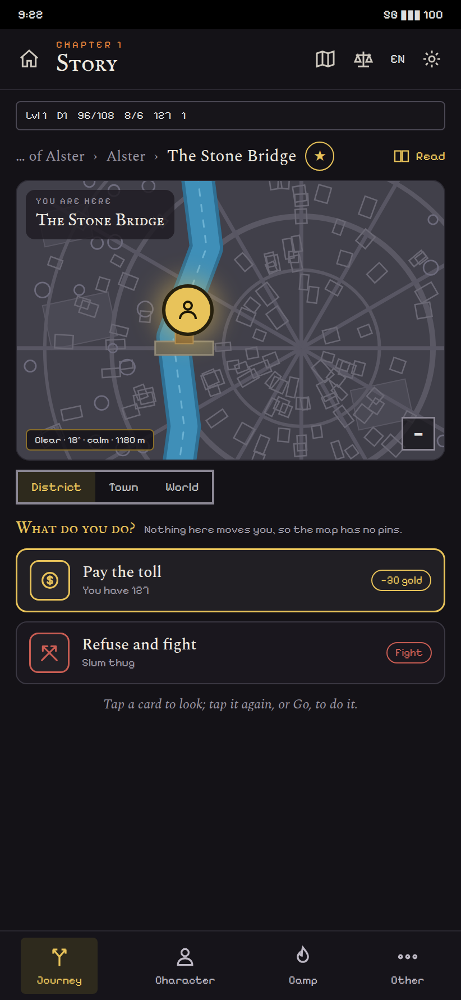 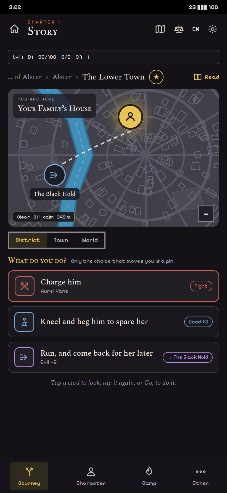

The map keeps only the plain `go` choices, as pins at their destination (none on these two screens). Under it, every `here` choice is a card: action icon in its colour, the text, a note line (what you have, who you fight, → where it leads on) and a tag at the right. The first card starts selected. Tapping a card highlights its path on the map, or pulses the marker when it stays; tapping it again, or Go, does it.

- **For:** the smallest change. Nothing overlaps because text lives in a list and never on the map. Reads the same for 1, 2, 5 or 8 choices. Works at 320 px and in French (the text wraps in the card, not on a pin). The tap-twice rule stays as it is today.
- **Against:** reads as a menu, not as a place. The map is a long way from the choices when the list is long.
- **Build:** new `ChoiceList` widget in `lib/widgets/`; the map's pin layer keeps only `go` choices (`!here`); the pin and the card share one selection state. No new art.

## 2. Scene panel

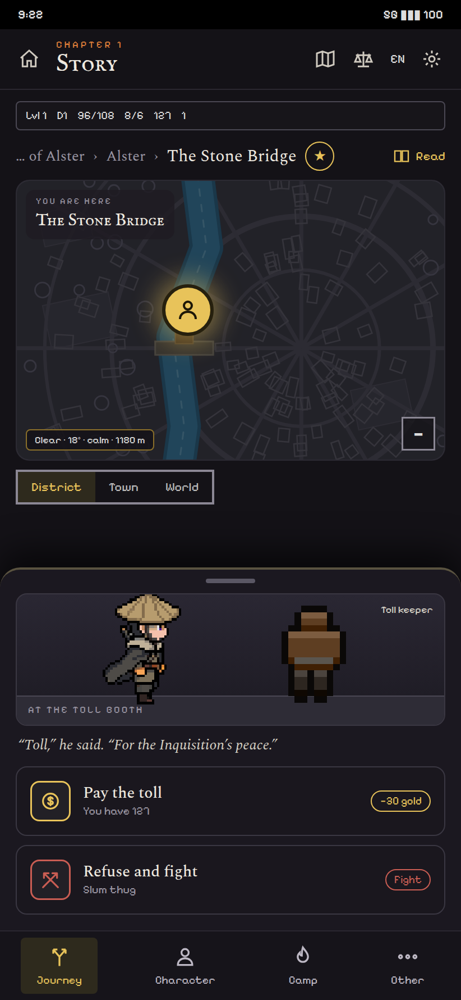 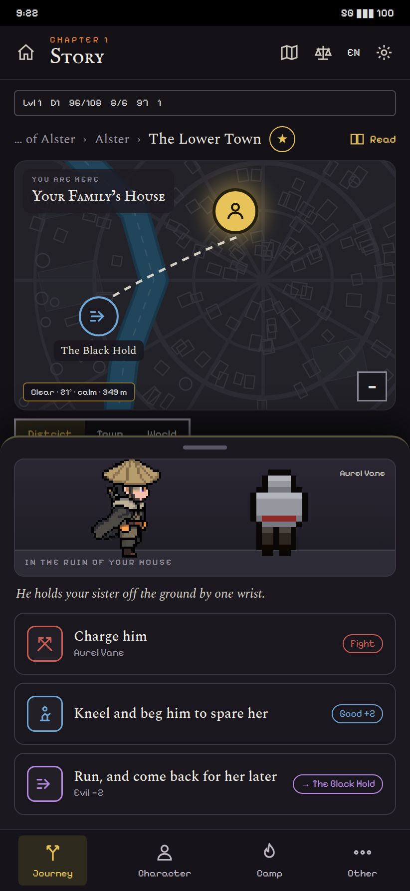

When the step's choices are `here` choices, the map dims and a panel slides up: a small vignette (you, the one you face, the place's name), the line the scene ends on, and the choices as large buttons. The map comes back after. A plain `go` choice still shows its pin on the dimmed map.

- **For:** it says "you are in a moment, answer it". The vignette gives the other person a face. Big buttons are easy to hit.
- **Against:** it covers most of the screen, so a 5-choice scene scrolls inside the panel. It hides the map exactly when the player may want to see where "Run" goes. Two kinds of step now look different, so the rule for which one you get has to be exact (every choice `here` → panel, otherwise → list?).
- **Build:** a bottom sheet (like the reward card), a `SceneVignette` that needs the foe's picture (icon today), and the "line the scene ends on", which is the last sentence of the node's text or a new `prompt` field from Narrative.

## 3. Rings by list, with a chip

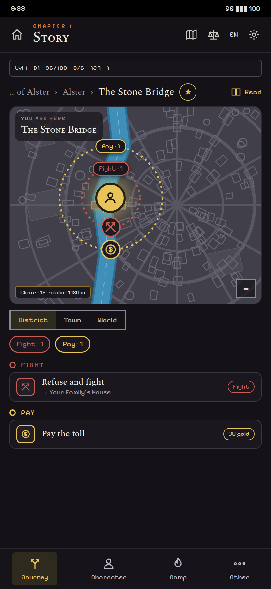 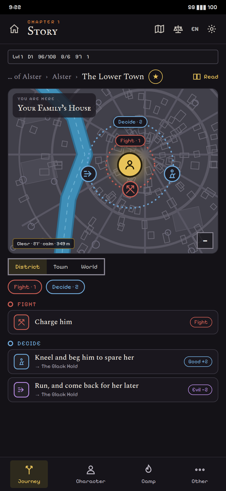

Revised after the user's note: **one ring for each list, and a chip that opens the list.** The `here` choices are grouped by kind (Core's action: fight, pay, talk or decide, check), and each group is its own ring around "You are here", with a chip on the ring ("Fight · 1", "Pay · 1") and the same chip under the map. A ring holds up to 5 icons and a "+N" icon for the rest; tapping a chip, on the ring or under the map, opens that list (a sheet of cards, as in design 1) and lights its ring. A plain `go` choice stays a pin with its path. A scene with 2 or 3 choices shows 2 small rings and its lists stacked under the map (above); a **town hub with many choices has several rings**:

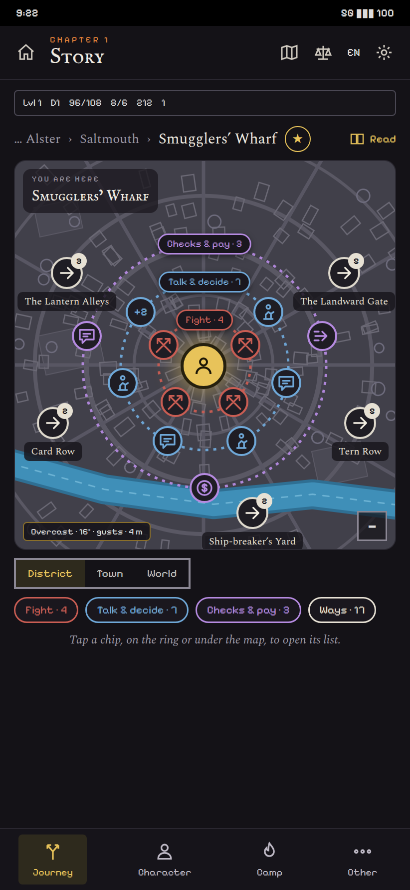 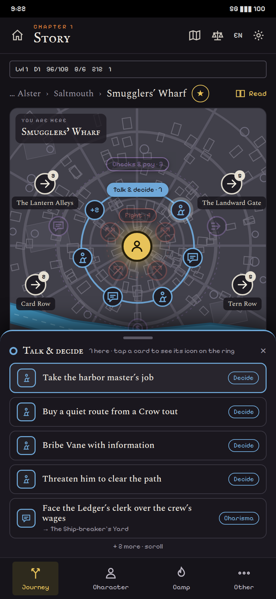

The example is a real hub, Smugglers' Wharf (node 2015 of the story, 31 choices). By Core's `choiceShape`: 14 are `here` (4 fights, 7 talks and decisions, 2 checks, 1 payment), shown as three rings (Fight · 4, Talk & decide · 7, Checks & pay · 3), and 17 are plain `go` choices, shown as pins at their places with a count (The Landward Gate 5, Tern Row 5, The Lantern Alleys 3, Card Row 2, The Ship-breaker's Yard 2) and one "Ways · 17" chip. The second screen has the "Talk & decide" chip open: its ring is lit, the others dimmed, and the sheet lists its cards (the first card's icon is lit on the ring).

- **For:** the map stays the place where things are. Each ring is one short, learnable list, so a hub never needs more than 3 or 4 rings. The chip, not the icon, is what you read, so the icons need not carry meaning alone.
- **Against:** a hub whose choices are all one kind overflows its ring: the Reliquary Quarter (node 6010) has 28 choices, 23 of them `decide`, so one ring says "+18" and its list is long. That hub needs a second way to group (by who you talk to, which means a speaker or place field on the choice, from Narrative) or a search in the sheet. The rings sit on top of the buildings around the marker.
- **Build:** design 1's list (as the sheet), a ring layer on the marker (one ring per non-empty group, chips at the top of each ring, stacked), a "Ways" chip for the `go` pins, and the grouping rule (Core's action, with fight, talk and decide, checks and pay as the four lists).

## 4. Stage mode

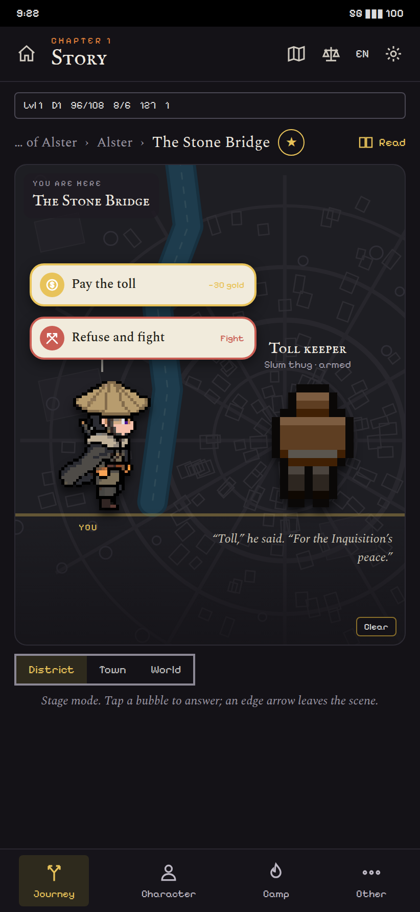 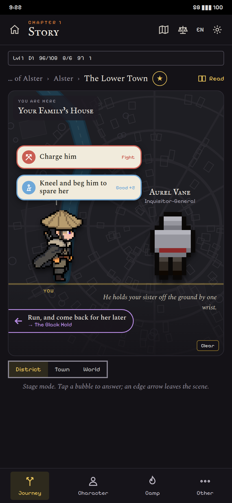

The map dims and zooms to the District; your sprite and the other character face each other on the ground line, the choices come out above your head as speech bubbles (icon, text, tag), and their line sits under them. A plain `go` choice is an arrow at the map's edge, pointing the way and naming the destination (not on these two screens).

- **For:** the most like a game and the most readable: nothing overlaps because the choices are above the heads, and who you face is on screen. It is also the one that works for dialogue and fights alike.
- **Against:** the most work. It needs a standing side-view sprite for every foe and NPC who can be faced (we have the hero's walker and 128 px front-facing foe icons, so every one of them is new art, in the style of the side-view kit). A long choice text wraps to 2 or 3 lines in a bubble. It takes the whole top of the screen, and a scene with 5 choices needs a scrolling stack.
- **Build:** a `StageScene` widget on the side-view painter engine, a facing sprite per foe or NPC (or a portrait fallback for those without one), bubbles from the same list as design 1, and edge arrows (a new small widget). The biggest of the four.

## Side by side

| | 1 List | 2 Panel | 3 Ring | 4 Stage |
|---|---|---|---|---|
| Fixes the overlap | yes | yes | yes | yes |
| Keeps the map in view | yes | dimmed | yes | dimmed |
| Many choices (5+) | yes | scrolls | several rings, one chip each | scrolls |
| French and 320 px | yes | yes | yes | tight in bubbles |
| New art | none | a vignette | icon set | a sprite per foe and NPC |
| Cost | small | medium | medium | large |

## 5. Main story: a scene view, like the explorations

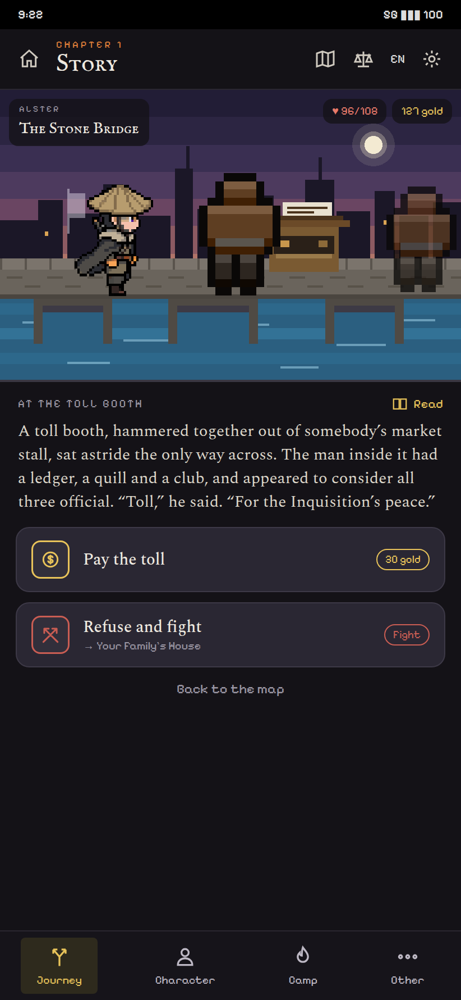 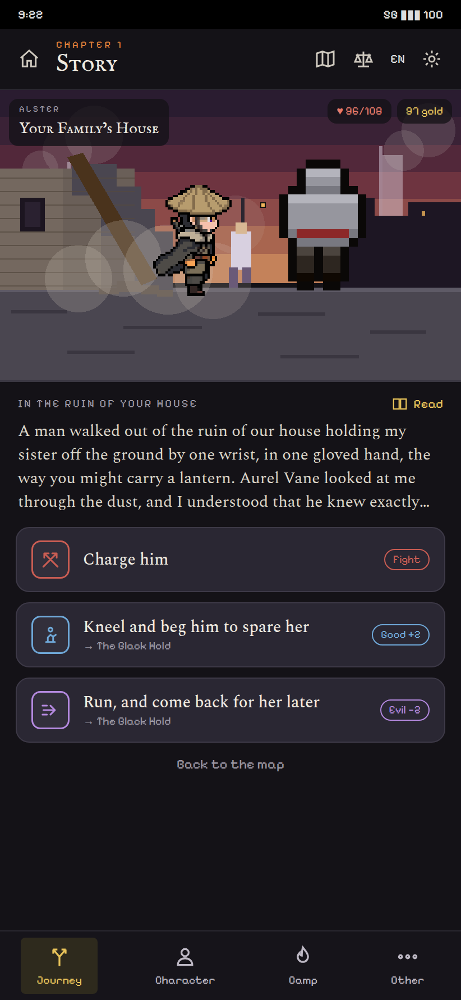

Added at the user's request: for the main story, **the scene view the explorations have**. The land crossing and the detours already play on a screen with a side-view scene on top (`SideViewScene`, the walker in front of a kit), the text under it and the choices as buttons (`LandCrossingScreen`). The story's steps get the same screen: a **side-view scene** of the place with you facing the one you speak to (the toll keeper at the Stone Bridge; Aurel Vane in the ruin of the house), a small header with the place and your health and gold, the **node's text** (four lines, "Read" for all of it), and the **choices as buttons**: action icon, text, tag (a cost, `Fight`, an alignment shift), and a "→ destination" line when the aftermath moves you. "Back to the map" returns to the Journey map.

This is how a step that is a *scene* reads; a *hub* (Smugglers' Wharf) is still the map, with design 3's rings. The map is where you go; the scene is what is said and done where you are.

- **Needs art:** a kit per `ui_theme`. The story's 426 nodes use 14 themes (docks 131 nodes, cathedral 94, slums 52, catacombs 48, desert 10, torture chamber 6, sewers 5, hovel 4, gate 4, bridge 3, market 1, and the prologue, the origin endings and the epilogues). Ten kits cover the story's play; the desert one exists. The mockups draw two (bridge, ruined street) in the app's pixel look. A scene also needs a facing sprite for who you speak to; foes have front icons only, so until a sprite exists the scene can show the portrait icon instead.
- **Needs from Core and Narrative:** a "who you face" per node (an enemy or NPC id; many nodes are narrator-only and show just the scene) and, for the weather and time, what the Journey map already has.
- **Build:** a `StoryScene` screen on `LandCrossingScreen`'s layout, kits per theme on the existing side-view engine, the choice buttons from design 1's card. It replaces the Journey map for the nodes that are scenes (every node with a `ui_theme` kit and no hub), and the map's list and rings stay for the hubs.

## Recommendation

Two layers, one set of cards:

1. **The choice card** (design 1's: icon, text, tag, "→ destination") is the common part everywhere: in the scene view's buttons, in a list under the map, in a ring's sheet.
2. **The main story's steps play as scene views** (5), like the explorations.
3. **Hubs and towns stay on the map**, with design 3's rings by list and a chip each, and pins only for plain `go` choices.
4. Designs 2 (panel) and 4 (stage) are what 5 grows into if the scene should be more theatrical: 4 is a scene view whose choices are bubbles over the sprites. If the user likes 5, 2 and 4 need not be built.

Build 1's card and the map's pins filter first (it fixes the overlap alone, in a few days), then the rings, then the story scene kits one theme at a time (docks and slums first: they hold 183 of the 426 nodes).

## What I need

- **Core:** per choice, its tag data (cost, alignment shift, the aftermath's destination name) next to `choiceShape`'s move, action and `here`; the price of a toll-style choice comes from the next scene's `reqGold`, so `choiceShape` or a sibling should expose it.
- **Narrative:** for the scene view and designs 2 and 4, a "who you face" per node (an enemy or NPC id), and a short `prompt` line for each choice node (today the last sentence of the text is quoted). For hubs with many choices of one kind (the Reliquary Quarter), a way to group them beyond the action (who they are about).
- **User:** which design to build, and whether the list may sit under the map on a phone where the map takes the top half.

The files for the mockups: `docs/proposals/images/inplace-{1-list,2-panel,3-ring,4-stage,5-scene}-{bridge,house}.png`, `inplace-3-ring-town.png`, `inplace-3-ring-town-open.png` and `inplace-overview.png`.
