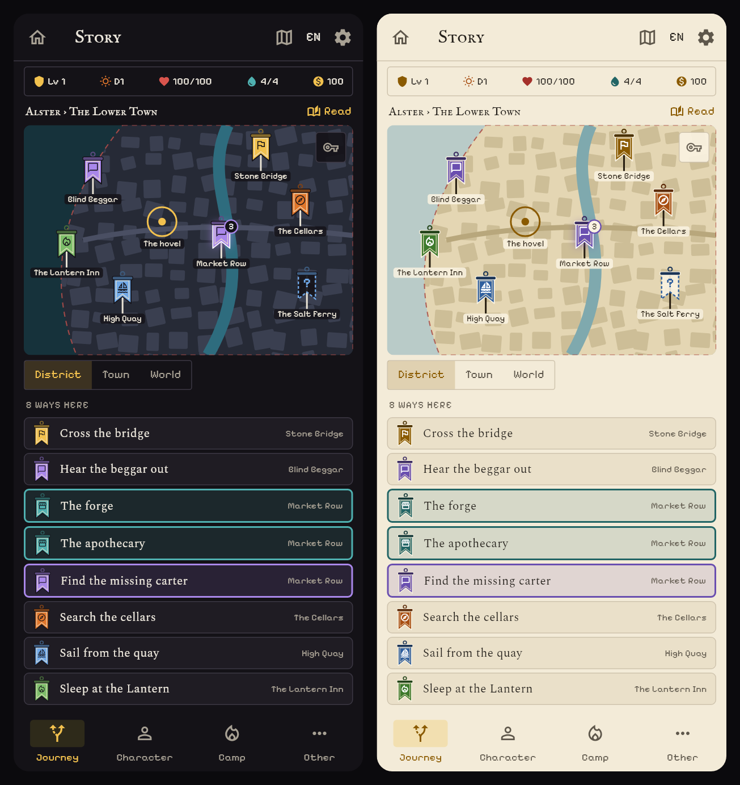
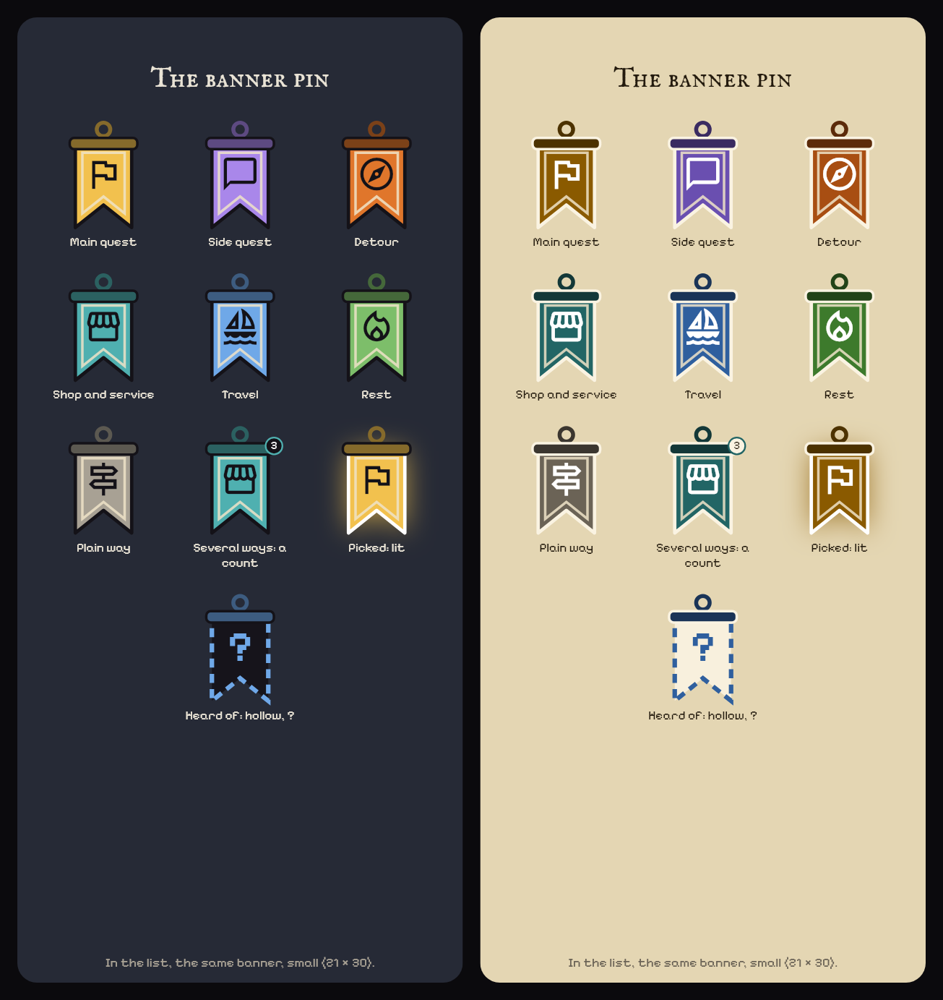
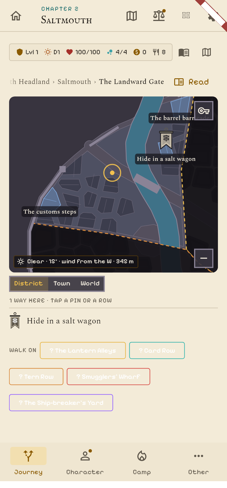

# The Journey map's pins as banners

The user's pick from `docs/proposals/journey-pins-scene.md`: **A's logic, in the shape of the clans' hung banners** ("instead of a simple pin, a pin banner, a rectangle banner like the clans banner form; keep the same icons and logic as A"). Mockup first; **built in v1.440** (see "Built" at the end).

## The shape

Drawn after the clans' banners (`assets/visuals/banners/clan_*.png`, `pixel_banner.dart`): a **ring and a rod** across the top, a **cloth** with straight sides and a **swallow-tail hem**, a **cream cord** inside the edge, and the category's **icon** on it. The cloth is the **category's colour** (the clans' are black with a coloured header; a pin has to read by colour at 26 × 38 px, so the colour moves to the cloth and the rod takes its darker shade). It hangs from a **pole planted at the place's spot**, so the foot of the pole is where the place is and the label sits under it.

Kept from A:
- the most important way decides the colour and the icon (main, side, detour, shop, travel, rest, plain), the same seven categories;
- **a count badge** at the rod's corner when a place holds several ways (Market Row: 3);
- picking a pin lights it (a white cord and a glow) and **lights its ways in the list together**;
- the **list rows wear the same banner**, small (21 × 30), instead of the disc;
- a place only **heard of** is a **hollow banner**: a dashed edge in the Travel blue, "?" on the cloth (The Salt Ferry), as the "Aller à" chips were.

The key button and the legend sheet are approved as drawn; with banners the legend's discs become these banners (same colours, icons and lines).

## Build (when the version comes)

`BannerPin` is a small `CustomPaint` plus the icon (see `test/ux_journey_pins_mockups_test.dart`, which draws these boards); it would live in `lib/widgets/journey_banner_pin.dart` and replace the disc in the pin layer, the list rows and the legend. The pole's foot is the pin's anchor, so the map's hit areas, labels and the 'journey_step_*' keys stay where they are. Pixel versions of the seven icons are art UX would draw after; the banner takes whatever glyph the category has.

Pictures: `docs/proposals/images/journey-banner-pins.png` and `journey-banner-pins-closeup.png`, drawn by `test/ux_journey_pins_mockups_test.dart` (the `banner` tests, with `UX_SHOTS=<folder>`).

## Built (v1.440)

- `lib/widgets/journey_banner_pin.dart`: `JourneyPinCat` (the seven categories, folded from `JourneyStepKind` and the quest tie by `journeyPinCatOf`), `BannerPin` (widget), `paintBannerPin` (canvas, for the city chart), and the legend sheet.
- **Where a banner hangs:** the district view's pins (the city chart's painter, hem on the building, same tap area as the round pin), the Journey's own marks (the land and room maps), the rows under the map and the ways' cards in the lists.
- **What keeps its round pin:** fights and rolls (`fight`, `check`, `challenge`), played where the party stands; they keep their number, and their row its number.
- **The key button** at the top right of the map opens the legend (a sheet: each banner, its name in its colour, one line).
- **Not in this slice:** the count badge and the "heard of" hollow banner. The district chart pins one way per building and a place only heard of is still the "Walk on" chip; both need a place-level grouping that does not exist yet (the arrival scenes' PR, with Core's `choiceFlow`).
