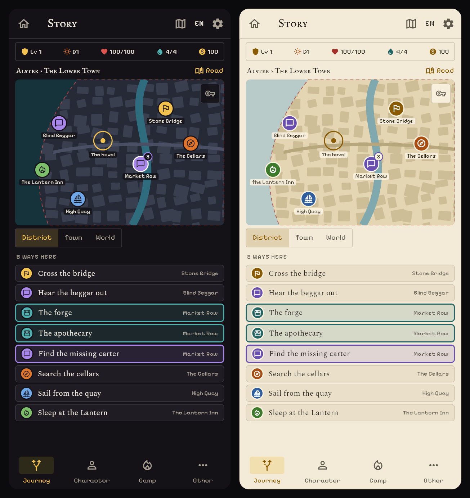
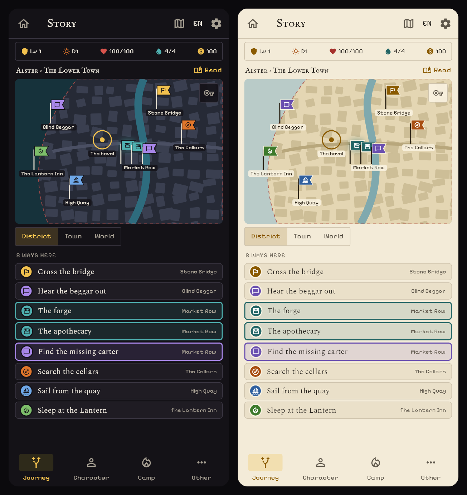
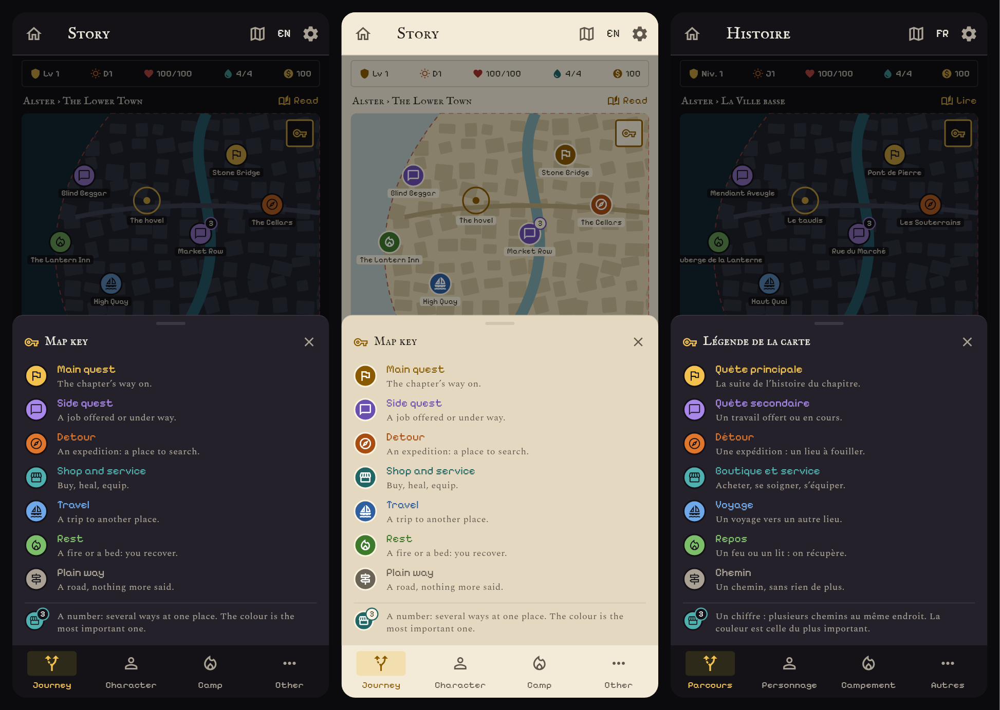
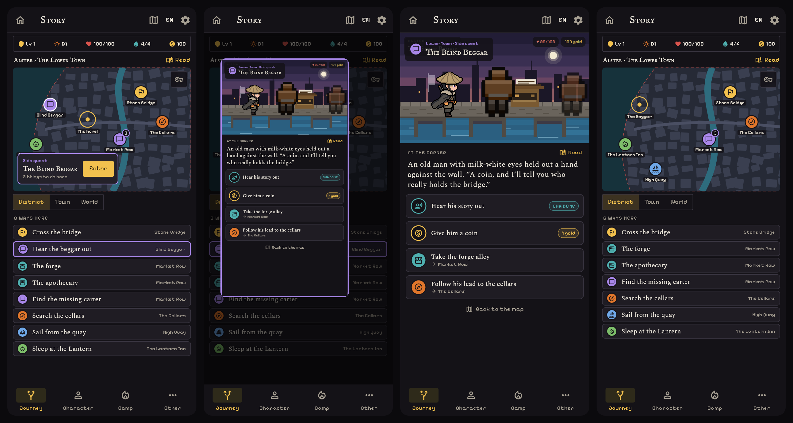
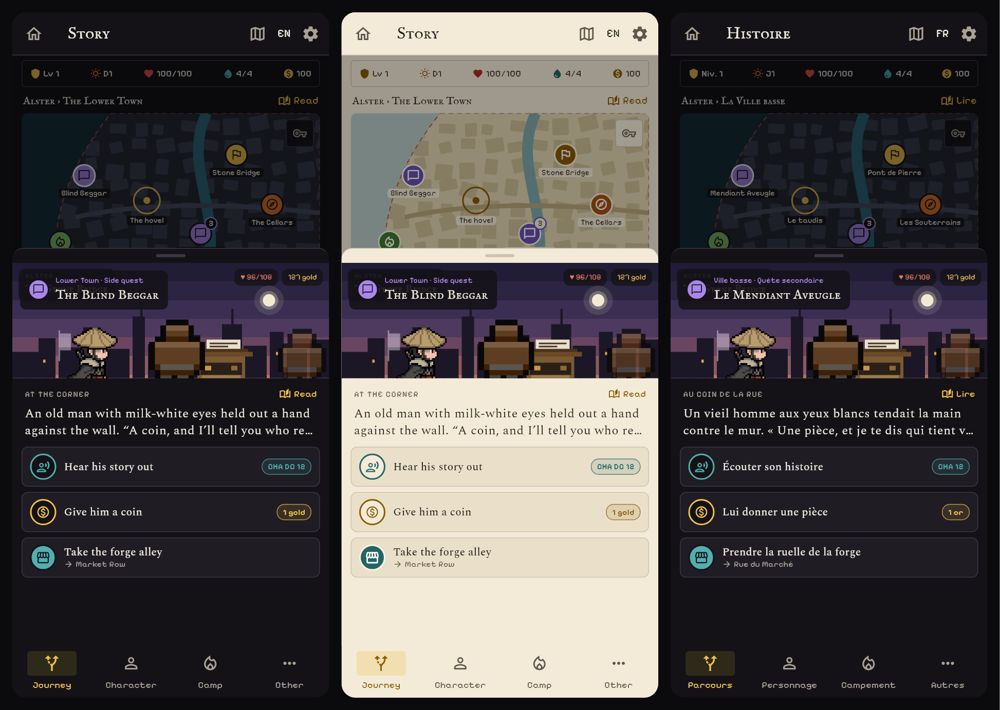

# The Journey map: pins by category, a legend, and a scene on arrival

Mockups only; nothing is built. The brief is the user's feedback on the Lower Town district view (`docs/proposals/images/feedback-journey-district-map.jpg` on the manager's branch):

> On the journey map design, instead of having 1, 2, 3, … add categories of quests (main, sub, detours, shops…) as colours, with a legend available by opening a popin. Each type has a specific icon. When going to a location, instead of adding the choices at the bottom, open a "scene" like the story mode in the edit mode.

What the screenshot shows: a numbered pin ("1"), the line "1 chemin ici" with a numbered row under the map, and "Aller à" chips. The number says only "there is a way here"; nothing says what kind.

## What the Journey already knows

The data is mostly there. Each way is a `_Step` with a `JourneyStepKind` (`journey_map.dart`), a glyph per kind (`journey_glyph.dart`) and a quest tie (`JourneyQuestTie.main/side`):

| Kind today | Glyph | Colour today |
|---|---|---|
| `mainQuest` | flag | gold (the chart's mark colour) |
| `quest` (someone offers work) | speech bubble | **gold** |
| `shop` | shop (forge, apothecary, anchor… by id) | **gold** |
| `expedition` (a detour) | compass, or by zone (cave, ruin, wood, sea…) | ember |
| `travel` | sailboat | tide (teal) |
| `check`, `challenge` | die or ability glyph | tide (teal) |
| `fight` | foe glyph | blood |
| `rest` | fire or bed | green |
| `road` (plain way) | signpost | ash |

The problem the user sees is real: **the main quest, side quests and shops are all gold**, and rolls and voyages are both teal. And on a map that has not been given a colour per kind (the Shroud look keeps colour for the Void and the main mark only), the number is all there is. Since #340 the choices acted out where the party stands (fights, rolls, payments, decisions) are cards, not pins, so a pin now means a way to a place: main, side, detour, shop, travel, rest or a plain road. That is the set this proposal names.

## The seven categories

Each has a colour **and** an icon, so the colour never carries the meaning alone (the Shroud look, colour-blind players). The icons are the glyphs the marks already use; pixel versions of the seven are art UX would draw next.

| Category | Icon | Dark / light colour | Folds these kinds |
|---|---|---|---|
| Main quest | flag | gold | `mainQuest` |
| Side quest | speech bubble | violet | `quest`, any way with a side quest tie |
| Detour | compass | ember | `expedition` |
| Shop and service | storefront | teal | `shop` |
| Travel | sailboat | blue | `travel` (voyage, road to another place) |
| Rest | flame | green | `rest` |
| Plain way | signpost | ash | `road` |

Fights and rolls keep their action cards (red and teal); they are not pins.

## 1. Pins by category

Three ways to draw the same district (Lower Town, with a main way at the Stone Bridge, a side quest at the Blind Beggar, a market row with three ways, a detour into the cellars, a voyage at the quay and an inn). Dark and light, phone size, English.

### A. Discs with a count

A disc in the category's colour with its icon, the place's name under it. A place with several ways shows the disc of **the most important one** (main, then side, detour, shop, travel, rest, plain) with a small count badge. The list under the map is the same discs, one row per way, and a place's ways light up together when its pin is picked (Market Row: forge, apothecary, the carter).

- **For:** the closest to today's marks (a disc with a glyph), the least change, the clearest. The legend is the discs themselves.
- **Against:** a place with a main way and three shops shows only the gold disc; the shops are in the count and the list, not on the map.

### B. Flags

A pole with a banner in the category's colour and icon. A place with several ways plants up to three flags side by side, then a count.

- **For:** the most "game": a camp of banners reads as a place with several things. Every category shows at once.
- **Against:** flags are taller and wider than discs, so a hub crowds the map and flags cover the roads; the labels under them collide sooner. Three flags at Market Row already sit on the street.

### C. Disc with a ring of ways

A disc for the most important way, and a ring of arcs round it, one arc per way, each in its own category's colour (Market Row: teal, teal, violet).

- **For:** the composition of a place at a glance, with no number.
- **Against:** the arcs are thin on a phone and the colours of neighbouring arcs blend; it asks the player to count arcs. Fine for 2 to 4 ways, poor for a hub.

## 2. The legend

A small **key button** at the top right of the map (a key icon, 36 px, in the corner every map button uses) opens a sheet: each category with its disc, its name in its colour and one line, then one line for the count badge. English dark, English light, French dark. The first time the player meets a map with pins, the button pulses once (the unlock-moment dot, no card). The sheet is the same for the three pin options; B and C would add one line for the flag stack or the ring.

## 3. Arriving at a place opens its scene

The way in, as a strip (dark; the light strip is `journey-scene-1-view-light.png`):

1. **Pick.** A tap on a pin (or its row) lights it and shows a callout under it: the category, the place's name, how many things there are to do there, and **Enter**. The way's road shows on the map as it does today.
2. **Open.** The scene grows out of the pin's spot over the dimmed map.
3. **The scene.** The story-step scene view (design 5 of `inplace-choices.md`): the place's side-view art on top with its name and **its category** in the card, the node's text (three lines, "Read" for all of it), then the choices as cards. The things done here (a Charisma check, a coin) carry their action icon and tag; the ways on to other places carry their **category disc** and a "→ destination" line. "Back to the map" returns.
4. **Back.** The party's mark sits at the place, the pins of the new place appear, and the list under the map is the new place's.

### Option S1: a full scene (shown above), as in the explorations

The recommendation. It is the scene view the explorations already have, so it costs the kit per `ui_theme` and nothing else.

### Option S2: a scene sheet over the map

The same content in a sheet that rises over the dimmed map, the picked pin still visible above it; art band 150 px, three cards. English dark, light, French dark.

- **For:** the map stays in view, so "Take the forge alley" and its pin are in the same screen; a place with no kit can show a plain band.
- **Against:** a cramped scene (three lines of text, three cards, scrolling for more), and two layers over a map that is already busy.

The scene art in the mockups is the toll-booth scene of the in-place proposal, a stand-in for the place's own kit.

## Recommendation

- **Pins: A (discs with a count)**, with the category order above deciding the colour of a multi-way place, and the places' ways lit together when it is picked. B is a good look for a **camp** (a few banners round the fire) and could replace A there; C is not worth its cost.
- **Legend:** the key button and the sheet above.
- **Arrival: S1 (full scene)** for places with a kit (the story's nodes with a `ui_theme`: docks and slums first, 183 of the 426 nodes), **S2 as the fallback** for a place with no kit yet, so no place has to wait for its art.
- **The "Aller à" chips** under the map in the screenshot (the places heard of, with "?") fold into the same pins as **Travel** (a hollow disc with "?" while unvisited), so the screen has one way to go somewhere.

## What I need

- **Core:** nothing for the seven categories: they are `journeyStepKindOf` and the quest tie, which the Journey already has. Two small things would sharpen them:
  1. **"Service"** (an inn, a healer, the trainer, the harbour master, a clan court) is `road` today unless the way unlocks a shop. For **Shop and service** to cover them, the place (the geography's place kind) should say which services it holds; a `servicesAt(placeId)` or a kind on the choice would do.
  2. **Grouping by place** for the count badge is what `_pinIdx` already does; no data.
- **Narrative (for the scene):** a "who you face" per node and a short `prompt`, as in `inplace-choices.md`.
- **UX (me):** the pixel icons for the seven categories, and the kit per theme.
- **User:** which pins (A, B or C), and whether S1 may be the default with S2 as the fallback.

The mockups are drawn by `test/ux_journey_pins_mockups_test.dart` (run with `UX_SHOTS=<folder> flutter test`) in the app's own theme, fonts and icons; the map is a stand-in painter, not the real chart. Files: `docs/proposals/images/journey-pins-{1-discs,2-flags,3-ring}.png`, `journey-legend.png`, `journey-scene-1-view.png`, `journey-scene-1-view-light.png`, `journey-scene-2-sheet.png`.
