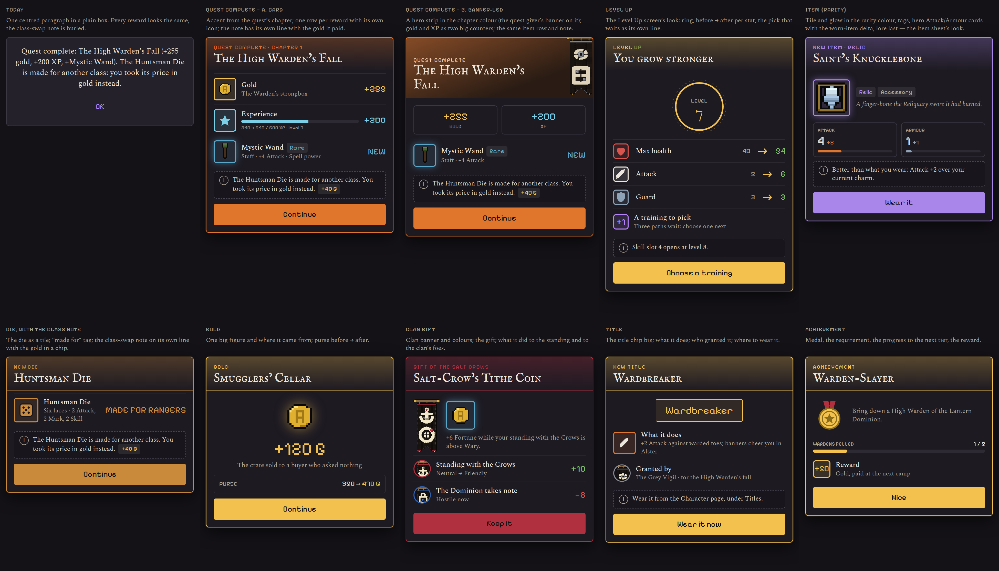

# Reward popups (design, not built)

Today a reward is one centred paragraph in a plain box:

> Quest complete: The High Warden's Fall (+255 gold, +200 XP, +Mystic Wand).
> The Huntsman Die is made for another class: you took its price in gold
> instead.

Everything reads the same, the icon of the thing is missing, and the one
sentence that changes the outcome (the class swap) is buried at the end.

## The system
One **reward card** for every kind, so players learn it once:

1. **Header** in the source's own look: the quest's chapter colour, the clan's
   banner colour, the item's rarity colour. A small kind label (QUEST COMPLETE ·
   CHAPTER 1) over the title in the display font.
2. **One row per reward**: an icon tile (pixel art, rarity-coloured border and
   glow for items), the name, a sub-line, the value at the right (`+255`).
3. **A note line of its own**, set apart (dashed box, "i" mark): class swap,
   "better than what you wear", where to wear a title. The gold it paid is a
   chip on that line.
4. **One primary button** whose label says what happens next (Continue,
   Choose a training, Wear it).

Reduce-motion: no motion beyond the 180 ms page fade; otherwise rows count in
top to bottom (60 ms apart), numbers tick up, a rare item flashes its tile once.

## The kinds
| Kind | Mockup | What it carries |
|---|---|---|
| Today | `reward-0-today.png` | reference |
| Quest complete, A (card) | `reward-1-quest-card.png` | chapter colour; gold, XP with its bar, item with rarity tag; the class-swap note |
| Quest complete, B (banner-led) | `reward-2-quest-banner.png` | hero strip in the chapter colour with the giver's banner; gold and XP as two counters; item row; note |
| Level up | `reward-3-levelup.png` | the Level Up screen's ring; before → after per stat; the pick that waits; Choose a training |
| Item | `reward-4-item.png` | the item sheet's look: tile in rarity colour, tags, Attack/Armour cards with the worn-item delta, lore |
| Die | `reward-5-die.png` | the die as a tile; "made for" tag; the class-swap note with the gold chip |
| Gold | `reward-6-gold.png` | one big figure, where it came from, purse before → after |
| Clan gift | `reward-7-clan-gift.png` | clan banner and colour; the gift; the standing change and what it did to the clan's foes |
| Title | `reward-8-title.png` | the title chip big; what it does; granted by; where to wear it |
| Achievement | `reward-9-achievement.png` | medal; the requirement; progress to the next tier; reward |

A vs B for the quest: A is the same card for every kind (cheaper, consistent);
B is a one-off moment for quests only, with art. Recommendation: A for all,
B's hero strip for quests once chapter art exists (`assets/visuals/quests` is
empty today).

## Build notes
- A single `RewardCard` widget in `lib/widgets/` with a `RewardLine` list
  (icon widget, title, sub, value, tag) and a `note` (text + optional chip).
  The existing sheets (`ItemDetailView`, `TitleDetailView`, the level-up
  screen) keep their own bodies; the card is for the *moment* after the event.
- Core would need to hand over structured rewards instead of one string: the
  list of lines (gold, XP, item id, die id, title id), and the swap as data
  (`swappedForGold: 40`, `reason: wrongClass`). Today the string is built in
  the quest completion code; a small `RewardSummary` model would carry it.
- Strings: kind labels, "Made for {class}", the note texts, button labels
  (EN + FR). Narrative may reword.
- No version bump (docs only); build would be one PR once a design is picked.
