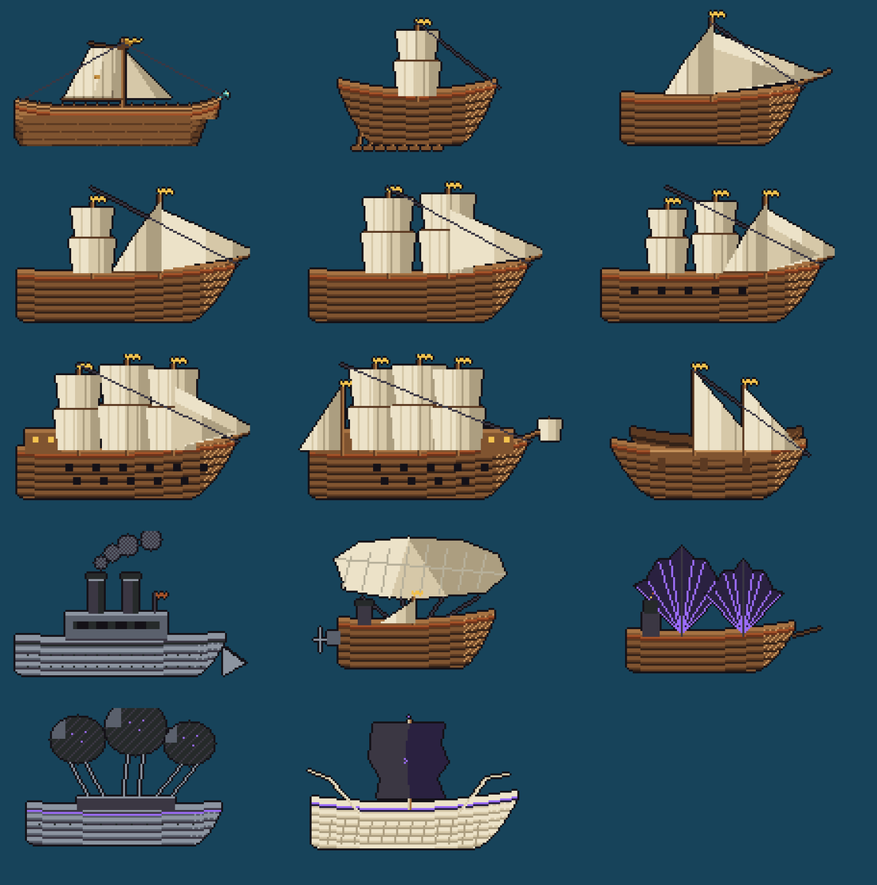
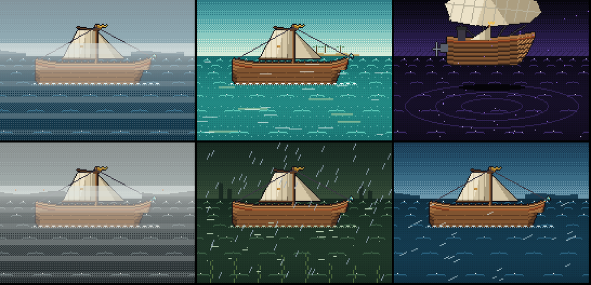
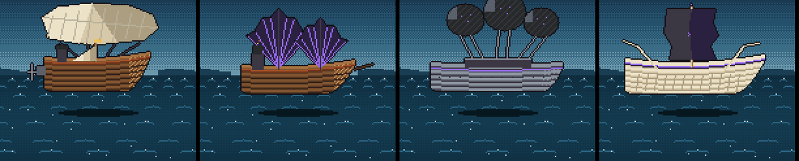
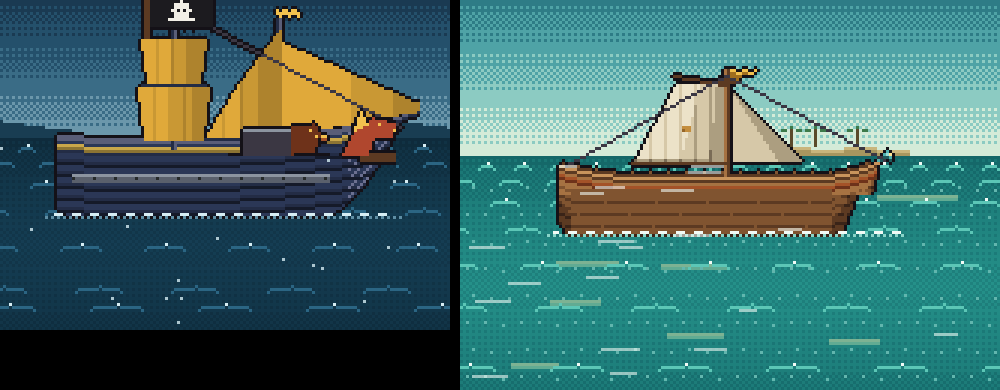
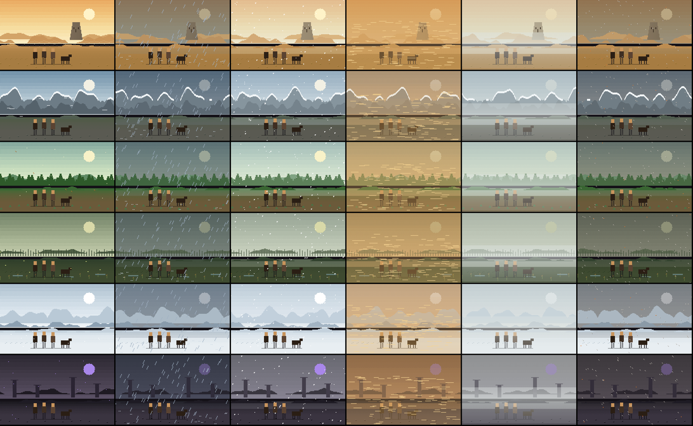

# UX proposal: voyages and land walks in side view (I and L)

UX, for the manager and Core. Mock-ups only: nothing here is built. The design file is the Design artifact "Character tab, redesign proposals", boards 5 and 6. The user has seen both and asked for the changes below, which the boards already carry. This note is the written record, with preview images, and the list of what each session would have to do.

## What the user decided

- **I, voyages:** the concept is right (the ship small, in side view, over a scrolling sea, no interior). The sea keeps the weather (fog, rain, wind) and **takes its colours from where the ship is**; the same colours serve the battle screen. The ships must **match the existing art, names and appearance**: no new ships, only a side view of every hull there is, **parts and looks included**.
- **L, land walks:** the party's health is the one meter, where a voyage has the hull (Core's `land-expeditions.md`). The user will **send the walking sprite** and asked for **better pixel art and particle effects by place** (rain, sandstorm and so on).
- The first walk is the desert crossing after the crash: the wreck of the Lark, the Sleeper's Face, the White Wells.

## I: the voyage in side view

- **One sea, two screens.** `SeaLook.of(waters)` (in `sea_battlefield.dart`: deep, shallow, wave, foam, accent) already paints each of the five waters (open, shallows, drowned, abyss, ashen) in the fight. The side view reads the same record and the same `seaWatersFor(portId)` rule, so a ship sails and fights in the same sea. Weather is `SeaWeather` (calm, tailwind, crosswind, squall, fog), over the scene only, never over the words and buttons.
- **Waters, with the weather:**

- **The hulls.** Each of the 14 records of `ships.json` is drawn from its own data (length, masts where the record puts them, how each is rigged, jibs, oars, castles, beak, kind) in the palette and plank style of `assets/visuals/ship_cutaways/`. The Rusty Eel's three refits and the four raider ships are the existing cutaway sprites with the rooms closed in planking (nothing redrawn but the planks) and the hull flattened to the same depth. The sea beasts are already side view.

- **Parts and looks.** All 67 parts of `ship_parts.json` (weapons on deck, plating on the hull, screens on the rail, gear on deck, a sigil on the sail in the colour of its people) and the 8 hull paints, 8 sail cloths, 11 figureheads and 8 ensigns of `ship_looks.json`. A paint or a cloth is a palette swap, as the top-down painter does it.

### What each session would do

| Who | What |
|---|---|
| UX | A side-view painter: hull from the record, parts and looks from the dress, the sea from `SeaLook`. The sprites above are first-pass references, to be redrawn properly (a sprite sheet per hull, parts as small overlays) once the user picks. Reduced motion: a still scene. |
| Core | Nothing in the rules. The voyage screen keeps its events; only its picture changes. `seaWatersFor` already exists. |
| Narrative | Nothing. |

## L: the land walk in side view

- **Six scene kits:** desert, mountain pass, forest road, marsh, snow field, ruins/underhill. A kit is a sky, a sun or moon, three land bands, a few props, and what is on the horizon (the walk's goal comes forward as the days go). The party walks in place; the world scrolls (far 0.15, mid 0.4, near 0.8, foreground 1.2).
- **Particles by place** (the game's `WeatherKind`): rain, sandstorm (dust), snow, ash, fog, and in clear weather the place's own: heat shimmer in the desert, leaves and light motes in the forest, fireflies in the marsh, violet motes in the ruins.
- **The switch.** On the Journey map a choice that leaves a place on foot slides the map away (the app's 180 ms fade and slide) and the side view takes over; on arrival it slides back. Towns and camps stay on the map. A terrain with no kit yet keeps the map.
- **The sprite.** The user will send the walking sprite. Once it arrives UX cleans it up (one outline colour, the cutaway palette, no stray anti-aliasing) and sets it up as an idle of 2 frames and a walk of 6 frames per party member, 24 × 32 px, facing right, on a fixed baseline. Until then the scenes show flat placeholder figures.

### What each session would do

| Who | What |
|---|---|
| Core | `land_routes.json` and the events (see `land-expeditions.md`); which terrain and weather a route has (a route record field `terrain`, weather from `skyHereProvider`). |
| UX | The scene painter, the layers, the particles, the switch from the map, the party's health bar in the HUD. |
| Narrative | The events' text, as for a voyage. |

## Open

- Waits on the user: the walking sprite; picks on boards 5 and 6.
- Order: both are last in the queue, after the full-screen map (board 8) and the skill choice sheet (board 9).
